# Архитектура pan_for_lang

*Версия 1.2, 2026-10-13. Статус: проект на утверждение. Изменения относительно v1.0 — в разделе «Изменения v1.1», относительно v1.1 — в разделе «Изменения v1.2» в конце.*

**Входы:**
- [METHODOLOGY.md](METHODOLOGY.md) **v1.2** — функциональные требования. Ссылки вида «М §8.5», «М FR-1», «М D26».
- [03 Техника](research/03-tech-stack-pen-input.md) — ссылки вида «03 §4.5.3».
- [04 Согласование с УМК Верещагиной](research/04-school-alignment-vereshchagina.md) — британское произношение, транскрипция, школа (v1.2).
- Ревью: [архитектуры](reviews/ARCHITECTURE-review.md) (A01–A34) и [методики](reviews/METHODOLOGY-review.md) (R01–R42).

**Метки достоверности:**
- **[проверено]** — подтверждено в 03 или в ревью по первоисточнику;
- **[не проверено]** — предположение; рядом указаны спайк или задача, которые его проверяют;
- **[решение]** — архитектурное решение, см. ADR в §14.

Идентификаторы, имена проектов, типов и код — на английском. Префикс сборок и пространств имён — `PenForLang`.

---

## 0. Кратко

1. **Один процесс, офлайн, для своей семьи.**
   - Настольное WPF-приложение на .NET 10 LTS, self-contained.
   - Установщик Inno Setup без подписи кода.
   - Данные — в локальной SQLite. Сетевого кода в продуктовых сборках нет, это проверяет архитектурный тест. Сеть разрешена только инструменту авторинга (`pfl images suggest`, §3.3.1).
   - **Основная платформа — Windows 10 22H2** (целевая машина семьи, сейчас). Windows 11 — позже. .NET 10 официально не включает потребительскую Windows 10 22H2 в матрицу поддержки: это принятый риск K13 (self-contained сборка, ранняя ручная проверка на целевой машине в V0.5).
2. **Сначала работающая вертикаль, потом контракты** ([решение] оркестратора, A07). Первая веха — **вертикаль v0** на реальном XPPen:
   - буквы a, i, t: анимация → обводка и копия → оценка → одна подсказка с наложением → лог пера;
   - затем слово `at` с альтернативой «соединение или отрыв».

   Контракты v1 пишутся по работающему коду. Педагогическая сторона (`AttemptFacts`, `TaskSpec`, `IExerciseHost`, `FeedbackPlan`) замораживается раньше оценщика. Потребители оценщика видят узкий фасад `EvaluationSummary`, детальный результат остаётся предварительным до решения по спайку S2.
3. **Чистое ядро, тонкие края, 14 сборок** (A16). Предметная логика лежит в библиотеках `net10.0` без WPF, Win32, SQLite и системных часов. P/Invoke — только в `Platform.Windows`, XAML — в `Wpf.Controls` и `App.Wpf`. Один WPF-инструмент разработчика — **InkLab**, вкладки:
   - зонд пера;
   - запись;
   - разметка;
   - редактор глифов;
   - экспертные оценки.
4. **Данные — для чисел и контента, код — для логики** (A15). Версионированные JSON-пакеты с валидацией в CI:
   - стили письма: американская пропись (внутренний id `zaner-bloser`), печатный стиль, русская пропись как пакет ловушек;
   - контент: блоки, слова, ловушки, правила гипотез, фразы;
   - **числа** методики и веса оценщика;
   - строки RU/EN;
   - манифест аудио (с полем `accent`, §3.3);
   - картинки слов с метаданными источника (`media.json`).

   Правила статусов, шлюзов и календаря написаны на C# и берут пороги из JSON. Упражнения — C#-сценарии над общими примитивами, параметры тоже в JSON. Самодельных языков выражений нет.
5. **Оценщик выдаёт факты, педагогика — решения.** `Evaluation` возвращает сегментацию, метрики и коды ошибок L/P/J/F/D/K с привязкой к букве или соединению. Что считать стоп-ошибкой, какую подсказку показать и как сдвинуть коробку Leitner, решают `Learner` и `Lesson` по таблицам конфигурации.
6. **Оценщик v1 (A03, A04, A09):**
   - DTW по целевому слову с полосой по x после деслантинга;
   - соединение — альтернатива «геометрия или отрыв»; ожидаемый отрыв возле точки или перекладины, поставленной сразу, не считается J1;
   - гипотезы о написанном (М FR-1: ловушки кириллицы, включая ш, ч, й, в; гласные; частые орфографические замены; пропуск или вставка) сравниваются **локально**, на окне «буква ± 1», в нормированных единицах;
   - подмены внутри моторной семьи (m/n, u/w, e/l) — отдельный класс `L2m`, без стоп-ошибки;
   - если ни одна гипотеза не проходит порог — «не распознано» (`U0`), без штрафа.
7. **Приватность по умолчанию** (A01, М D26).
   - Сырые траектории сохраняются только с согласия родителя (по умолчанию выключено). Без согласия они живут в памяти текущей сессии.
   - В БД пишутся производные метрики. Дашборд рисует ошибки на эталоне.
   - Единственное исключение — **миниатюра собственного написания** для коллекции слов: упрощённая векторная линия без времени и давления. Удаляется вместе с профилем (ADR-023).
8. **Модель знаний по методике v1.1:**
   - головные карточки: буква, заглавная, соединение, диграф, ≤ 20 активных слов;
   - неявное зачисление через слова: диктант — по двум осям, копирование — только по исполнению;
   - нагрузка: «> 6 отдельных заданий повторения, или > 10 отложенных слов, или `success_20` < 75%» — новое не вводится;
   - скользящие шлюзы; календарь подчинён шлюзам;
   - итоговая проверка — по событию, продление до недели 16.

   Симулятор курса («виртуальные ученики») прогоняет 12–16 недель без UI в CI.
9. **Каждая задача плана — одна сессия агента-кодера** с явными зависимостями и автоматически проверяемыми критериями готовности. Работу человека (железо, разметка, ревью форм) помечают метки `needs-human` / `needs-hardware`. Golden-снимки оценщика принимает только оркестратор или человек.
10. **Решения заказчика:**
    - произношение — британское (SSBE, `accent: "en-GB"`), как в школьном УМК Верещагиной (М D46); пропись остаётся Zaner-Bloser;
    - целевая ОС — Windows 10 22H2 сейчас, Windows 11 — позже;
    - картинки к словам добавляются вручную или подбираются при авторинге через Perplexity API (ключ пользователя в переменной окружения, только в инструменте); рантайм офлайн;
    - ребёнок правша (левши поддерживаются, но позже);
    - программа для своей семьи: подпись кода не нужна;
    - в интерфейсе — «Американская пропись», без названия Zaner-Bloser;
    - английские слова и фразы — открытый нейро-TTS с голосом SSBE при сборке; изолированные звуки — запись человеком;
    - русской озвучки в v1 нет;
    - бумажные задания — да;
    - объём v1 — 12 недель;
    - отложенные штрихи, поставленные сразу, засчитываются.

---

## 1. Обзор и принципы

### 1.1. Назначение и границы v1

Программа учит ребёнка 8–10 лет писать по-английски американской прописью (стиль Zaner-Bloser) на перьевом дисплее XPPen Artist 12 Pro (М §0).

**В v1 входит:**
- ядро курса: 12 номинальных недель, продление до 16 (М §8.7);
- диагностика;
- 26 строчных, 26 заглавных, 9 семейств соединений, 5 диграфов;
- слова, фразы, мини-тексты, диктант;
- различение гласных (E32), алфавит по порядку (E33), спринты;
- бумажные задания: тренировка E34, проекты E35, проверки E27 — PDF и чек-лист;
- несколько профилей, родительский режим с PIN, дашборд;
- интерфейс RU/EN;
- опциональная запись траекторий для калибровки (по умолчанию выключена).

Отдельное упражнение печатной коррекции E29 — опция, по умолчанию выключена (М D38, подтверждено оркестратором). Печатные привычки исправляются в цикле прописи (М §4.5).

**Вне v1:**
- уровень 2: долгие гласные и соединение заглавных. Добавляется контент-пакетом, без изменения кода (§9.3);
- русская озвучка (М D27);
- автоанализ фото;
- любые сетевые функции в программе (сеть есть только в инструменте авторинга картинок, §3.3.1);
- режим учителя (М Q3) — архитектура его допускает.

### 1.2. Контекст (C4, уровень 1)

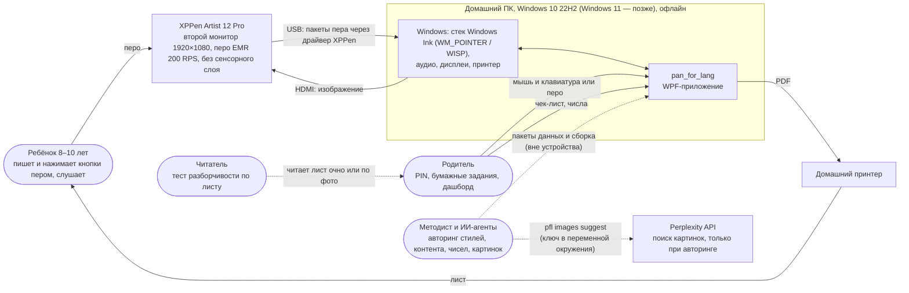

**Ввод — только перо** (A34). Сенсорного слоя у Artist 12 Pro нет (03 §1.1), поэтому ни обработки касаний пальцем, ни отбраковки ладони в коде нет. Мышь работает как перо только в режиме разработчика (`MousePenSource`). Кнопки интерфейса нажимаются пером.

### 1.3. Контейнеры (C4, уровень 2)

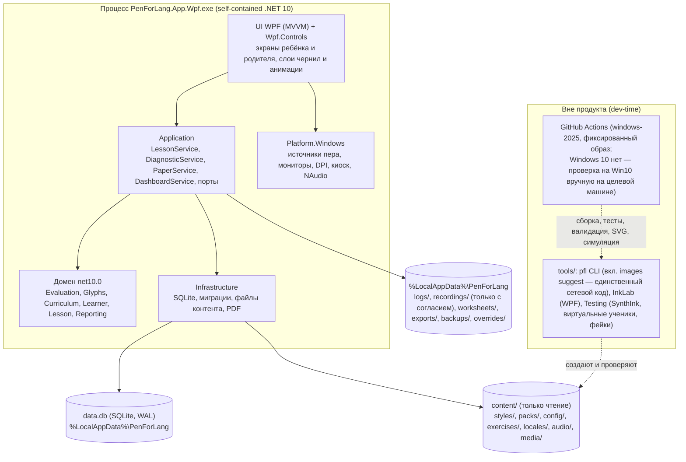

### 1.4. Атрибуты качества

| Атрибут | Цель | Как обеспечивается | Как проверяется |
|---|---|---|---|
| **Точность пера** | без потерь точек при 200 Гц; ошибка координат ≤ 0,5 мм при масштабе 100/125/150%; время у каждой точки | WM_POINTER с историей coalesced-точек и QPC (03 §2.3); владение указателем по `pointerId` (A11); Per-Monitor V2; прямоугольник холста из `PointToScreen` без двойного масштабирования (A12) | V0.5–V0.6, S1; тест с синтетическим указателем (§10.1) |
| **Задержка отрисовки** | ≤ 1 кадра (16,7 мс при 60 Гц) от получения точки до кадра. Сквозная «перо → пиксель» включает драйвер и матрицу; ожидается 30–70 мс [не проверено, S1] | слой живых чернил без layout-проходов и аллокаций в горячем пути, `SustainedLowLatency` на время попытки (A32); оценка и IO — вне UI-потока | dev-оверлей; камера 240 fps (S1) |
| **Детерминизм оценщика** | одинаковый вход даёт одинаковый результат **в одном процессе и на одной машине**. Между машинами решения совпадают, числа — в пределах допуска (A19) | нет часов, RNG и параллелизма в домене; стабильные сортировки; без SIMD-интринсиков в `Evaluation`; версия оценщика и `ConfigHash` в каждой попытке | property-тест «дважды одно и то же»; снимки решений с допусками; фиксированный образ раннера |
| **Расширяемость** | новый стиль, слова, язык интерфейса, числа — без кода. Новое упражнение — небольшой C#-класс над общими примитивами | стиль-пакеты, контент-пакеты, числа в JSON; реестр сценариев упражнений | рецепты §9 |
| **Офлайн** | 100% функций без сети | нет `System.Net.*` в продуктовых сборках; сеть — только в `Tools.Cli` (`pfl images`), инструменты в установку не входят | архитектурный тест R3 |
| **Приватность** | без согласия сырые траектории не сохраняются; экспорт — только действием родителя | классы данных §11.2, ADR-012, ADR-023 | тесты Infrastructure: без согласия на диске нет penlog и `ink_blobs` |
| **Надёжность** | сбой теряет не больше одной попытки; урок продолжается после перезапуска | WAL; транзакция на попытку; чекпойнт сессии без чернил | интеграционные тесты с «убийством» процесса |
| **Производительность** | изолированная буква ≤ 5 мс; слово из 8 букв (копирование) ≤ 20 мс; диктант с гипотезами ≤ 100 мс; требование М FR-1 — ≤ 300 мс | DTW по цели с полосой по x; локальная переоценка гипотез; кеш эталонов | BenchmarkDotNet nightly |
| **Тестируемость без железа** | ≥ 90% логики проверяется без планшета | `ReplayPenSource`, SynthInk, фейки часов, аудио и контента, симулятор | покрытие в CI |

### 1.5. Принципы

1. **Домен не зависит от UI и инфраструктуры.** Зависимости направлены внутрь, к `Core`. Порты чтения контента (`IContentSource`) и часов лежат в `Core`, прикладные порты — в `Application`. Композиция собирается только в `App.Wpf`, `InkLab` и тестах.
2. **Сначала работающий код, потом заморозка.** Вертикаль v0 → контракты v1 (A07). Узкий фасад `EvaluationSummary` стабилен. Детальный `EvaluationDetail` предварителен до решения по S2.
3. **Числа — в данных, логика — в коде** (A15). Ни одного порога из М §8.5 и §9 в коде нет. Правила, которые эти пороги используют, — C#-классы с табличными тестами и проверкой симуляцией.
4. **Факты отдельно от решений.** Оценщик ничего не знает о статусах, коробках и текстах подсказок.
5. **Одна геометрия — много выводов.** `WordTemplate` — источник для анимации, наложения, PDF, SVG в CI и синтетических штрихов.
6. **Мягкий отказ для ребёнка.** При `Confidence.Low` или `U0` негативной подсказки нет. Технические сбои дают паузу, а не ошибку.
7. **Код для агентов.** Одна задача — одна сессия, один модуль, один проверяемый результат. Контент — по файлу на сущность. JSON-схемы дают валидацию в CI.

---

## 2. Решение (solution layout)

### 2.1. Дерево репозитория

```
pan_for_lang/
├─ PenForLang.sln
├─ Directory.Build.props          # net10.0, C# 14, Nullable, TreatWarningsAsErrors, Deterministic, analyzers
├─ Directory.Packages.props       # Central Package Management
├─ BannedSymbols.Domain.txt       # запрещённые в домене API (§2.4)
├─ .editorconfig, global.json     # фиксированная версия SDK
├─ .github/workflows/ci.yml, nightly.yml, release.yml
├─ docs/                          # METHODOLOGY.md, ARCHITECTURE.md, adr/, reviews/, spikes/, qa/
├─ schemas/                       # JSON Schema: pfl.style/1, pfl.glyph/1, pfl.pack/1, pfl.config.*/1, pfl.penlog/1, pfl.locale/1
├─ content/                       # копируется в установку как есть (§3)
│  ├─ styles/zaner-bloser/        # style.json, glyphs/*.json, labels/*.json — в UI «Американская пропись»
│  ├─ styles/zaner-bloser-print/  # печатный стиль: чтение, диагностика, листы
│  ├─ styles/ru-propis/           # пакет ловушек (role = confuser)
│  ├─ styles/school-ipa/          # знаки транскрипции ʃ æ ŋ θ ə ɒ для класса L6 (role = confuser; М v1.2 §1.3)
│  ├─ packs/core-en-ru/           # учебный контент
│  ├─ exercises/params.json       # числовые параметры сценариев упражнений
│  ├─ config/                     # числа методики и оценщика (§3.6)
│  ├─ locales/                    # ru.json, en.json
│  ├─ audio/                      # manifest.json + ogg/
│  └─ media/                      # картинки слов (вручную или `pfl images`, метаданные — в media.json пакета), иконки, шрифт Noto Sans (OFL)
├─ src/                           # 14 продуктовых сборок, §2.2
├─ tools/                         # pfl, InkLab, Testing
├─ tests/                         # тестовые проекты (§10)
│  ├─ corpus/                     # реальные записи взрослых: *.pfl.jsonl.gz + labels/ + decisions/ (снимки решений)
│  └─ fixtures/                   # маленький пакет-фикстура для тестов до появления данных методиста
└─ build/                         # installer/*.iss, скрипты публикации
```

### 2.2. Сборки и ответственность

| # | Сборка | TFM | Ответственность | Зависит от | Ключевые типы | Внешние пакеты (лицензия) |
|---|---|---|---|---|---|---|
| 1 | `PenForLang.Core` | net10.0 | общее ядро:<br>• строго типизированные ID, `SupportLevel`, `Handedness`;<br>• порты `IClock`, `IRandomSource` (детерминированный PCG), **`IContentSource`** (чтение потоков по относительному пути, A13);<br>• `ConfigProvider`: слои, снимок, `ConfigHash`;<br>• `ExperimentResolver` (A21);<br>• пространство имён `Core.Geometry`: векторы, Безье, ресэмплинг, фильтры, DTW (полный, с полосой, open-begin/end, многопризнаковый), Фреше, коридор, Венгерский алгоритм, ключевые точки, наклон, самопересечения | — | `ItemId`, `StyleId`, `IContentSource`, `ConfigSnapshot`, `ExperimentConditions`, `Dtw`, `Resampler`, `Hungarian` | — |
| 2 | `PenForLang.Ink` | net10.0 | сырой ввод: `PenSample`, `InkStroke`, `InkAttempt`; `IPenInputSource`; `GuideFrame` и проекция в линейку; формат лога пера; `ReplayPenSource`; `InkThumbnail` (упрощение линии для коллекции, ADR-023) | Core | `IPenInputSource`, `InkAttempt`, `RulerInk`, `PenLogReader/Writer`, `ReplayPenSource`, `InkThumbnail` | — |
| 3 | `PenForLang.Glyphs` | net10.0 | стиль-пакеты и глифы: загрузка через `IContentSource`, семантическая проверка, варианты, `JoinGenerator`, `WordTemplateBuilder` (с альтернативами соединений), `AnimationScriptBuilder`, SVG; реализует `Curriculum.IWordAnalyzer` (A14) | Core, Curriculum | `StylePack`, `Glyph`, `WordTemplate`, `AnimationScript`, `IStyleRepository`, `ITemplateBuilder`, `StyleWordAnalyzer` | — |
| 4 | `PenForLang.Evaluation.Abstractions` | net10.0 | контракт оценщика: запрос (с разрешённым `HypothesisRuleSet`, A06), **стабильный фасад** `EvaluationSummary`, предварительный `EvaluationDetail`, коды ошибок, живые сигналы и прогресс | Core, Ink | `IHandwritingEvaluator`, `IEvaluatorFactory`, `EvaluationRequest`, `EvaluationSummary`, `EvaluationDetail`, `ErrorCode`, `ILiveMonitor` | — |
| 5 | `PenForLang.Evaluation` | net10.0 | реализация (§6): предобработка, нормализация, отложенные штрихи и исправления, DTW по цели с альтернативами соединений, локальная переоценка гипотез, изолированная буква, метрики частей, беглость, графемы, `form`, уверенность, живой монитор | Evaluation.Abstractions, Glyphs | `HandwritingEvaluator`, `TargetAligner`, `HypothesisScorer`, `IsolatedLetterEvaluator`, `PartScorers`, `FluencyAnalyzer` | — |
| 6 | `PenForLang.Curriculum` | net10.0 | контент-пакет: блоки, порядок букв, семейства JF по неделям, заглавные группы, слова с графемами и сложностью, фразы, мини-тексты, рифмы, ловушки, правила гипотез, наборы гласных; порт `IWordAnalyzer` | Core | `ContentPack`, `Block`, `WordEntry`, `TrapTable`, `HypothesisRules`, `IWordAnalyzer` | — |
| 7 | `PenForLang.Learner` | net10.0 | модель знаний (М §8):<br>• головные и пассивные карточки, Leitner, исход по двум осям, мягкие процессные ошибки;<br>• `AttemptFactsBuilder` и неявное зачисление;<br>• правила статусов, опоры, цикла исправления, шлюзов, календаря — C#-классы с числами из JSON;<br>• сводные показатели и алерты | Curriculum, Evaluation.Abstractions | `AttemptContext`, `AttemptFacts`, `KnowledgeSnapshot`, `KnowledgeUpdater`, `LetterStatusRule`, `RepairCycleMachine`, `BlockGate`, `CourseCalendar`, `MetricsAggregator` | — |
| 8 | `PenForLang.Lesson` | net10.0 | урок, три пространства имён:<br>• `Lesson.Exercises` — примитивы, `IExerciseHost`, сценарии 37 упражнений, `CompletionPolicy`;<br>• `Lesson.Feedback` — одна подсказка, частота, похвала, живые подсказки;<br>• `Lesson.Session` — планировщик, рантайм-адаптация, первое знакомство, итоговая проверка, учёт времени письма | Learner, Ink, Evaluation.Abstractions | `IExerciseScenario`, `IExerciseHost`, `TaskSpec`, `FeedbackPlanner`, `SessionPlanner`, `SessionRuntime`, `FinalCheckPlanner` | — |
| 9 | `PenForLang.Reporting` | net10.0 | дашборд (DTO), рекомендации, модель листов `WorksheetDocument` (все виды М §9.5), SVG-рендер листов, отчёт об овладении | Learner, Glyphs | `DashboardBuilder`, `WorksheetBuilder`, `WorksheetDocument`, `SvgWorksheetRenderer` | — |
| 10 | `PenForLang.Application` | net10.0 | прикладные сценарии и порты:<br>• хранение, аудио, PDF, диспетчер UI;<br>• `LocaleCatalog` (JSON-строки), `AudioCatalog`;<br>• оркестрация урока, диагностики, бумажных заданий, записи с согласием, экспорта | Lesson, Reporting | `LessonService`, `DiagnosticService`, `PaperService`, `RecordingService`, `DashboardService`, `I*Repository`, `IAudioService`, `IPdfRenderer`, `IUiDispatcher` | — |
| 11 | `PenForLang.Infrastructure` | net10.0 | SQLite: схема, миграции, репозитории, резервные копии; `FileContentSource`; экспорт и импорт ZIP; хеш PIN; `PdfWorksheetRenderer` | Application | `SqliteDb`, `MigrationRunner`, `*Repository`, `FileContentSource`, `PdfWorksheetRenderer` | Microsoft.Data.Sqlite (MIT), SQLitePCLRaw (Apache-2.0), Dapper (Apache-2.0), PDFsharp 6.2.x (MIT, есть `net10.0` [проверено в ревью, A31]) |
| 12 | `PenForLang.Platform.Windows` | net10.0-windows | P/Invoke и WPF-интероп: `Win32PointerPenSource`, `WpfStylusPenSource`, `MousePenSource` (разработка), подавление помех Windows Ink, монитор пера, DPI, полноэкранное окно, киоск, наблюдение за устройством, `NAudioService` | Ink, Application | `PointerSourceFactory`, `PenMonitorLocator`, `WindowInkSuppressor`, `PenDeviceWatcher`, `NAudioService` | NAudio (MIT), NVorbis (MIT) |
| 13 | `PenForLang.Wpf.Controls` | net10.0-windows (WPF) | визуальные слои для приложения и InkLab: линейки в мм, живые чернила, аниматор глифов, наложение «эталон и рукопись», повтор траектории, печатный текст стилем, миниатюры | Glyphs, Ink | `GuidesLayer`, `LiveInkLayer`, `GlyphAnimator`, `OverlayCompareView`, `InkReplayView`, `StyledTextBlock` | — |
| 14 | `PenForLang.App.Wpf` | net10.0-windows (WinExe) | корень композиции, оболочка, навигация, экраны ребёнка и родителя, представления примитивов, мастер настройки, диагностика пера, dev-оверлей | всё выше | `App`, `ShellViewModel`, `LessonViewModel`, `ExerciseHostAdapter` | CommunityToolkit.Mvvm (MIT), Microsoft.Extensions.Hosting (MIT), Serilog + Sinks.File (Apache-2.0) |

**Инструменты** (`tools/`, в установку не входят):

| Сборка | Тип | Назначение |
|---|---|---|
| `PenForLang.Tools.Cli` (`pfl`) | консоль | команды:<br>• `validate` — стили, пакеты, конфигурация (каждый ключ задан ровно в одном файле), локали, аудио, «каждый E-код методики имеет сценарий», «пары ловушек не в одном блоке»;<br>• `render` — SVG букв, всех пар, слов, листов;<br>• `synth`, `eval`, `s2-report`, `golden diff`;<br>• `simulate`, `calibrate`;<br>• `assets` — TTS при сборке (голос SSBE для `accent: en-GB`) → OGG + манифест;<br>• `images suggest` / `images add` — подбор и добавление картинок к словам (§3.3.1); **единственный сетевой код** проекта;<br>• `penlog convert` |
| `PenForLang.Tools.InkLab` | WPF, одно приложение (A16) | вкладки:<br>• **Зонд** — спайк S1: источники, частота, давление, джиттер, задержка, hot-plug, монитор;<br>• **Запись** — сценарии записи взрослых и детей, копирование экранного эталона;<br>• **Разметка** — границы букв, соединений, отложенных, «что написано»;<br>• **Глифы** — редактор пером по подложке;<br>• **Эксперт** — оценки 0/1/2;<br>• **Разбор** — прогон оценщика, наложение, сравнение версий |
| `PenForLang.Testing` | библиотека net10.0 | `SynthInk` (синтетика с мутациями), `VirtualLearner` и прогон симуляции, `FakeClock`, `InMemoryContentSource`, `ScriptedExerciseHost`, фабрики фикстур. Используется тестами и `pfl` |

**Тесты:**
- по проекту на сборку: `tests/PenForLang.<Module>.Tests`;
- `PenForLang.Architecture.Tests`;
- `PenForLang.Evaluation.Corpus` — решения на реальном корпусе;
- `PenForLang.UiTests` (FlaUI, nightly);
- `PenForLang.Benchmarks`.

### 2.3. Диаграмма зависимостей

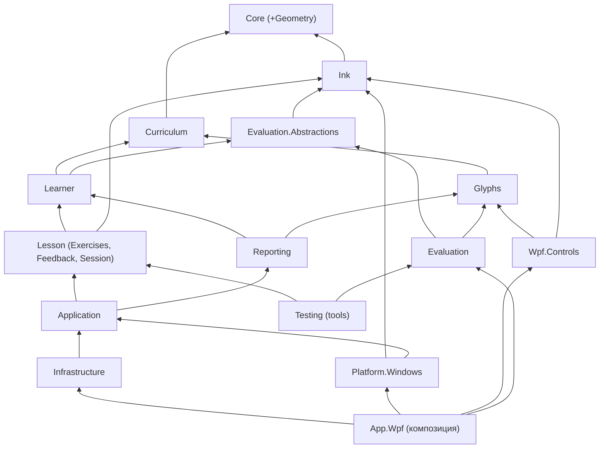

`Application` и `Lesson` не ссылаются на `Evaluation` — только на `Evaluation.Abstractions`. Реализацию подключает корень композиции. Агент, который пишет модель знаний или планировщик, не зависит от геометрии.

**Разрыв цикла Learner ↔ Lesson** (A05):
- нейтральный тип `AttemptContext` (упражнение, режим, цель, уровень опоры, контекст буквы, `MeasurementOnly`, ответ выбора, условия эксперимента) объявлен в `Learner`;
- `Lesson` строит его сам;
- `KnowledgeUpdater.Apply` принимает только `IReadOnlyList<AttemptFacts>`.

### 2.4. Правила (проверяются автоматически)

| # | Правило | Механизм |
|---|---|---|
| R1 | Сборки `net10.0` не ссылаются на `net10.0-windows`, WPF, WinForms, `Microsoft.Data.Sqlite`, NAudio, PDFsharp (кроме `Infrastructure`) | `Architecture.Tests` (NetArchTest.Rules, MIT [не проверено, V0.1]) + разбор `.csproj` |
| R2 | Доменные сборки (`Core`, `Ink`, `Glyphs`, `Evaluation*`, `Curriculum`, `Learner`, `Lesson`, `Reporting`) не используют `DateTime.Now/UtcNow`, `Environment.TickCount*`, `Stopwatch`, `System.Random`, `Guid.NewGuid`, `Parallel.*`, `Task.Run`, `File.*`, `Directory.*`, `Console.*`. В `Evaluation` и `Core.Geometry` также запрещены `System.Runtime.Intrinsics.*` и `System.Numerics.Vector<T>` (A19) | Microsoft.CodeAnalysis.BannedApiAnalyzers (MIT), `BannedSymbols.Domain.txt` |
| R3 | В продукте (все сборки `src/`) нет `System.Net.Http`, `System.Net.Sockets`, `HttpClient`, `WebRequest`. Сеть разрешена только в `PenForLang.Tools.Cli` (пространство `Tools.Cli.Images`); продуктовые сборки не ссылаются на `tools/`, установщик их не включает | архитектурный тест (белый список: одна сборка и одно пространство имён) |
| R4 | P/Invoke есть только в `Platform.Windows` | архитектурный тест |
| R5 | Зависимости между проектами соответствуют §2.3; циклов нет | тест сравнивает граф с разрешённым списком |
| R6 | Публичные типы `Evaluation.Abstractions`, `Learner` (контракты) и `Lesson.Exercises` (контракты) документированы | `GenerateDocumentationFile` + CS1591 как ошибка |
| R7 | DTO сериализуются через source-generated `JsonSerializerContext` | тест round-trip для каждого DTO |
| R8 | В доменном коде нет строк, видимых пользователю: только ключи фраз | тест: в доменных сборках нет кириллических литералов |
| R9 | В `Learner`/`Lesson` нет числовых литералов-порогов (кроме 0, 1, −1 и индексов) | анализатор литералов в `Architecture.Tests`, белый список |

### 2.5. Модель потоков

| Поток | Что выполняет | Правила |
|---|---|---|
| UI (Dispatcher) | WPF; `HwndSource`-hook с `WM_POINTER` (если выбран Win32-источник); добавление точек в `LiveInkLayer`; анимации | без оценки, IO и БД; пачка точек ≤ 1 мс, **без аллокаций** (пулы, `Span`); `GetPointerPenInfoHistory` вызывается строго в hook, без вложенных циклов сообщений [проверено в ревью] |
| Поток пера WISP | только при `WpfStylusPenSource`: `StylusPlugIn` и `DynamicRenderer` | плагин копирует точки в lock-free буфер |
| Фоновый пул | оценка, тик живого монитора (~50 мс), планирование, PDF, запись в БД | результат возвращается через `IUiDispatcher`; оценщик вызывается из `Application`/`App.Wpf`, а не из домена |
| Аудио | NAudio | клипы < 10 с предзагружены |
| БД | один пишущий `SqliteConnection` через `Channel<T>`; чтения — параллельно (WAL) | транзакция на попытку |

На время попытки письма ставится `GCSettings.LatencyMode = SustainedLowLatency`, после завершения — прежний режим (A32).

---

## 3. Модель данных

### 3.1. Системы координат и время

| Уровень | Единицы | Где | Преобразование |
|---|---|---|---|
| Устройство | px экрана (физические) или HIMETRIC; время в тиках QPC | `Platform.Windows` | `ptPixelLocation`. Субпиксельная точность через `ptHimetricLocation` + `GetPointerDeviceRects` [не проверено, S1] |
| Поверхность письма | физические px относительно левого верхнего угла холста, `double`; время — мкс от начала задания | `Ink` (`PenSample`) | источник вычитает экранный прямоугольник холста, **уже** в физических px: `PointToScreen` возвращает device pixels, дополнительно на DPI не умножается (A12) |
| Линейка | `u, v`: baseline = 0, x-height = 1, y вверх; время — мкс | `Ink.RulerInk` → `Evaluation`, `Glyphs` | `u = (x − x0)/h`, `v = (yBaseline − y)/h`, `h = xHeightMm · pxPerMm` (03 §4.2) |
| Визуальный слой WPF | DIP | `Wpf.Controls` | `DIP = px / dpiScale` монитора окна |
| Бумага | мм | `Reporting` | `mm = u · xHeightMmPaper` |

`GuideFrame` фиксирует линейку попытки: `OriginXPx`, `BaselineYPx`, `XHeightPx`, `PxPerMm`, `LineSpacing`, `SlantDeg`, `StyleId`.

### 3.2. Стиль-пакет

Каталог `content/styles/<styleId>/`. Три роли пакетов:
- `teach` — стиль, которому учат: `zaner-bloser`, в UI «Американская пропись»;
- `print` — печатный стиль `zaner-bloser-print`: чтение, диагностика, листы;
- `confuser` — пакет ловушек `ru-propis` (М FR-2). Содержит:
  - двойники: т, п, и, с, д, р, у, х, г, з, е, а, о, л;
  - русские буквы без латинского двойника: ш, ч, ж, й, в, б, ф.

  Состав задаёт таблица ловушек контент-пакета. Валидатор требует глиф для каждой упомянутой там русской буквы.

Название «Zaner-Bloser» в интерфейсе не показывается (решение заказчика). Внутренний id `zaner-bloser` используется только в файлах и коде.

#### 3.2.1. Структура

```
content/styles/zaner-bloser/
├─ style.json                  # метрики линейки, наклон, классы, правила соединений, варианты, политика отложенных штрихов
├─ glyphs/a.default.json …     # один файл = символ × вариант
├─ glyphs/e.after-high.json    # вариант e после высокого выхода (o, b, v, w)
├─ labels/ru.json, labels/en.json   # словесные метки траекторий (текст)
└─ README.md                   # источник форм, автор, статус ревью
```

#### 3.2.2. `style.json`

```jsonc
{
  "schema": "pfl.style/1",
  "id": "zaner-bloser",
  "version": "0.1.0",
  "role": "teach",                          // teach | print | confuser
  "script": "cursive",
  "language": "en",
  "displayName": { "ru": "Американская пропись", "en": "American cursive" },
  "lines": { "ascender": 2.0, "cap": 2.0, "xHeight": 1.0, "baseline": 0.0, "descender": -1.0 }, // ЗАГЛУШКА до сверки с прописью
  "slantDeg": null,                          // ЗАГЛУШКА; null = оценивается только консистентность
  "letterSpacing": 0.15,
  "wordSpacing": 0.9,
  "joins": {
    "rules": [
      { "family": "JF1", "exit": "X-BASE", "entry": ["E-UP", "E-UP-TALL"], "shape": "hermite" },
      { "family": "JF2", "exit": "X-BASE", "entry": ["E-C"],               "shape": "hermite-over", "params": { "overshootU": 0.12 } },
      { "family": "JF3", "exit": "X-BASE", "entry": ["E-HUMP"],            "shape": "hermite" },
      { "family": "JF4", "exit": "X-HIGH", "entry": ["E-UP", "E-UP-TALL"], "shape": "hermite", "high": true },
      { "family": "JF5", "exit": "X-HIGH", "entry": ["E-C"],               "shape": "hermite-over", "high": true },
      { "family": "JF6", "exit": "X-HIGH", "entry": ["E-HUMP"],            "shape": "hermite", "high": true },
      { "family": "JF7", "exit": "X-DESC", "entry": ["E-UP", "E-UP-TALL"], "shape": "hermite" },
      { "family": "JF8", "exit": "X-DESC", "entry": ["E-C"],               "shape": "hermite-over" },
      { "family": "JF9", "exit": "X-DESC", "entry": ["E-HUMP"],            "shape": "hermite" },
      { "family": null,  "exit": "X-NONE", "entry": ["*"],                 "shape": "break" }
    ],
    "tallEntryClass": "E-UP-TALL",
    "pairOverrides": []                      // ручная геометрия для пар, где автоматика выглядит плохо (по итогам ревью SVG)
  },
  "variantRules": [
    { "char": "e", "when": { "prevExit": "X-HIGH" }, "variant": "after-high" },
    { "char": "r", "when": { "prevExit": "X-HIGH" }, "variant": "after-high" },
    { "char": "s", "when": { "prevExit": "X-HIGH" }, "variant": "after-high" }
  ],
  "motorFamilies": [ ["m", "n"], ["u", "w"], ["e", "l"] ],   // подмены внутри семьи — класс L2m (§6.4.6)
  "capitals": { "joinMode": "break" },       // в ядре заглавная всегда отрывается (М D7, Q5); соединение — уровень 2
  "deferred": { "teachTiming": "afterWord" }, // как показывает анимация; что принимается — в config/scoring.json
  "animation": { "speedXhPerSec": 1.6, "cuspPauseMs": 120, "joinSlowdown": 0.6 }
}
```

Минимальная высота высокого соединения (флаг `high`) задаётся одним числом — `scoring.json → joins.highMinHeight` (A25). Других мест для этого числа нет.

Классы входа и выхода (`E-UP`, `E-UP-TALL`, `E-C`, `E-HUMP`; `X-BASE`, `X-HIGH`, `X-DESC`, `X-NONE`) и семейства `JF1–JF9` — словарь М §3.1, общий для всех стилей.

**Формы соединения** (`JoinGenerator`):
- `hermite` — кубический Эрмит между точками выхода и входа, касательные с G1-непрерывностью;
- `hermite-over` — «перекат» к старту овала для E-C;
- `break` — ожидаемый отрыв.

Новая форма — единственный случай, когда новый стиль требует кода.

#### 3.2.3. Политика отложенных штрихов (решение заказчика, М D18, FR-5)

- **Чему учим:** `style.json → deferred.teachTiming` — анимация модели слова ставит точки и перекладины после слова.
- **Что принимаем:** `scoring.json → deferred.acceptTiming` (`either` по умолчанию; `afterWord` — строгий режим, переключается в профиле).
- **Как подсказываем:** `feedback.json → deferredTiming`: мягкая подсказка не чаще раза за сессию на букву.

Поставленный сразу штрих даёт информационную находку `D4` (не стоп-ошибка, не снижает `form`, не влияет на исход). Кроме того, отрыв пера рядом с таким штрихом считается ожидаемым и не даёт J1 (§6.4.4, A03).

#### 3.2.4. Схема глифа `pfl.glyph/1`

| Поле | Тип | Смысл |
|---|---|---|
| `schema`, `id` | string | `"pfl.glyph/1"`, `"<styleId>/<char>.<variant>"` |
| `char`, `case`, `variant` | string | символ; `lower`/`upper`; вариант |
| `advance` | number | ширина тела без соединений, x-height |
| `entry` | `{class, point[2], tangent[2], height?}` | класс входа (М §3.1), точка и касательная начала тела |
| `exit` | `{class, point[2], tangent[2]}` | класс, точка и касательная конца тела |
| `leadIn`, `leadOut` | `{segments[]}` или `null` | входящий и выходящий штрихи изолированной буквы |
| `strokes[]` | массив | основные штрихи в порядке написания: `id`, `order`, `segments[]` |
| `segments[]` | `{c:[4 точки]}` или `{l:[2 точки]}` | Безье или отрезок. Атрибуты: `retrace`, `label`, `tempo`, `pauseBeforeMs` |
| `deferred[]` | массив | `id`, `kind` (`dot`/`bar`/`cross`), `segments`, `direction` (`ltr`/`any`), `anchor {stroke, t, offset[2]}` |
| `keypoints[]` | `{type, stroke, t}` | `start`, `end`, `ymax`, `ymin`, `cusp`, `loopTop`, `humpTop`, `baselineTouch` — мягкие якоря |
| `features[]` | string[] | `retrace`, `upperLoop`, `lowerLoop`, `closedOval`, `ascender`, `descender`, `deferred`, `humps:N` (для m, n, u, w) |
| `checks` | объект | `reach[]`, `closed[]`, `loops[]`, `retrace[]` — допуски по умолчанию в `scoring.json`, в глифе только исключения |
| `animation` | объект | `startDot`, `numbers[]`, `arrows[]` |
| `meta` | объект | `author`, `source`, `reviewed`, `reviewer`, `notes` |

#### 3.2.5. Примеры глифов

> **Координаты ниже иллюстративные.** Они показывают формат, а не эталон ZB. Настоящие формы, высоты и наклон создаются по прописи (М D29) на вкладке «Глифы» в InkLab и проходят ревью методиста.

**a** — вход E-C, выход X-BASE, овал против часовой и ретрейс ствола:

```jsonc
{
  "schema": "pfl.glyph/1",
  "id": "zaner-bloser/a.default",
  "char": "a", "case": "lower", "variant": "default",
  "advance": 0.95,
  "entry": { "class": "E-C",    "point": [0.80, 0.90], "tangent": [-0.95, 0.30] },
  "exit":  { "class": "X-BASE", "point": [0.98, 0.05], "tangent": [0.70, 0.71] },
  "leadIn":  { "segments": [ { "c": [[0.05,0.00],[0.35,0.10],[0.62,0.70],[0.80,0.90]] } ] },
  "leadOut": { "segments": [ { "c": [[0.98,0.05],[1.08,0.00],[1.22,0.12],[1.32,0.35]] } ] },
  "strokes": [
    {
      "id": "s1", "order": 1,
      "segments": [
        { "c": [[0.80,0.90],[0.45,1.12],[0.02,0.62],[0.18,0.15]], "label": "a.rollBackAround" },
        { "c": [[0.18,0.15],[0.30,-0.05],[0.72,0.05],[0.90,1.00]], "label": "a.roundUp" },
        { "l": [[0.90,1.00],[0.80,0.08]], "retrace": true, "label": "a.downSameLine", "pauseBeforeMs": 120 },
        { "c": [[0.80,0.08],[0.84,0.00],[0.92,0.00],[0.98,0.05]], "label": "a.tail" }
      ]
    }
  ],
  "deferred": [],
  "keypoints": [
    { "type": "start", "stroke": "s1", "t": 0.00 },
    { "type": "ymax",  "stroke": "s1", "t": 0.06 },
    { "type": "ymin",  "stroke": "s1", "t": 0.33 },
    { "type": "cusp",  "stroke": "s1", "t": 0.64 },
    { "type": "baselineTouch", "stroke": "s1", "t": 0.90 }
  ],
  "features": ["closedOval", "retrace"],
  "checks": {
    "reach":   [ { "line": "xHeight", "extreme": "max" }, { "line": "baseline", "extreme": "min" } ],
    "closed":  [ { "stroke": "s1", "from": 0.00, "to": 0.62 } ],
    "retrace": [ { "stroke": "s1", "segment": 2 } ]
  },
  "animation": {
    "startDot": "leadIn",
    "numbers": [ { "stroke": "s1", "at": [0.86, 1.08] } ],
    "arrows":  [ { "stroke": "s1", "t": 0.12 }, { "stroke": "s1", "t": 0.45 }, { "stroke": "s1", "t": 0.75 } ]
  },
  "meta": { "author": "agent:V0.4", "source": "illustrative", "reviewed": false, "license": "project data" }
}
```

**i** — вход E-UP, выход X-BASE, отложенная точка:

```jsonc
{
  "schema": "pfl.glyph/1",
  "id": "zaner-bloser/i.default",
  "char": "i", "case": "lower", "variant": "default",
  "advance": 0.45,
  "entry": { "class": "E-UP",   "point": [0.30, 1.00], "tangent": [0.45, 0.89] },
  "exit":  { "class": "X-BASE", "point": [0.45, 0.05], "tangent": [0.70, 0.71] },
  "leadIn":  { "segments": [ { "c": [[0.00,0.00],[0.15,0.05],[0.25,0.60],[0.30,1.00]] } ] },
  "leadOut": { "segments": [ { "c": [[0.45,0.05],[0.55,0.00],[0.65,0.12],[0.75,0.35]] } ] },
  "strokes": [
    {
      "id": "s1", "order": 1,
      "segments": [
        { "l": [[0.30,1.00],[0.22,0.10]], "label": "i.slantDown" },
        { "c": [[0.22,0.10],[0.25,0.00],[0.38,0.00],[0.45,0.05]], "label": "i.undercurveOut" }
      ]
    }
  ],
  "deferred": [
    {
      "id": "dot", "kind": "dot", "direction": "any",
      "segments": [ { "l": [[0.34,1.45],[0.35,1.46]] } ],
      "anchor": { "stroke": "s1", "t": 0.0, "offset": [0.04, 0.45] }
    }
  ],
  "keypoints": [
    { "type": "start", "stroke": "s1", "t": 0.0 },
    { "type": "baselineTouch", "stroke": "s1", "t": 0.85 }
  ],
  "features": ["deferred"],
  "checks": { "reach": [ { "line": "xHeight", "extreme": "max" } ] },
  "animation": {
    "startDot": "leadIn",
    "numbers": [ { "stroke": "s1", "at": [0.40, 1.05] }, { "stroke": "dot", "at": [0.48, 1.50] } ],
    "arrows":  [ { "stroke": "s1", "t": 0.30 } ]
  },
  "meta": { "author": "agent:V0.4", "source": "illustrative", "reviewed": false }
}
```

**t** — вход E-UP с повышенной высотой, ретрейс, отложенная перекладина слева направо:

```jsonc
{
  "schema": "pfl.glyph/1",
  "id": "zaner-bloser/t.default",
  "char": "t", "case": "lower", "variant": "default",
  "advance": 0.60,
  "entry": { "class": "E-UP", "height": 1.5, "point": [0.45, 1.50], "tangent": [0.35, 0.94] },
  "exit":  { "class": "X-BASE", "point": [0.62, 0.05], "tangent": [0.70, 0.71] },
  "leadIn":  { "segments": [ { "c": [[0.00,0.00],[0.20,0.05],[0.38,0.90],[0.45,1.50]] } ] },
  "leadOut": { "segments": [ { "c": [[0.62,0.05],[0.72,0.00],[0.82,0.12],[0.92,0.35]] } ] },
  "strokes": [
    {
      "id": "s1", "order": 1,
      "segments": [
        { "l": [[0.45,1.50],[0.30,0.10]], "retrace": true, "label": "t.downSameLine" },
        { "c": [[0.30,0.10],[0.33,0.00],[0.52,0.00],[0.62,0.05]], "label": "t.undercurveOut" }
      ]
    }
  ],
  "deferred": [
    {
      "id": "bar", "kind": "bar", "direction": "ltr",
      "segments": [ { "l": [[0.15,1.00],[0.62,1.00]] } ],
      "anchor": { "stroke": "s1", "t": 0.35, "offset": [0.0, 0.0] }
    }
  ],
  "keypoints": [
    { "type": "start", "stroke": "s1", "t": 0.0 },
    { "type": "baselineTouch", "stroke": "s1", "t": 0.85 }
  ],
  "features": ["retrace", "deferred"],
  "checks": {
    "reach":   [ { "line": "xHeight", "extreme": "max", "target": 1.5 } ],
    "retrace": [ { "stroke": "s1", "segment": 0 } ]
  },
  "animation": {
    "startDot": "leadIn",
    "numbers": [ { "stroke": "s1", "at": [0.55, 1.55] }, { "stroke": "bar", "at": [0.05, 1.08] } ],
    "arrows":  [ { "stroke": "s1", "t": 0.40 }, { "stroke": "bar", "t": 0.5 } ]
  },
  "meta": { "author": "agent:V0.4", "source": "illustrative", "reviewed": false }
}
```

Словесные метки (`labels/ru.json`) — ключ → текст: `"a.rollBackAround": { "text": "перекат наверх — назад по кругу" }`. Русской озвучки в v1 нет (М D27), поле `audio` необязательно. Целую фразу метки буквы `AnimationScriptBuilder` собирает из меток сегментов.


#### 3.2.6. Печатный стиль и пакет ловушек

- **`zaner-bloser-print`**: тот же формат, `script = print`. Буквы многоштриховые, `entry/exit.class = X-NONE`, соединения — `break`. Используется в трёх местах:
  - оценщик изолированных печатных букв (диагностика E30; E29, если включено);
  - печатные слова, графемы и мини-тексты на экране — `StyledTextBlock` рисует центральные линии круглым пером;
  - печатные образцы в PDF.
- **`ru-propis`** (`role = confuser`): русские буквы прописью — только те, что есть в таблице ловушек. Их не учат и не анимируют, кроме экрана «Не путай!» (E18), где буква показывается перечёркнутой. Классы входа и выхода у них заданы, чтобы буква-заменитель встраивалась в слово с соединениями при переоценке гипотез.

#### 3.2.7. Проверка стиль-пакета (CI, `pfl validate`)

1. JSON Schema для `style.json` и всех глифов.
2. Для каждой буквы алфавита стиля есть `default`; варианты из `variantRules` существуют; пары `motorFamilies` есть в алфавите.
3. G1-непрерывность на стыках сегментов (≤ 10°), кроме точек возврата (`cusp`).
4. `entry`/`exit` совпадают с началом и концом тела (≤ 0,01).
5. Экстремумы не выходят за линии стиля больше допуска.
6. Самооценка: эталон, оценённый сам собой, даёт `form = 1.0` и ни одной находки.
7. Все пары строчных 26 × 26 собираются, у соединения нет самопересечений, `high` соблюдается.
8. Ключи `label` есть в `labels/ru.json` и `labels/en.json`.
9. Рендер SVG-листов (буквы, пары, слова пакета) — артефакт CI для ревью человеком (метка `needs-human`).

### 3.3. Контент-пакет

Каталог `content/packs/<packId>/`. Пакет ссылается на стили по id и не содержит геометрии. Состав — по М v1.2.

```
content/packs/core-en-ru/
├─ pack.json            # id, версия, уровень, языки, стили, акцент en-GB (+ доступные аудио-наборы), список файлов
├─ blocks.json          # блоки: буквы (тег friend/trap), соединения, диграфы, heart words, заглавные группы ZB
├─ words/block-01.json …# слова: графемы, перевод, темы, сложность, аудио, картинка
├─ phrases.json         # фразы-рамки и предложения
├─ texts.json           # мини-тексты E36: 3–5 предложений + вопросы с картинками
├─ families.json        # рифмы (неделя 8+), мини-урок nk
├─ vowels.json          # наборы E32 под RP: /æ ʌ ɒ e ɪ/; a–u главный, o–u, a–o вводный (М прил. A.9)
├─ traps.json           # ловушки: захват при письме (вкл. ш/ч/й/в/ф), похожие латинские пары, двойники чтения, минимальные пары
├─ hypotheses.json      # правила гипотез диктанта (М FR-1)
├─ spellings.json       # фонема → допустимые графемы (c/k/ck …) для класса L5; варианты UK/US (mum/mom, colour/color) для Var
├─ themes.json          # темы для выбора ребёнка
├─ diagnostics.json     # батареи E30: week0, week6, week12
├─ final-check.json     # состав итоговой проверки: 3 сессии, 20 слов, 6 предложений, алфавит без полоски, бумага, копирование на время
├─ worksheets.json      # виды листов: practice (E34), project (E35), check (E27 short/extended), readerChoice, teacherMemo (М прил. D)
└─ media.json           # слово → картинка + метаданные источника и лицензии (§3.3.1)
```

**`pack.json`**:

```jsonc
{
  "schema": "pfl.pack/1",
  "id": "core-en-ru",
  "version": "1.2.0",
  "level": 1,                                   // уровень 2 — отдельный пакет с "requires": ["core-en-ru>=1.1"]
  "targetLanguage": "en",
  "supportLanguages": ["ru"],
  "accent": "en-GB",                            // М D46: британское (SSBE); акцент по умолчанию для аудио, наборов E32 и гипотез
  "audioAccents": ["en-GB"],                    // доступные аудио-наборы; en-US можно добавить данными (второй набор клипов в манифесте)
  "styles": { "teach": "zaner-bloser", "print": "zaner-bloser-print", "confusers": ["ru-propis"] },
  "requires": [],
  "files": ["blocks.json", "words/*.json", "phrases.json", "texts.json", "families.json", "vowels.json", "traps.json",
            "hypotheses.json", "spellings.json", "themes.json", "diagnostics.json", "final-check.json", "worksheets.json", "media.json"]
}
```

**`blocks.json`** (фрагмент; полный — из М §3.4 v1.1):

```jsonc
{
  "schema": "pfl.blocks/1",
  "blocks": [
    { "id": "B1", "nominalWeek": 1, "kind": "letters",
      "letters": [ { "char": "a", "tag": "friend" }, { "char": "i" }, { "char": "t", "tag": "trap" },
                   { "char": "n", "tag": "trap" }, { "char": "d", "tag": "trap" }, { "char": "s", "tag": "trap" } ],
      "joinFamilies": ["JF1", "JF3", "JF2"], "graphemes": ["a","i","t","n","d","s"], "heartWords": [] },
    { "id": "B7", "nominalWeek": 7, "kind": "digraphs", "graphemes": ["sh","ch","th","ng","wh"] }
  ],
  "capitalGroups": [                            // группы ZB (М §3.5 v1.1, R06); старт — по событию шлюза B6 (course.json)
    { "id": "Downcurve", "chars": ["A","O","D","C","E"] }, { "id": "Doublecurve", "chars": ["T","F"] },
    { "id": "CurveForward", "chars": ["N","M","H","K","U","Y","Z","V","W","X"] }, { "id": "Overcurve", "chars": ["I","J","Q"] },
    { "id": "UndercurveLoop", "chars": ["G","S","L"] }, { "id": "UndercurveDiagonal", "chars": ["P","R","B"] }
  ],
  "functionalCapitals": [ { "char": "I", "nominalWeek": 3 } ]
}
```

Блок `kind: "digraphs"` (и в будущем `kind: "graphemes"`) вводит новые графемы без новых форм букв. Тем же механизмом уровень 2 добавит `a_e`, `ee`, `ea`, `oa`, `ai`, `ay`, `igh`, `oo`, `ar`, `or`, `er`, `ir`, `ur`.

**Слово** (`words/block-02.json`, элемент):

```jsonc
{
  "id": "cat", "text": "cat",
  "graphemes": [ { "g": "c", "at": [0], "ph": "k" }, { "g": "a", "at": [1], "ph": "æ" }, { "g": "t", "at": [2], "ph": "t" } ],
  "block": "B2", "translation": { "ru": "кошка" }, "themes": ["animals"], "heart": false,
  "complexity": "CVC",                          // М прил. A v1.1: VC/CVC/CVCC/CCVC/CCVCC (R19); валидатор сверяет с графемами
  "audio": ["word/cat#v1", "word/cat#v2"], "image": "media/words/cat.svg",
  "minimalPairs": ["sat"], "vowelSet": "aeiou-cat", "readingTwinRu": null, "dictation": true   // seven: dictation=false (только чтение)
}
```

- `graphemes[].at` — индексы букв графемы. Так выражаются разделённые диграфы уровня 2: `cake` → `{ "g": "a_e", "at": [1, 3] }`.
- Буквы, пары, семейства JF и ожидаемые отрывы слова вычисляет `IWordAnalyzer` (реализация в `Glyphs`) по стилю профиля (A14). Планировщик получает их через порт, вручную они не задаются.

**`traps.json`** (фрагмент; М прил. B v1.1):

```jsonc
{
  "schema": "pfl.traps/1",
  "writingCapture": [
    { "sound": "t",  "target": "t",  "cyrillic": "т", "looksLike": "m" },
    { "sound": "p",  "target": "p",  "cyrillic": "п", "looksLike": "n" },
    { "sound": "ɪ",  "target": "i",  "cyrillic": "и", "looksLike": "u" },
    { "sound": "d",  "target": "d",  "cyrillic": "д", "looksLike": "g" },
    { "sound": "ʃ",  "target": "sh", "cyrillic": "ш", "looksLike": null },
    { "sound": "tʃ", "target": "ch", "cyrillic": "ч", "looksLike": null },
    { "sound": "j",  "target": "y",  "cyrillic": "й", "looksLike": null },
    { "sound": "v",  "target": "v",  "cyrillic": "в", "looksLike": "b" },
    { "sound": "f",  "target": "f",  "cyrillic": "ф", "looksLike": null }
  ],
  "trapLetters": ["t","i","p","n","d","g","r","u","h","b","e","c","x","y","w","m","s","v","f"],
  "latinPairs": [ ["b","d"], ["m","n"], ["u","n"], ["e","l"], ["h","k"], ["v","w"], ["r","s"], ["g","q"] ],
  "pairsNotInOneBlock": [ ["t","m"], ["p","n"], ["i","u"], ["s","c"], ["d","g"], ["r","p"], ["g","r"], ["v","b"], ["w","v"] ],
  "motorCues": { "b|d": "cue.dStartsLikeA" },
  "readingTwins": [ { "word": "nap", "ru": "пар" }, { "word": "mop", "ru": "тор" }, { "word": "map", "ru": "тар" } ],
  "minimalPairs": { "writing": [ ["top","mop"], ["ten","men"], ["pet","net"] ], "phonetic": [ ["bed","bad"], ["vet","wet"], ["thin","sin"] ] }
}
```

`pfl validate` проверяет правило «пары ловушек — не в одном блоке» (М D34) и то, что каждое слово блока пишется только из букв, введённых к этому блоку.

**`hypotheses.json`** — правила гипотез диктанта (М FR-1). Это данные. Перед вызовом оценщика `Application` превращает их в разрешённый `HypothesisRuleSet` с конкретными глифами (A06).

```jsonc
{
  "schema": "pfl.hypotheses/1",
  "maxEditsPerWord": 2,                            // не больше 2 правок в непересекающихся окнах (§6.4.6)
  "rules": [
    { "kind": "trapSubstitution",     "source": "traps.writingCapture.cyrillic",  "class": "L1" },
    { "kind": "latinSubstitution",    "source": "traps.writingCapture.looksLike", "class": "L2" },
    { "kind": "latinPairSubstitution","source": "traps.latinPairs",                "class": "L2" },   // пары из style.motorFamilies → L2m
    { "kind": "vowelSubstitution",    "letters": ["a","e","i","o","u"],            "class": "L5v",
      "accent": "en-GB",                                                        // М v1.2 FR-1 (в): приоритеты гласных для RP
      "pairPrior": { "a|u": "high", "o|u": "high", "a|e": "high", "i|e": "high", "a|o": "low" } },   // o|u — гипотеза u → o (аканье, М H12)
    { "kind": "graphemeRewrite",      "class": "L5", "pairs": [
        ["ck","k"], ["ck","c"], ["ss","s"], ["ll","l"], ["ff","f"], ["zz","z"],
        ["sh","s"], ["ch","c"], ["th","f"], ["th","s"], ["th","t"], ["ng","n"], ["wh","w"], ["nk","ngk"] ] },
    { "kind": "graphemeToCyrillic",   "class": "L1", "pairs": [ ["sh","ш"], ["ch","ч"] ] },
    { "kind": "transcriptionSign",    "class": "L6", "pairs": [ ["sh","ʃ"], ["a","æ"], ["ng","ŋ"], ["th","θ"], ["o","ɒ"], ["e","ə"] ] },  // М §1.3; глифы — пакет school-ipa
    { "kind": "spellingVariant",      "class": "Var", "source": "spellings.variants" },   // mum/mom: засчитывается без штрафа (М FR-1 (е))
    { "kind": "skipLetter",           "class": "L3" },
    { "kind": "insertLetter",         "class": "L4", "alphabet": ["doubleNeighbor", "trapLetters"] }   // М FR-1 (г); A09
  ]
}
```

**Аудио-манифест** (`content/audio/manifest.json`, элемент):

```jsonc
{ "key": "word/cat#v1", "file": "ogg/en-GB/word/cat.v1.ogg", "accent": "en-GB", "lang": "en-GB", "voice": "tts:<голос SSBE>",
  "kind": "word", "durationMs": 640, "lufs": -16.0, "sha256": "…", "source": "tts-build", "license": "<лицензия голоса> [проверить, T3.7]" }
{ "key": "phoneme/ʌ#v1", "file": "ogg/en-GB/phoneme/ʌ.v1.ogg", "accent": "en-GB", "lang": "en-GB", "voice": "rec:<диктор>",
  "kind": "phoneme", "durationMs": 410, "lufs": -16.0, "sha256": "…", "source": "human-recording", "license": "личное использование, согласие диктора" }
```

Ключи аудио: `phoneme/<ipa>#vN`, `letterName/<c>#vN`, `word/<id>#vN`, `phrase/<id>#vN`, `en/fb/<key>`, `sfx/<name>`, `song/alphabet`. Русских аудиоключей в v1 нет (М D27).

**Акцент как данные** (М D46, ADR-026). Ключ аудио не содержит акцента; акцент — поле записи манифеста.
- `AudioCatalog` выбирает клипы по `accent` профиля (по умолчанию — `pack.accent`), при отсутствии клипа не подменяет его клипом другого акцента: отсутствие логируется, как в §8.1.
- `pfl validate` проверяет полноту набора для каждого акцента из `pack.audioAccents`: каждое слово, фраза, фонема и название буквы; название z в en-GB — /zed/ (текст-источник `letterName/z` = «zed»).
- Наборы E32 (`vowels.json`) и правила гласных (`hypotheses.json`) помечены `accent`. Чтобы добавить en-US, достаточно данных: второй набор клипов (`accent: "en-US"`), `"en-US"` в `audioAccents`, свои наборы E32 и приоритеты гласных (образец — М D22 v1.1). Код не меняется.

#### 3.3.1. Картинки к словам (авторинг; ADR-025)

Картинка к слову (М §2 #30: показывается после попытки прочитать) — файл в контент-пакете. В рантайме картинки только читаются из `content/media/`, сети нет.

**Два способа добавить картинку** (оба — на этапе авторинга, вне устройства ребёнка):
1. **Вручную.** Родитель или автор контента кладёт свой файл: `pfl images add <wordId> <file> --source "<откуда>" --license "<лицензия или own>"`.
2. **Подбор через Perplexity API.** `pfl images suggest <wordId|--block B3|--missing>` строит запрос по слову и переводу («cartoon picture of a cat, plain background»), получает кандидатов (URL картинки и URL страницы-источника; конкретный эндпойнт и параметры, например `return_images` в Sonar API, — [не проверено], сверяется с документацией в задаче T3.14) и складывает превью в `artifacts/images/<wordId>/`. Человек выбирает кандидата: `pfl images pick <wordId> <n>`. Без выбора человеком ничего в пакет не попадает.

**Правила:**
- Ключ API — **только** в переменной окружения `PERPLEXITY_API_KEY` на машине автора. Он не пишется в файлы, логи, манифесты и артефакты; в CI переменной нет, сетевые команды в CI не запускаются (тесты — с подменным `HttpMessageHandler`).
- Сетевой код живёт только в `Tools.Cli` (пространство `Tools.Cli.Images`), правило R3.
- Скачанный файл нормализуется инструментом: PNG или JPEG, ≤ 512 px по большей стороне, без EXIF (WPF `BitmapDecoder`/`BitmapEncoder`, инструмент работает на Windows). Имя — `media/words/<wordId>.<ext>`.
- **Метаданные источника** обязательны и пишутся в `media.json` пакета:

```jsonc
{ "word": "cat", "file": "media/words/cat.png", "sha256": "…",
  "origin": "perplexity-search",                 // perplexity-search | manual
  "sourcePage": "https://…", "imageUrl": "https://…", "query": "cartoon picture of a cat, plain background",
  "license": "unknown",                          // CC0 | CC-BY-4.0 | own | unknown …; unknown допустим только для личного использования семьи
  "attribution": null, "retrievedOn": "2026-10-13", "pickedBy": "human" }
```

- `pfl validate` (офлайн) проверяет: у каждого слова пакета есть картинка или явная пометка `"image": null`; файл существует и совпадает по `sha256`; запись `media.json` содержит `origin`, `sourcePage` (для `perplexity-search`), `license`, `retrievedOn`. Картинки с `license: "unknown"` перечисляются в отчёте — для передачи за пределы семьи их нужно заменить (риск K16).
- Атрибуции картинок с CC BY выводятся в «О программе» (T4.7).

### 3.4. Формат лога пера `pfl.penlog/1`

JSON Lines, при хранении gzip (`*.pfl.jsonl.gz`). Основа — 03 §8.1.

```jsonc
{"type":"header","schema":"pfl.penlog/1","app":"0.3.0","os":"10.0.26100",
 "device":{"product":"XPPen Artist 12 Pro","source":"wm_pointer","rateHzNominal":200,"rateHzMeasured":199.6,
           "pressureLevels":1024,"tilt":true,"timestamps":"qpc"},          // wpf_stylus: "timestamps":"interpolated"
 "screen":{"wPx":1920,"hPx":1080,"mmW":256,"mmH":144,"dpiScale":1.5,"pxPerMm":7.5,"pxPerMmSource":"calibrated"},
 "guides":{"x0Px":180,"baselinePx":620,"xHeightPx":112.5,"xHeightMm":15,"lineSpacing":3.0,"style":"zaner-bloser","slantDeg":null},
 "task":{"taskId":"s12-t07","exercise":"E16","target":"word:cat","level":"L0","mode":"dictation","handedness":"right"},
 "subject":{"anon":"p-3f9a","ageYears":9,"kind":"child"},                   // adult | child; без имени
 "consent":{"id":17,"kind":"trajectory_recording","version":"1.0"},        // для детских записей — обязательно
 "qpcFreq":10000000}
{"type":"ev","t":0,"name":"stimulus-start","key":"word/cat#v2"}
{"type":"ev","t":640000,"name":"stimulus-end"}
{"type":"p","t":1810000,"x":231.4,"y":598.2,"p":0.31,"tx":12,"ty":-8,"btn":0,"ph":"down","pid":3}
{"type":"p","t":1815012,"x":232.0,"y":597.1,"p":0.35,"tx":12,"ty":-8,"btn":0,"ph":"move","pid":3}
{"type":"p","t":1920000,"x":-3.5,"y":601.0,"p":0.30,"btn":0,"ph":"move","pid":3,"clip":1}   // точка за краем холста (A11)
{"type":"p","t":2903300,"x":410.7,"y":612.9,"p":0.0,"btn":0,"ph":"up","pid":3}
{"type":"ev","t":3000000,"name":"restart-button"}                        // «Заново» (A10)
{"type":"ev","t":4500000,"name":"completed","by":"pause","tEndMs":3100}   // pause | done-button | timer | asked-confirmed
```

- `t` — мкс от начала задания (QPC); `x, y` — физические px поверхности письма; `p` — 0..1; `tx, ty` — наклон в градусах; `btn` — маска (1 — барабанная кнопка, 2 — ластик); `ph` — `hover`/`down`/`move`/`up`; `pid` — `pointerId`; `ti: 1` — интерполированное время; `clip: 1` — точка за краем холста.
- Этот же формат используется для корпуса, `ReplayPenSource` и экспорта для калибровки.
- **Когда penlog пишется на диск:**
  - записи разработчика и взрослых в InkLab — всегда;
  - в продукте — только при действующем согласии родителя (§11.2, ADR-012).

  Без согласия попытка живёт в памяти текущей сессии как `InkAttempt`.

### 3.5. Схема БД SQLite

Файл `%LocalAppData%\PenForLang\data.db`, `journal_mode=WAL`, `foreign_keys=ON`, `synchronous=NORMAL`. Время — UTC ISO-8601, даты занятий — локальные `YYYY-MM-DD`. JSON-колонки сериализуются source-generated контекстами.

```sql
-- V0001__initial.sql
CREATE TABLE schema_migrations (version INTEGER PRIMARY KEY, name TEXT NOT NULL, checksum TEXT NOT NULL, applied_at TEXT NOT NULL);
CREATE TABLE app_settings (key TEXT PRIMARY KEY, value_json TEXT NOT NULL);
  -- parent_pin {hash,salt,iterations,algo}, pen_monitor, mm_calibration, audio_volume, dev_mode, pilot_mode

CREATE TABLE profiles (
  id INTEGER PRIMARY KEY, display_name TEXT NOT NULL, avatar_key TEXT NOT NULL, birth_year INTEGER,
  ui_lang TEXT NOT NULL DEFAULT 'ru', teach_style TEXT NOT NULL, print_style TEXT NOT NULL, pack_id TEXT NOT NULL,
  handedness TEXT NOT NULL DEFAULT 'right', name_latin TEXT,                -- имя латиницей вводит родитель (М D28)
  school_english_json TEXT,                                                 -- М §1.1, §1.3: класс, УМК, текущий урок, алфавит, транскрипция, полупечатный (A28)
  matte_film_confirmed_at TEXT,                                             -- без подтверждения курс не начинается (М §11)
  course_started_on TEXT, created_at TEXT NOT NULL, archived_at TEXT);

CREATE TABLE profile_settings (profile_id INTEGER NOT NULL REFERENCES profiles(id) ON DELETE CASCADE,
  key TEXT NOT NULL, value_json TEXT NOT NULL, PRIMARY KEY (profile_id, key));
  -- pen_color, pen_width, guide_size_override, deferred_strict, kiosk, sessions_per_week_goal, e29_enabled (по умолчанию false),
  -- school_hint (М §1.3, по умолчанию false), audio_accent (по умолчанию pack.accent = en-GB)

CREATE TABLE consents (id INTEGER PRIMARY KEY, profile_id INTEGER NOT NULL REFERENCES profiles(id) ON DELETE CASCADE,
  kind TEXT NOT NULL, granted INTEGER NOT NULL, text_version TEXT NOT NULL, changed_at TEXT NOT NULL);
  -- kind = 'trajectory_recording'; строки нет = выключено (решение заказчика)

CREATE TABLE sessions (id INTEGER PRIMARY KEY, profile_id INTEGER NOT NULL REFERENCES profiles(id) ON DELETE CASCADE,
  kind TEXT NOT NULL,          -- regular | practice (С3) | check (С5) | mini | diagnostic | final | retest
  local_date TEXT NOT NULL, nominal_week INTEGER, started_at TEXT NOT NULL, ended_at TEXT, end_reason TEXT,
  active_ms INTEGER, writing_ms INTEGER, planner_version TEXT NOT NULL, config_hash TEXT NOT NULL, seed INTEGER NOT NULL,
  plan_json TEXT NOT NULL, choices_json TEXT, checkpoint_json TEXT);       -- checkpoint без чернил

CREATE TABLE session_tasks (id INTEGER PRIMARY KEY, session_id INTEGER NOT NULL REFERENCES sessions(id) ON DELETE CASCADE,
  seq INTEGER NOT NULL, block TEXT NOT NULL, exercise_code TEXT NOT NULL, target_item TEXT NOT NULL,
  support_level TEXT, spec_json TEXT NOT NULL, status TEXT NOT NULL, origin TEXT NOT NULL,  -- plan | requeue | firstEncounter | adaptation | retryU0
  started_at TEXT, ended_at TEXT, UNIQUE (session_id, seq));

CREATE TABLE attempts (id INTEGER PRIMARY KEY, profile_id INTEGER NOT NULL REFERENCES profiles(id) ON DELETE CASCADE,
  session_id INTEGER REFERENCES sessions(id) ON DELETE SET NULL, task_id INTEGER REFERENCES session_tasks(id) ON DELETE SET NULL,
  item_id TEXT NOT NULL, card_kind TEXT NOT NULL, exercise_code TEXT NOT NULL, support_level TEXT, letter_context TEXT,
  started_at TEXT NOT NULL, local_date TEXT NOT NULL, latency_ms INTEGER, duration_ms INTEGER,
  outcome TEXT NOT NULL,                 -- correct | slow | wrong | na
  axis_selection TEXT, axis_execution TEXT, implicit INTEGER NOT NULL DEFAULT 0, measurement_only INTEGER NOT NULL DEFAULT 0,
  form REAL, process_ok INTEGER, decision TEXT, written_text TEXT, xscript_char TEXT, confidence TEXT,
  hint_used INTEGER NOT NULL DEFAULT 0, show_again_used INTEGER NOT NULL DEFAULT 0, restarts INTEGER NOT NULL DEFAULT 0,
  completion TEXT, feedback_json TEXT, evaluator_version TEXT, config_hash TEXT, experiment_json TEXT,
  summary_json BLOB);                    -- gzip(EvaluationSummary): решения, находки с местом НА ЭТАЛОНЕ, без координат рукописи
CREATE INDEX ix_attempts_item ON attempts(profile_id, item_id, started_at DESC);
CREATE INDEX ix_attempts_date ON attempts(profile_id, local_date);

CREATE TABLE attempt_findings (attempt_id INTEGER NOT NULL REFERENCES attempts(id) ON DELETE CASCADE,
  code TEXT NOT NULL, class TEXT, letter_index INTEGER, join_index INTEGER, item_id TEXT, severity REAL,
  template_from REAL, template_to REAL);                                    -- участок эталона для иллюстрации на дашборде

CREATE TABLE item_state (profile_id INTEGER NOT NULL REFERENCES profiles(id) ON DELETE CASCADE,
  item_id TEXT NOT NULL,                 -- letter/zaner-bloser/a, capital/zaner-bloser/A, join/zaner-bloser/JF4, digraph/sh, word/cat
  status TEXT NOT NULL,                  -- locked | learning | familiar | mastered | stable | automated
  support_level TEXT NOT NULL, memory_delay_step INTEGER NOT NULL DEFAULT 0, first_encounter_on TEXT,
  last_seen TEXT, status_changed_at TEXT, contexts_json TEXT, confusions_json TEXT,
  xscript_count INTEGER NOT NULL DEFAULT 0, xscript_opportunities INTEGER NOT NULL DEFAULT 0, vowel_errors INTEGER NOT NULL DEFAULT 0,
  repair_json TEXT,                      -- состояние RepairCycleMachine (A23)
  flags_json TEXT, PRIMARY KEY (profile_id, item_id));

CREATE TABLE card_state (profile_id INTEGER NOT NULL, item_id TEXT NOT NULL,
  card_kind TEXT NOT NULL,               -- головные: write:sound>cursive | write:capital | write:join | write:sound>digraph | write:word
  box INTEGER NOT NULL, due_on TEXT NOT NULL, trap_boost_active INTEGER NOT NULL, lapses INTEGER NOT NULL DEFAULT 0,
  last_outcome TEXT, last_advanced_on TEXT,                                 -- не чаще одного продвижения в день (неявное зачисление)
  word_pool TEXT,                        -- для слов: active (≤ 20) | pool
  PRIMARY KEY (profile_id, item_id, card_kind),
  FOREIGN KEY (profile_id, item_id) REFERENCES item_state(profile_id, item_id) ON DELETE CASCADE);
CREATE INDEX ix_cards_due ON card_state(profile_id, due_on);
  -- пассивные задания (write:print>cursive, write:name>cursive, read:cursive, read:grapheme>sound, read:word, write:phrase)
  -- расписания не имеют: выборка по ошибкам и давности из attempts (М §8.1)

CREATE TABLE practice_days (profile_id INTEGER NOT NULL, item_id TEXT NOT NULL, local_date TEXT NOT NULL,
  PRIMARY KEY (profile_id, item_id, local_date));
CREATE TABLE pause_stats (profile_id INTEGER NOT NULL, exercise_kind TEXT NOT NULL, median_pause_ms REAL NOT NULL,
  samples INTEGER NOT NULL, updated_on TEXT NOT NULL, PRIMARY KEY (profile_id, exercise_kind));   -- для FR-4 (A22)

CREATE TABLE block_progress (profile_id INTEGER NOT NULL REFERENCES profiles(id) ON DELETE CASCADE, block_id TEXT NOT NULL,
  opened_on TEXT NOT NULL, mode TEXT NOT NULL, gate_passed_on TEXT, PRIMARY KEY (profile_id, block_id));
CREATE TABLE course_milestones (profile_id INTEGER NOT NULL REFERENCES profiles(id) ON DELETE CASCADE,
  milestone_id TEXT NOT NULL,            -- capitals.start, capitals.reducedTrack, final.start, final.done, retest.done, core.extension
  reached_on TEXT NOT NULL, trigger_json TEXT NOT NULL, PRIMARY KEY (profile_id, milestone_id));

CREATE TABLE sprints (id INTEGER PRIMARY KEY, profile_id INTEGER NOT NULL REFERENCES profiles(id) ON DELETE CASCADE,
  attempt_id INTEGER REFERENCES attempts(id), kind TEXT NOT NULL, with_strip INTEGER NOT NULL, measurement_only INTEGER NOT NULL,
  local_date TEXT NOT NULL, lpm REAL, wpm REAL, counted INTEGER, details_json TEXT);

CREATE TABLE paper_checks (id INTEGER PRIMARY KEY, profile_id INTEGER NOT NULL REFERENCES profiles(id) ON DELETE CASCADE,
  session_id INTEGER REFERENCES sessions(id), kind TEXT NOT NULL,          -- short | extended | sheet0 | final
  nominal_week INTEGER NOT NULL, generated_at TEXT NOT NULL, pdf_path TEXT, sheet_json TEXT NOT NULL,
  child_checklist_json TEXT, parent_checklist_json TEXT, words_matched INTEGER, words_total INTEGER,
  alphabet_seconds REAL, alphabet_letters INTEGER, paper_wpm REAL, process_observed_json TEXT,
  reader_variant TEXT, reader_correct INTEGER, reader_total INTEGER, completed_at TEXT);   -- reader_variant: direct | choice (М §9.5)
CREATE TABLE paper_practice (id INTEGER PRIMARY KEY, profile_id INTEGER NOT NULL REFERENCES profiles(id) ON DELETE CASCADE,
  session_id INTEGER REFERENCES sessions(id), kind TEXT NOT NULL,          -- practice (E34) | project (E35)
  nominal_week INTEGER NOT NULL, sheet_json TEXT NOT NULL, self_marks_json TEXT, done_at TEXT);
CREATE TABLE paper_photos (id INTEGER PRIMARY KEY, paper_check_id INTEGER REFERENCES paper_checks(id) ON DELETE CASCADE,
  paper_practice_id INTEGER REFERENCES paper_practice(id) ON DELETE CASCADE, file_path TEXT NOT NULL, added_at TEXT NOT NULL);

CREATE TABLE weekly_answers (profile_id INTEGER NOT NULL REFERENCES profiles(id) ON DELETE CASCADE, week_start TEXT NOT NULL,
  question_key TEXT NOT NULL, answer_json TEXT NOT NULL, PRIMARY KEY (profile_id, week_start, question_key));
CREATE TABLE alerts (id INTEGER PRIMARY KEY, profile_id INTEGER NOT NULL REFERENCES profiles(id) ON DELETE CASCADE,
  rule_id TEXT NOT NULL, raised_on TEXT NOT NULL, params_json TEXT, acknowledged_at TEXT);
CREATE TABLE achievements (profile_id INTEGER NOT NULL REFERENCES profiles(id) ON DELETE CASCADE,
  achievement_id TEXT NOT NULL, earned_at TEXT NOT NULL, PRIMARY KEY (profile_id, achievement_id));

CREATE TABLE word_collection (profile_id INTEGER NOT NULL REFERENCES profiles(id) ON DELETE CASCADE, word_id TEXT NOT NULL,
  added_on TEXT NOT NULL, thumbnail BLOB,  -- pfl.thumb/1: упрощённая линия в единицах линейки, без времени и давления, ≤ 2 КБ (ADR-023)
  thumbnail_on TEXT, PRIMARY KEY (profile_id, word_id));

CREATE TABLE diagnostics (id INTEGER PRIMARY KEY, profile_id INTEGER NOT NULL REFERENCES profiles(id) ON DELETE CASCADE,
  kind TEXT NOT NULL, run_on TEXT NOT NULL, results_json TEXT NOT NULL);   -- week0 | week6 | week12; флаги печатных привычек, скорость русской строки

-- Только при действующем согласии на запись траекторий (ADR-012):
CREATE TABLE ink_blobs (id INTEGER PRIMARY KEY, profile_id INTEGER NOT NULL REFERENCES profiles(id) ON DELETE CASCADE,
  consent_id INTEGER NOT NULL REFERENCES consents(id), attempt_id INTEGER REFERENCES attempts(id) ON DELETE CASCADE,
  format TEXT NOT NULL, bytes BLOB NOT NULL, created_at TEXT NOT NULL);    -- pfl.ruler-ink/1 для переоценки и примеров на дашборде
CREATE TABLE recordings (id INTEGER PRIMARY KEY, profile_id INTEGER NOT NULL REFERENCES profiles(id) ON DELETE CASCADE,
  consent_id INTEGER NOT NULL REFERENCES consents(id), attempt_id INTEGER REFERENCES attempts(id) ON DELETE SET NULL,
  file_path TEXT NOT NULL, created_at TEXT NOT NULL);                       -- полные penlog в recordings/
```

**Миграции.**
- Файлы `src/PenForLang.Infrastructure/Migrations/V{NNNN}__{name}.sql` встроены как ресурсы. Только вперёд, с контрольными суммами (изменённый задним числом файл — ошибка).
- Перед применением — копия `backups/data.v{old}.{timestamp}.db` через SQLite backup API. Каждая миграция — в своей транзакции, затем обновляется `PRAGMA user_version`.
- Миграции данных — C# `IDataMigration` с тем же номером.
- Тесты:
  - применение к пустой БД;
  - применение к fixture-БД каждой выпущенной версии;
  - снимок итоговой схемы.

**Удаление.**
- Отзыв согласия → удаляются `ink_blobs`, `recordings` и файлы `recordings/`.
- Удаление профиля → каскадное удаление всего, включая миниатюры коллекции и файлы профиля. Подтверждается PIN.

### 3.6. Конфигурация: числа методики и оценщика

**Файлы** (`content/config/`):

| Файл | Содержимое | Потребитель |
|---|---|---|
| `thresholds.json` | пороги М §8.5: процесс, `form`, латентность, завершение FR-4, нагрузка и новое, активные слова, новое за сессию, окно успеха, ловушки, усталость, тревоги, наклон для левшей, `processErrorsHard`, потолок занятия, пауза E28 | Learner, Lesson |
| `learner.json` | числа статусов (М §8.2), карточек и неявного зачисления (М §8.1), опоры (М §4.1), цикла исправления (М §4.5) | Learner |
| `course.json` | числа шлюзов (М §8.6), календаря, сокращённого трека, итоговой проверки и продления (М §8.7) | Learner, Lesson |
| `scheduler.json` | структура занятий regular/practice/check/final, длительности заданий (М §6.1), веса покрытия, правила перемешивания | Lesson |
| `scoring.json` | оценщик: ресэмплинг, веса стоимости, полоса по x, штрафы альтернатив, окна и пороги гипотез, кусочно-линейные функции метрик, веса `form`, допуски, `deferred.acceptTiming`, уверенность, беглость | Evaluation |
| `errors.json` | каталог кодов: приоритет, класс, ось, стоповость по режиму и контексту, ключ фразы | Lesson.Feedback, Learner |
| `feedback.json` | частота по статусам, перегрузка, смена способа при повторе, похвала, политика `D4` | Lesson.Feedback |
| `guides.json` | x-height на экране и бумаге по номинальным неделям | Lesson, Reporting |
| `alerts.json`, `recommendations.json`, `achievements.json` | М §9.7, рекомендации, достижения | Learner, Reporting |
| `storage.json` | лимиты логов, размер миниатюр | Infrastructure |
| `experiments.json` | экспериментальные условия пилота (A21) | Core (`ExperimentResolver`) |

**Владелец каждого числа — один файл** (A25). Пересекающиеся числа:

| Число | Единственный ключ |
|---|---|
| минимальная высота высокого соединения | `scoring.json → joins.highMinHeight` |
| порог отрыва гипотез и порог уверенности | `scoring.json → hyp.localMargin`, `scoring.json → confidence.lowMargin` (разный смысл, оба описаны) |
| политика отложенных: учим | `style.json → deferred.teachTiming` |
| политика отложенных: принимаем | `scoring.json → deferred.acceptTiming` |
| эвристики детектора отложенных | `scoring.json → deferredDetector.*` |
| завершение попытки | `thresholds.json → completion.*` |
| процессные ошибки жёсткие или мягкие | `thresholds.json → processErrorsHard` (имя как в М FR-7) |
| окно заглавных | `learner.json → status.capital.processWindow` |

`pfl validate` проверяет, что каждый ключ задан ровно в одном файле и что все ключи, на которые ссылается код (`ConfigKeys.*`), существуют.

**Слои:**
1. `content/config/`;
2. `config/` пакета;
3. `%LocalAppData%\PenForLang\overrides\*.json` — только в режиме пилота;
4. для отдельных ключей — настройка профиля (`deferred.acceptTiming`, `e29Enabled`);
5. **условия эксперимента** (`experiments.json`) — переопределения, привязанные к профилю, элементу и дате.

`IConfigProvider` выдаёт неизменяемый `ConfigSnapshot` и `ConfigHash` (SHA-256 канонического JSON). Снимок фиксируется на сессию и пишется в `sessions` и `attempts`. Действующие условия эксперимента пишутся в `attempts.experiment_json`.

**`thresholds.json`** (фрагмент; значения М §8.5 v1.1):

```jsonc
{
  "schema": "pfl.config.thresholds/1",
  "process": {
    "startTolerance": { "L4": 0.35, "L3": 0.35, "L2": 0.35, "L1": 0.30, "L0": 0.30 },
    "direction": { "reverseCostRatioMax": 0.8, "firstSegmentAngleMaxDeg": 60 },
    "strokeCountIsolated": { "extraForP4": 1, "extraForStop": 2 }
  },
  "processErrorsHard": false,                      // М FR-7: до подтверждения процессная стоп-ошибка = slow
  "formForCorrect": { "learning": 0.60, "familiar": 0.60, "mastered": 0.70, "stable": 0.75, "sprint": 0.60, "capital": 0.65 },
  "slowBand": 0.10,
  "latencyMs": { "letter": 3000, "word": 6000 },
  "pauseInsideWordMs": 250,
  "completion": {                                  // М FR-4 (A22)
    "word":   { "tEndMinMs": 2500, "tEndMedianFactor": 3.0, "tEndMaxMs": 6000, "minProgress": 0.90, "requireRightOfEnd": true,
                "askAfterMs": 6000, "askIfProgressBelow": 0.90 },
    "letter": { "tEndMinMs": 1200, "tEndMedianFactor": 3.0, "tEndMaxMs": 6000, "minProgress": 0.95 },
    "pauseStatsMinSamples": 10
  },
  "ovalClosedGap": 0.10,
  "support": { "downAfterCorrectInRow": 3, "upAfterProcessErrorsInRow": 2, "maxDownStepsPerSession": 2,
               "memoryDelaysMs": [1000, 3000, 6000, 10000] },
  "successWindow": { "size": 20, "easeBelow": 0.70, "hardenAbove": 0.92, "clustersFrom": 0.85 },
  "trapIntervalMultiplier": { "factor": 0.5, "untilBox": 4 },
  "loadAndNew": { "maxSeparateReviewTasks": 6, "maxDeferredWords": 10, "minSuccess20": 0.75 },    // замена правила 40% (М §8.3)
  "activeWords": { "max": 20, "refillIfDeferredAtMost": 3, "newPerSessionMax": 2 },
  "newPerSession": { "letters": 1, "lettersIfFriend": 2, "digraphPlusCapital": true, "capitalsSameGroup": 2, "joinFamilies": 1 },
  "xscriptAlarm": { "rate": 0.15, "minOccurrences": 10, "afterDays": 14 },
  "vowelAlarm": { "rate": 0.20, "afterNominalWeek": 5 },
  "fatigue": { "window": 5, "formDropNormalized": 0.15, "latencyRise": 0.50 },   // нормировано по элементу и типу задания (R37)
  "session": { "ceilingMin": 20, "writingPauseEveryMin": [5, 7] },
  "slant": { "left": { "allowFromVertical": true, "backhandToleranceDeg": 5 } }   // М §6.3
}
```

**`learner.json`** (фрагмент; числа М §8.1–8.2, §4.5):

```jsonc
{
  "schema": "pfl.config.learner/1",
  "status": {
    "familiar":  { "correctFromMemory": 1 },
    "mastered":  { "correctFromMemory": 3, "distinctDays": 2, "minForm": 0.70, "requiresDictation": true },
    "stable":    { "headMinBox": 4, "headMinIntervalDays": 7, "cleanLastN": 10, "minContexts": 3 },
    "automated": { "sprintsInRow": 2, "minForm": 0.60 },
    "capital":   { "isolatedCorrect": 2, "distinctDays": 2, "phraseStartUses": 2, "processWindow": 10, "processShare": 0.80, "minForm": 0.65 },
    "joinFamily":{ "correctInstances": 5, "distinctPairs": 3, "distinctDays": 2, "jf9": { "correctInstances": 3, "distinctPairs": 2 } },
    "word":      { "correctDictations": 2, "distinctDays": 2, "extraLiftsAllowed": 1, "leaveActiveAtBox": 3 },
    "demote":    { "masteredToFamiliarStopErrorsInRow": 2 }
  },
  "implicitCredit": { "dictationAxes": ["selection", "execution"], "copyAxes": ["execution"],
                      "onlyIfDue": true, "maxAdvancesPerDay": 1, "paperChangesBoxes": false },
  "repairCycle": { "triggerSessionsWithProcessError": 2, "speedCheckAfterDays": 2, "flagAfterCycles": 3 },
  "idealLearnerCheck": { "masteredWithinSessions": 4, "block1WithinSessions": 7 }   // проверка симуляции (М §12.1)
}
```

**`course.json`** (фрагмент; М §8.6–8.7):

```jsonc
{
  "schema": "pfl.config.course/1",
  "nominalWeeks": 12, "extensionUntilWeek": 16, "maxLeadWeeks": 1,
  "blockGate": { "allLettersAtLeast": "familiar", "masteredShareOfIntroducedSessionsAgo": { "share": 0.80, "sessionsAgo": 2 },
                 "cvcReading": 0.80, "dictationGraphemeScoreLast10": 0.75, "newJoinFamiliesAtLeast": "familiar",
                 "softAfterNominalWeeks": 2, "softPace": { "newLetterEverySessions": 2, "reviewMultiplier": 2 } },
  "capitals": { "startOnGatePassed": "B6", "groupMasteredShare": 0.80, "maxWeeksPerGroup": 1.5,
                "reducedTrack": { "ifGateNotPassedByNominalWeek": 8, "required": ["I","T","A","S","M","W","H","Y","B","D"], "plusNameInitial": true } },
  "finalCheck": { "sessions": 3, "minWeeksAfterLastCapitalIntroduced": 2, "notBeforeNominalWeek": 11, "retestAfterDays": [7, 14] }
}
```

**`errors.json`** (фрагмент; М §7.3 v1.1 с поправками A04):

```jsonc
{
  "schema": "pfl.config.errors/1",
  "codes": [
    { "code": "L1",  "priority": 1,  "axis": "selection", "stop": { "dictation": true, "copy": true },  "phrase": "fb.xscript" },
    { "code": "L2",  "priority": 2,  "axis": "selection", "stop": { "dictation": true, "copy": false }, "phrase": "fb.otherLatin" },
    { "code": "L2m", "priority": 6,  "axis": "execution", "stop": { "dictation": false, "copy": false }, "phrase": "fb.humpsOrLoop" },  // m/n, u/w, e/l
    { "code": "L3",  "priority": 2,  "axis": "selection", "stop": { "dictation": true, "copy": true },  "phrase": "fb.missingLetter" },
    { "code": "L4",  "priority": 2,  "axis": "selection", "stop": { "dictation": true, "copy": true },  "phrase": "fb.extraLetter" },
    { "code": "L5",  "priority": 2,  "axis": "selection", "stop": { "dictation": true, "copy": false }, "phrase": "fb.grapheme" },
    { "code": "L5v", "priority": 2,  "axis": "selection", "stop": { "dictation": true, "copy": false }, "phrase": "fb.vowel" },
    { "code": "L6",  "priority": 2,  "axis": "selection", "stop": { "dictation": true, "copy": false }, "phrase": "fb.transcriptionSign" },  // М v1.2 §1.3
    { "code": "Var", "priority": 13, "axis": "none",      "stop": false, "kind": "info", "phrase": null },  // mum/mom: без штрафа, флаг «вариант»
    { "code": "P1",  "priority": 3,  "axis": "execution", "stop": { "isolated": true, "wordFirst": true }, "process": true, "phrase": "fb.start", "live": true },
    { "code": "P2",  "priority": 3,  "axis": "execution", "stop": { "isolated": true, "wordFirst": true, "wordInner": true }, "process": true, "phrase": "fb.direction", "live": true },
    { "code": "P4",  "priority": 4,  "axis": "execution", "stop": { "isolated": "strokeExtraAtLeast:2" }, "phrase": "fb.pieces" },
    { "code": "J1",  "priority": 5,  "axis": "execution", "stop": false, "phrase": "fb.joinLift" },
    { "code": "D4",  "priority": 12, "axis": "none",      "stop": false, "kind": "info", "phrase": "fb.deferredTiming" },
    { "code": "K4",  "priority": 11, "axis": "execution", "stop": false, "phrase": "fb.retouch", "enabledFrom": "fluency" }
  ]
}
```

Флаг `process: true` вместе с `processErrorsHard = false` даёт исход `slow`, а не `wrong` (М §8.3). Код `U0` (не распознано) — не ошибка, а решение (§6.4.7).

**`experiments.json`** (A21; М §12.2 H2b, H5):

```jsonc
{
  "schema": "pfl.config.experiments/1",
  "conditions": [
    { "id": "H2b.doubleOnlyAfterL1", "overrides": { "feedback.showCyrillicDoubleOnIntro": false } },
    { "id": "H5.instantCueOn",       "overrides": { "feedback.instantCues": true } },
    { "id": "H5.instantCueOff",      "overrides": { "feedback.instantCues": false } }
  ],
  "assignments": [
    { "profile": "*", "items": ["letter/zaner-bloser/t", "letter/zaner-bloser/p"], "condition": "H2b.doubleOnlyAfterL1", "from": "2026-11-02" },
    { "profile": 1,   "items": ["letter/zaner-bloser/o", "letter/zaner-bloser/a"], "condition": "H5.instantCueOn", "from": "2026-11-09" }
  ]
}
```

`ExperimentResolver.Resolve(profile, item, date)` → `ExperimentConditions` (список id + переопределения). Конфигурация берётся слоем поверх снимка сессии для этого элемента. Условия передаются в `TaskSpec` и `FeedbackContext` и пишутся в попытку.

### 3.7. Базовые DTO ввода и эталона (C#)

```csharp
namespace PenForLang.Ink;

public enum PenPhase : byte { Hover, Down, Move, Up }
[Flags] public enum PenButtons : byte { None = 0, Barrel = 1, Eraser = 2 }
[Flags] public enum SampleFlags : byte { None = 0, InterpolatedTime = 1, Coalesced = 2, Clipped = 4 }

/// Точка в физических px поверхности письма; время — мкс от начала задания.
public readonly record struct PenSample(long TimeUs, double X, double Y, float Pressure,
    float TiltXDeg, float TiltYDeg, PenPhase Phase, PenButtons Buttons, SampleFlags Flags, uint PointerId);

public sealed record InkStroke(int Index, ImmutableArray<PenSample> Samples);
public sealed record GuideFrame(double OriginXPx, double BaselineYPx, double XHeightPx,
    double PxPerMm, double LineSpacing, double? SlantDeg, StyleId Style);
public sealed record InkEvent(long TimeUs, string Name, IReadOnlyDictionary<string, string>? Data = null);
public enum InkCompletion { Pause, DoneButton, Timer, AskedConfirmed, Cancelled }

public sealed record InkAttempt(ImmutableArray<InkStroke> Strokes, GuideFrame Guides, PenDeviceInfo Device,
    long? StimulusEndUs, InkCompletion Completion, int Restarts, ImmutableArray<InkEvent> Events);

public readonly record struct RulerPoint(double U, double V, long TimeUs, float Pressure);
public sealed record RulerStroke(int Index, ImmutableArray<RulerPoint> Points, bool Clipped);
public sealed record RulerInk(ImmutableArray<RulerStroke> Strokes, long? StimulusEndUs, double MmPerUnit, bool InterpolatedTime);

public static class RulerProjection { public static RulerInk Project(InkAttempt attempt); }   // без hover/barrel/eraser

/// Упрощённая линия для коллекции слов: Дуглас–Пекер 0,02 x-h, квантование 1/128 x-h, без времени и давления (ADR-023).
public static class InkThumbnail { public static byte[] Encode(RulerInk ink); public static ImmutableArray<Polyline> Decode(byte[] data); }

public interface IPenInputSource : IAsyncDisposable
{
    PenSourceKind Kind { get; }                                 // Win32Pointer | WpfStylus | Replay | Mouse (разработка)
    PenDeviceInfo? Device { get; }
    event Action<ReadOnlyMemory<PenSample>> SamplesReceived;    // хронологически; буфер переиспользуется — копировать сразу
    event Action<PenDeviceEvent> DeviceChanged;                  // Connected | Lost | MonitorChanged
    void SetSurface(PenSurface surface);                         // экранный прямоугольник холста в ФИЗИЧЕСКИХ px (из PointToScreen)
    ValueTask StartAsync(CancellationToken ct);
    ValueTask StopAsync();
}
```

```csharp
namespace PenForLang.Glyphs;

public enum TemplatePart { LeadIn, Body, Join, LeadOut, Deferred }
public readonly record struct TemplatePoint(double U, double V, double Theta, int LetterIndex, TemplatePart Part,
    int JoinIndex, KeypointType Keypoint);

public sealed record TemplateLetter(int Index, string Char, GlyphRef Glyph, EntryClass Entry, ExitClass Exit,
    int BodyStart, int BodyEnd, ImmutableArray<string> Features);

/// Соединение — альтернатива: геометрия [Start..End] ИЛИ отрыв пера (A03). Break — альтернатива: отрыв ИЛИ слитный переход.
public sealed record TemplateJoin(int Index, int Left, int Right, string? Family, bool Tall, bool High,
    bool IsBreak, int Start, int End);
public sealed record DeferredSlot(int LetterIndex, DeferredKind Kind, string Direction, Polyline Shape, AnchorRef Anchor);

public sealed record WordTemplate(string Text, StyleId Style, string StyleVersion, ImmutableArray<TemplatePoint> Path,
    ImmutableArray<TemplateLetter> Letters, ImmutableArray<TemplateJoin> Joins, ImmutableArray<DeferredSlot> Deferred);

public interface ITemplateBuilder
{
    WordTemplate BuildIsolated(StyleId style, string glyphChar, string? variant = null);   // с lead-in/lead-out
    WordTemplate BuildWord(StyleId style, IReadOnlyList<GlyphRef> glyphs);                // произвольная последовательность глифов, вкл. ru-propis
    WordTemplate BuildWord(StyleId style, string text);                                   // варианты по правилам стиля
}

public interface IAnimationScriptBuilder { AnimationScript Build(WordTemplate template, AnimationOptions options); }
```

---

## 4. Ключевые потоки

### 4.1. Попытка письма: перо → отрисовка → оценка → обратная связь → модель знаний → следующее задание

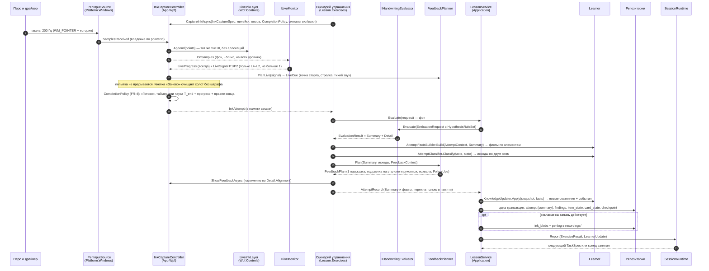

Детали:
- Шаги 3–4 идут на UI-потоке: только копирование в буфер попытки и обновление последнего фрагмента штриха.
- При `Confidence.Low` или `U0`:
  - `FeedbackPlanner` не выдаёт негативных подсказок;
  - факты пишутся с `Confidence`. `Learner` по ним не повышает статус, а оси с низкой уверенностью получают `na`.
- Исключение в оценщике → лог, попытка `na`, ребёнок видит «спасибо, дальше».

### 4.2. Запуск занятия

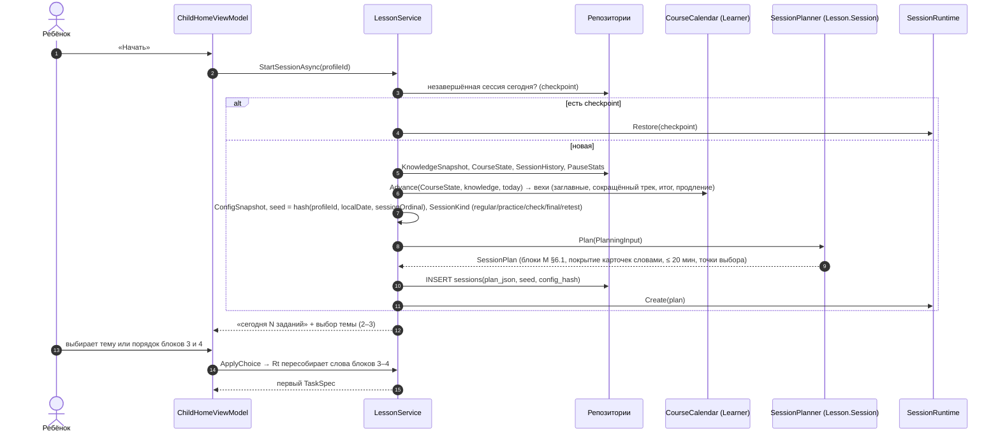

### 4.3. Диктант слова (E16)

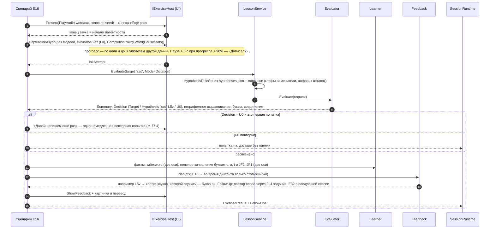

`AttemptFactsBuilder` раскладывает результат слова на факты:
- слово;
- каждая буква на её позиции — с контекстом соседей и позиции;
- каждое ожидаемое соединение — семейство и пара;
- диграфы.

Неявное зачисление (М §8.1): диктант зачисляет обе оси; копирование (E15, E21) — только ось исполнения; коробка меняется, только если карточка готова, и не чаще раза в день.

### 4.4. Диагностика (неделя 0, E30)

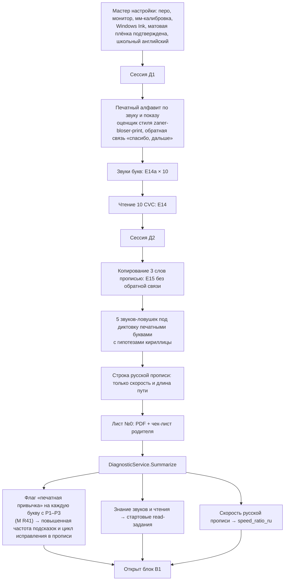

Отдельного трека печатной коррекции нет (М D38). E29 запускается, только если родитель включил его в настройках.

Без согласия на запись чернила печатных букв из диагностики не сохраняются. Поэтому экран E06 при флаге «печатная привычка» показывает **иллюстрацию типичной печатной траектории** на эталоне печатного стиля: старт снизу, овал по часовой стрелке. Свою печатную букву ребёнок видит, только если запись включена (открытый вопрос §13.2, В2).

### 4.5. Бумажные задания недели (E34/E35, E27)

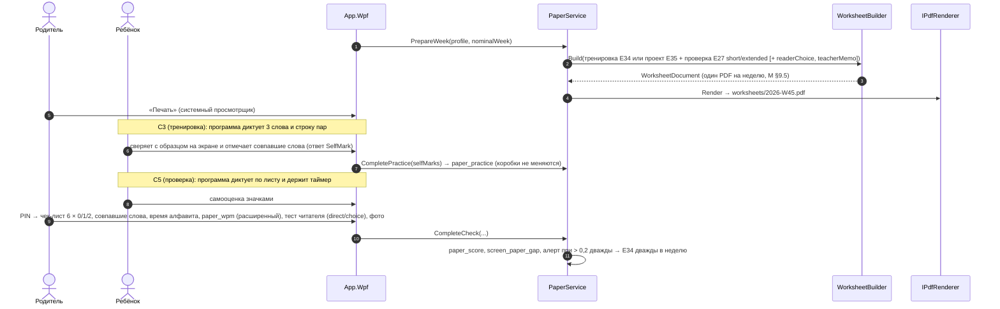

### 4.6. Потеря и возврат устройства

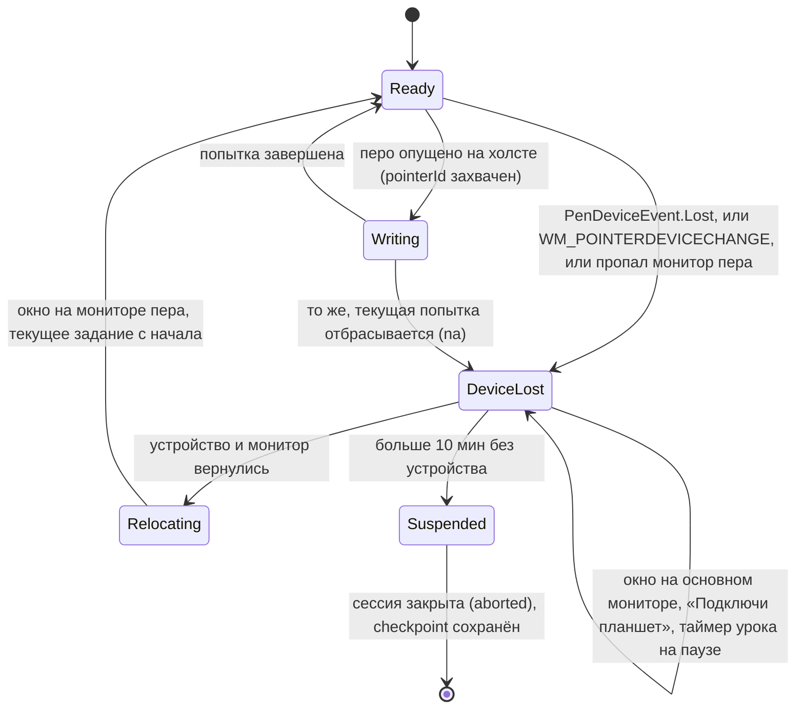

### 4.7. Цикл исправления (`RepairCycleMachine`, Learner; A23)

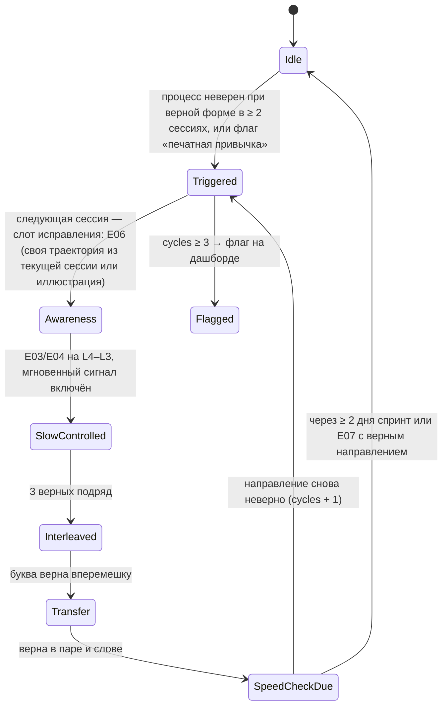

Состояние хранится в `item_state.repair_json`. Планировщик читает его при сборке слота исправления (М §8.4 п. 2).

### 4.8. Первое знакомство (`FirstEncounterPlan`, Lesson.Session; A23)

В сессии, где вводится буква, планировщик:
1. Ставит шаги 0–5 М §4.2 в блок «Новое» фиксированным сценарием (`TaskSpec.Scenario = FirstEncounter`). Правила спуска и подъёма опоры здесь не действуют.
2. Добавляет в блок «Слова» шаг 6 — 2 пары в разрешённом семействе — и шаг 7 — 1–2 слова (E15, затем E16), если они существуют при текущем наборе букв. В С1 блока 1 — пара `ai`.
3. Вставляет возврат буквы через 2–4 задания (L1) и в конце занятия (L0, E07).

Со следующей сессии буква в адаптивном режиме. Проверка — сценарные тесты на фикстуре блока 1.

### 4.9. Итоговая и повторная проверка (`FinalCheckPlanner`; A23)

- `CourseCalendar` ставит веху `final.start`, когда выполнено событие М §8.7:
  - все шлюзы пройдены;
  - заглавные трека введены;
  - после последней заглавной прошло ≥ 2 недели;
  - номинальная неделя ≥ 11.

  Если к неделе 12 событие не наступило — веха `core.extension` до недели 16.
- `FinalCheckPlanner` строит 3 сессии `SessionKind.Final` по `final-check.json`: 20 слов и 6 предложений, распределённых по сессиям; алфавит без полоски; копирование на время; расширенный бумажный лист. Итог считается суммарно по трём сессиям (М §1.2).
- Через 7–14 дней — `SessionKind.Retest` с тем же составом.

Отчёт об овладении строит `Reporting` по суммарным показателям.

### 4.10. Время письма и пауза E28

`WritingTimeTracker` в `SessionRuntime` суммирует время, когда перо опущено или пауза между штрихами < 2 с. Когда набирается 5–7 минут (`thresholds.session.writingPauseEveryMin`; точка внутри интервала выбирается по seed), следующим заданием вставляется E28. Обычно это 1–2 раза за занятие. Потолок занятия — 20 минут: планировщик урезает план, а не продлевает занятие.

---

## 5. Движок упражнений

### 5.1. Идея

**Упражнение** — это C#-сценарий (`IExerciseScenario`), который вызывает общие примитивы порта `IExerciseHost`:
- показать стимул;
- поймать чернила, выбор или самоотметку;
- показать обратную связь.

**Задание** (`TaskSpec`) — код упражнения, целевой элемент, уровень опоры, режим сценария, политика обратной связи, `handedness`, условия эксперимента и seed. Числовые параметры (длительность показа, число попыток, задержки) лежат в `content/exercises/params.json`.

Почему C#, а не шаблоны JSON с языком выражений (A15):
- логика упражнений устоялась в методике v1.1;
- C#-сценарий типобезопасен и отлаживается дебаггером;
- агенту проще написать маленький класс, чем расширять интерпретатор.

Повторяющиеся шаги вынесены в `ExerciseSteps`: `Demonstrate`, `TraceAttempts`, `CopyAttempts`, `MemoryAttempt`, `WriteFromAudio`, `ReadAndChoose`, `CompareWithModel`. Типичный сценарий — 20–60 строк.

### 5.2. Примитивы

**Стимулы** (`StimulusSpec`, у каждого вида — свой record):

| Примитив | Параметры | Представление |
|---|---|---|
| `AnimateModel` | цель (буква, пара, слово), стиль, стрелки, номера, словесная метка (текст), выделение соединения, замедление | `GlyphAnimator` |
| `ShowModel` | цель, позиция (`aboveLine` — над строкой, М §4.1; `underPen` — обводка; `flash` — показ и скрытие), длительность, вид | `GuidesLayer` + статический рендер |
| `ShowPrinted` | буква, графема, слово, фраза или список в печатном стиле; виден ли во время письма | `StyledTextBlock` |
| `ShowText` | мини-текст E36 (3–5 предложений), печатный стиль, разбивка на строки (A02) | `StyledTextBlock` (многострочный) |
| `PlayAudio` | ключ или ключи, ротация голосов по seed, кнопка «ещё раз» | `IAudioService` |
| `ShowImage` | картинка; когда показать (`afterAnswer`) | `Image` |
| `ShowContrast` | перечёркнутая русская буква (глиф `ru-propis`) + латинская + звук | `GlyphAnimator` × 2 |
| `ReplayInk` | попытка ребёнка **из текущей сессии**, замедление, рядом анимация эталона, подсветка расхождений; без согласия — только чернила этой сессии | `InkReplayView`, `OverlayCompareView` |
| `ShowIllustration` | заготовленная иллюстрация ошибки на эталоне (типичная печатная траектория и т. п.) | `GlyphAnimator` |

**Опоры** (`ScaffoldSpec`):
- `Guides` — x-height в мм по номинальной неделе, число строк;
- `StartDot`, `Arrows`;
- `ModelAbove` — эталон над строкой, а не рядом, чтобы его не закрывала рука (М §4.1);
- `ModelUnderPen`;
- `Corridor`;
- `AlphabetStrip` — полоска a–z (E33, спринты до недели 8).

Раскладку для левшей зеркалит `HandednessLayout` (§7.8): сценарий указывает роль, а не сторону.

**Ответы:**

| Примитив | Результат |
|---|---|
| `Ink` (цель, `CompletionPolicy`, сигналы вкл/выкл, многострочность, разрешена ли кнопка «Заново») | `InkAttempt` |
| `Choice` (картинки, тексты, аудио, буквы; правильный; перемешивание по seed) | `ChoiceResponse` |
| `TileAssembly` (клетки по графемам; фишки; «тап-тап» или перетаскивание) | `TileResponse` |
| `SelectBest` (N последних попыток этой сессии, теги критериев) | `SelfAssessResponse` |
| `SelfMark` (список слов листа; ребёнок отмечает совпавшие с образцом — E34) | `SelfMarkResponse` |
| `ParentConfirm` (пункты «показал», PIN или без) | `ConfirmResponse` |
| `PaperEntry` (чек-лист, числа, вариант теста читателя) | `PaperResponse` |
| `None` («Дальше», «Покажи ещё раз») | — |

**Политики обратной связи:**
- `ByStatus` (М §7.2);
- `StopOnly` (диктант, спринт);
- `SummaryAfterSeries(n)`;
- `None` (диагностика, итоговая проверка).

Живой канал (`InstantCues`) работает только на L4–L2. Условие эксперимента H5 может его выключить.

**Флаги задания:**
- `MeasurementOnly` — пробный спринт изученного: попытки пишутся в историю, но статусы, коробки и опору не меняют (М R11);
- `Scenario = FirstEncounter | Adaptive | Repair | Final`.

### 5.3. Контракты (C#)

```csharp
namespace PenForLang.Lesson.Exercises;

public sealed record TaskSpec(TaskId Id, string ExerciseCode, ItemRef Target, SupportLevel Level, ScenarioMode Scenario,
    FeedbackPolicyKind FeedbackPolicy, bool InstantCues, bool MeasurementOnly, Handedness Handedness,
    ExperimentConditions Experiments, ulong Seed, TaskOrigin Origin);

public sealed record ItemRef(ItemKind Kind, string Value, StyleId? Style);   // Letter | Capital | Pair | Word | Phrase | Text | Sequence | Grapheme | VowelSet

public interface IExerciseScenario
{
    string Code { get; }                                         // "E04"
    IReadOnlySet<ItemKind> Targets { get; }
    Task<ExerciseResult> RunAsync(TaskSpec task, ExerciseContext ctx, IExerciseHost host, CancellationToken ct);
}

/// Контекст без IO: знания по целевым элементам, параметры упражнения, конфигурация, попытки этой сессии (для E05/E06),
/// история подсказок, статистика пауз (FR-4), фасад оценки (вызов уходит в Application).
public sealed record ExerciseContext(KnowledgeView Knowledge, ExerciseParams Params, ConfigSnapshot Config,
    SessionInkMemory SessionInk, HintHistory Hints, PauseStats Pauses, IEvaluationGateway Evaluation, CurriculumView Curriculum);

public interface IEvaluationGateway { Task<EvaluationResult> EvaluateAsync(EvaluationTargetSpec target, InkAttempt ink, EvaluationMode mode, CancellationToken ct); }

public interface IExerciseHost
{
    Task PresentAsync(StimulusSpec stimulus, ScaffoldSpec scaffold, CancellationToken ct);
    Task<InkAttempt> CaptureInkAsync(InkCaptureSpec spec, CancellationToken ct);
    Task<ChoiceResponse> CaptureChoiceAsync(ChoiceSpec spec, CancellationToken ct);
    Task<TileResponse> CaptureTilesAsync(TileSpec spec, CancellationToken ct);
    Task<SelfAssessResponse> CaptureSelfAssessAsync(SelfAssessSpec spec, CancellationToken ct);
    Task<SelfMarkResponse> CaptureSelfMarkAsync(SelfMarkSpec spec, CancellationToken ct);
    Task<ConfirmResponse> CaptureConfirmAsync(ConfirmSpec spec, CancellationToken ct);
    Task ShowFeedbackAsync(FeedbackPlan plan, EvaluationDetail? detail, CancellationToken ct);
    Task ShowLiveCueAsync(LiveCue cue, CancellationToken ct);
    bool ShowAgainRequested { get; }
}

/// Политика завершения (М FR-4): чистая функция, тестируется на логах с длинными паузами.
public sealed record CompletionPolicy(CompletionKind Kind, TimeSpan TEnd, double MinProgress, bool RequireRightOfEnd,
    TimeSpan AskAfter, double AskIfProgressBelow, bool DoneButton, bool RestartButton, TimeSpan? Timer)
{
    public static CompletionPolicy ForWord(PauseStats stats, CompletionConfig cfg);   // T_end = clamp(max(min, k·медиана), ≤ max)
    public static CompletionPolicy ForLetter(PauseStats stats, CompletionConfig cfg);
    public CompletionDecision Decide(TimeSpan sincePenUp, LiveProgress progress);    // Continue | Complete | Ask
}

public sealed record AttemptRecord(TaskId Task, int AttemptNo, string ExerciseCode, ItemRef Target, SupportLevel Level,
    DateTimeOffset StartedAt, EvaluationSummary? Summary, ResponseSummary? Response, IReadOnlyList<AttemptFacts> Facts,
    FeedbackPlan? Feedback, bool HintUsed, bool ShowAgainUsed, int Restarts, InkCompletion? Completion);

public sealed record ExerciseResult(TaskId Task, IReadOnlyList<AttemptRecord> Attempts, ExerciseEndReason End,
    IReadOnlyList<FollowUpAction> FollowUps);   // Requeue(2–4), RetryNowOnce(U0), InsertExercise(E18|E06|E10|E32), RaiseSupport, DeferItem
```

`InkAttempt` не входит в `AttemptRecord`: чернила живут в `SessionInkMemory` до конца сессии. Сохраняет их `RecordingService` (§11.2), и только при согласии.

### 5.4. Пример сценария и параметров

```csharp
public sealed class MemoryWriteScenario(ExerciseSteps steps) : IExerciseScenario   // E04 «Посмотри — запомни — пиши»
{
    public string Code => "E04";
    public IReadOnlySet<ItemKind> Targets { get; } = new HashSet<ItemKind> { ItemKind.Letter, ItemKind.Capital, ItemKind.Pair };

    public async Task<ExerciseResult> RunAsync(TaskSpec task, ExerciseContext ctx, IExerciseHost host, CancellationToken ct)
    {
        var p = ctx.Params.For<MemoryParams>("E04");            // flashMs, attempts.min/max — из params.json
        var attempts = new List<AttemptRecord>();
        for (int i = 0; i < p.Attempts.Max && !steps.PolicySaysStop(attempts, p.Attempts.Min, ctx); i++)
        {
            await host.PresentAsync(new ShowModel(task.Target, ModelPosition.Flash, p.FlashMs), Scaffold.Guides, ct);
            await steps.WaitAsync(ctx.Knowledge.MemoryDelay(task.Target), ct);
            var spec = steps.InkSpec(task, ctx, startDot: task.Level == SupportLevel.L2, CompletionKind.Letter);
            attempts.Add(await steps.WriteEvaluateFeedbackAsync(task, ctx, host, spec, EvaluationMode.Memory, ct));
            await host.PresentAsync(new ShowModel(task.Target, ModelPosition.AboveLine, CompareWithLast: true), Scaffold.Guides, ct);
        }
        return steps.Result(task, attempts);
    }
}
```

```jsonc
// content/exercises/params.json (фрагмент)
{
  "schema": "pfl.exercises.params/1",
  "E02": { "attempts": { "min": 1, "max": 2 } },
  "E03": { "attempts": { "min": 2, "max": 3 }, "hideArrowsAfterCorrect": 2 },
  "E04": { "flashMs": 2000, "attempts": { "min": 2, "max": 3 } },
  "E16": { "voices": 2, "requeueAfterTasks": [2, 4] },
  "E24": { "kinds": { "learned": { "seconds": 30, "strip": true, "measurementOnly": true }, "alpha60": { "seconds": 60 } } },
  "E33": { "stages": [ { "weeks": [2, 4], "mode": "pointNext" }, { "weeks": [5, 7], "mode": "fillGaps" }, { "weeks": [8, 9], "mode": "fromMemory" } ] }
}
```

### 5.5. Сопоставление 37 типов упражнений с примитивами

Каталог М v1.1 §6.2: E01–E36 и E14a. `pfl validate` проверяет, что для каждого кода из `content/exercises/catalog.json` (сверяется с методикой) зарегистрирован сценарий (A02).

| Код | Стимул | Опора | Ответ | Оценка | ОС | Сценарий |
|---|---|---|---|---|---|---|
| E01 Демонстрация | `AnimateModel` + `ShowPrinted` (печатная ↔ прописная) | Guides | `None` | — (просмотры) | `None` | `DemonstrateScenario` |
| E02 Обводка | `AnimateModel` ×1 | ModelUnderPen, StartDot, Arrows | `Ink` ×1–2 | `trace` | `ByStatus` + сигналы; коридор | `TraceScenario` |
| E03 Копия с моделью над строкой | — | ModelAbove, Guides | `Ink` ×2–3 | `copy` | `ByStatus` + сигналы | `CopyScenario` |
| E04 По памяти | `ShowModel: flash` → задержка → сигнал | StartDot (L2) / — (L1) | `Ink` | `memory` | сигналы на L2; сводная | `MemoryWriteScenario` |
| E05 Выбери лучшую | `ReplayInk` (3 попытки сессии, статично) | — | `SelectBest` | `SelfAgreement` | фраза согласия | `SelectBestScenario` |
| E06 Разбор своей траектории | `ReplayInk` (замедленно) ∥ `AnimateModel`; при флаге без согласия — `ShowIllustration` | — | `Ink` ×2 (L3) | `copy` | словесная метка | `ReviewOwnScenario` |
| E07 Звук → буква | `PlayAudio: phoneme` | Guides | `Ink` | `dictation` (буква, гипотезы) | `ByStatus` | `SoundToLetterScenario` |
| E08 Название → буква | `PlayAudio: letterName` | Guides | `Ink` | как E07 | как E07 | `SoundToLetterScenario` (параметр) |
| E09 Печатная → прописная | `ShowPrinted: letter` | Guides | `Ink` | как E07 | как E07 | `SoundToLetterScenario` (параметр) |
| E10 Пара | `AnimateModel: pair` (соединение выделено), по уровню | ModelAbove (L3) / — (L1) | `Ink` | `copy`/`memory` (J1–J4) | о соединении | `PairScenario` |
| E11 Дорожка соединений | `ShowModel: pattern` | Guides (длинная строка) | `Ink` (≤ 60 с) | `copy` + беглость | `SummaryAfterSeries(1)` | `JoinTrackScenario` |
| E12 Семейство слов | `ShowPrinted: rime` + `PlayAudio` | Guides | `Ink` × 3–5 | `dictation` + постоянство римы | сводная | `WordFamilyScenario` |
| E13 Сборка из фишек | `PlayAudio: word` | клетки | `TileAssembly` → письмо | `TileEval` + `dictation` | по клеткам | `TilesScenario` |
| E14 Чтение печатного слова | `ShowPrinted: word` | — | `Choice` (3) | точность, латентность | звук + картинка после ответа | `ReadWordScenario` |
| E14a Графема → звук | `ShowPrinted: grapheme` | — | `Choice` (3–4 аудио) | точность | правильный звук | `GraphemeSoundScenario` |
| E15 Прочитай → напиши | `ShowPrinted: word` (виден) | Guides | `Ink` | `copy` (гипотезы только двойников, L2 не стоп) | `ByStatus` | `ReadWriteScenario` |
| E16 Диктант слова | `PlayAudio: word` (2 голоса) | Guides | `Ink` | `dictation` | `StopOnly`; U0 → один повтор | `DictationScenario` |
| E17 Минимальная пара | `ShowImage` ×2 + `PlayAudio` | — | `Choice` → `Ink` | точность + `dictation` | контраст | `MinimalPairScenario` |
| E18 «Не путай!» | `ShowContrast` | Guides | `Ink` ×3 → слово | `dictation` | фиксированная фраза | `ContrastScenario` |
| E19 Чтение прописи | `ShowModel: word` (эталон) или `ReplayInk` (написание этой сессии); миниатюра коллекции — если слово там есть | — | `Choice` | точность | фраза о двойнике | `ReadCursiveScenario` |
| E20 Различение похожих | `PlayAudio` (чередование пары) | Guides | `Ink` × N | `dictation` | моторная опора | `DiscriminateScenario` |
| E21 Фраза: прочитай → напиши | `ShowPrinted: phrase` | Guides (2 строки) | `Ink` (многострочно) | `copy`, цель Phrase | `ByStatus` | `PhraseCopyScenario` |
| E22 Фраза под диктовку | `PlayAudio: phrase` | Guides | `Ink` | `dictation`, цель Phrase | `StopOnly` | `PhraseDictationScenario` |
| E23 Заглавная | E01–E04 для заглавной → фраза или имя (разрыв) | как E01–E04 | `Ink` | критерий заглавных | как у строчной | `CapitalScenario` (композиция шагов) |
| E24 Спринт | `ShowPrinted: prompt` + таймер; `AlphabetStrip` до недели 8 | Guides (строки) | `Ink` (таймер) | `SprintCount` (lpm) | итог «я против меня» | `SprintScenario` |
| E25 Спринт слов | `ShowPrinted: wordList` (автопереход) | Guides | `Ink` × N (60 с) | `SprintCount` (wpm) | итог, рекорд | `WordSprintScenario` |
| E26 Мои слова | `Choice` слов (коллекция, имя латиницей) → E15 | как E15 | `Ink` | как E15 | похвала | `MyWordsScenario` |
| E27 Бумажная проверка | диктовка по листу + таймер (`PaperService`) | — | `PaperEntry` | — (данные в `paper_checks`) | `None` | `PaperCheckScenario` → `Application.PaperService` |
| E28 Разминка кисти | анимация упражнения для кисти | — | `None` (20–30 с) | — | — | `WarmupScenario` |
| E29 Коррекция печатной (опция, выкл.) | E01–E04 со стилем print | как E01–E04 | `Ink` | процесс | как у прописной | `PrintCorrectionScenario` |
| E30 Диагностика | батарея `diagnostics.json` | по пунктам | по пунктам | по пунктам | `None` | `DiagnosticScenario` → `DiagnosticService` |
| E31 Покажи взрослому | `ShowModel` (3 буквы + 2 слова) | — | `ParentConfirm` | — | — | `ShowAdultScenario` |
| E32 Услышь гласную | `PlayAudio` (2–3 голоса, набор из `vowels.json`) + `ShowImage` 2–3 | — | (а) `Choice` картинки, (б) `Choice` гласной буквы, (в) `Ink` слова | точность; гласная в письме (L5v) | правильное слово звучит снова, подсветка гласных | `VowelScenario` |
| E33 Алфавит по порядку | `PlayAudio: song/alphabet` + `AlphabetStrip` | полоска (до недели 7) | `Choice` (следующая буква) / `Ink` (пропуски, по порядку) | точность порядка | правильная последовательность | `AlphabetOrderScenario` |
| E34 Бумажная тренировка | диктовка 3 слов и строки пар (`PaperService`) → образец на экране | — | `SelfMark` | самоотметка | образец, похвала процесса | `PaperPracticeScenario` |
| E35 Бумажный проект | шаблон проекта (`PaperService`, лист `project`) | — | `ParentConfirm` (опц.) | — | — | `PaperProjectScenario` |
| E36 Мини-текст | `ShowText` | — | `Choice` (картинка по вопросу) | понимание | — | `MiniTextScenario` |

### 5.6. Что данные, а что код

| Изменение | Что делать |
|---|---|
| Новые числа существующего упражнения | `params.json` |
| Новое упражнение из существующих примитивов | новый класс `IExerciseScenario` (≈ 20–60 строк) + регистрация + фразы в `locales/*.json` + место в `scheduler.json` + тест на `ScriptedExerciseHost` |
| Новый примитив стимула или ответа | record спецификации + метод `IExerciseHost` + представление WPF + поддержка в `ScriptedExerciseHost` |
| Новое правило выбора задания | код в `Lesson.Session` + числа в `scheduler.json` + снимок плана + прогон симуляции |

---

## 6. Оценщик (ядро)

### 6.1. Задача и границы

Оценщик отвечает на вопрос «насколько хорошо написана **заданная** цель и что именно не так» (03 §4.1). В его задачу входит и ограниченное распознавание: какую гипотезу из небольшого набора написал ребёнок (М FR-1).

Оценщик **не** решает:
- верна ли попытка в смысле Leitner;
- стоп-ошибка или нет;
- какую подсказку показать.

Это решают `Learner` и `Lesson.Feedback` по `errors.json` и правилам.

**Цели:** изолированная буква (печатная или прописная), пара, слово, фраза, последовательность (спринт). Координаты — в единицах линейки.

**Стратегия v1** ([решение] оркестратора, A09): DTW по целевому слову и **локальная** переоценка гипотез. Общая решётка гипотез (one-pass DP) — улучшение на потом, если S2 покажет, что сегментация цели разрушается при пропусках и вставках.

### 6.2. Публичный API

```csharp
namespace PenForLang.Evaluation.Abstractions;

/// Оценщик создаётся на сессию со снимком конфигурации: чистая функция от (запрос, снимок) (A06).
public interface IEvaluatorFactory { IHandwritingEvaluator Create(ScoringConfig config, IStyleRepository styles); }

public interface IHandwritingEvaluator
{
    EvaluatorInfo Info { get; }                                          // EvaluatorVersion, ConfigHash
    EvaluationResult Evaluate(EvaluationRequest request, CancellationToken ct = default);
    ILiveMonitor CreateLiveMonitor(LiveMonitorRequest request);
}

public enum TargetKind { Letter, Pair, Word, Phrase, Sequence }
public enum EvaluationMode { Trace, Copy, Memory, Dictation, Sprint, Diagnostic }
public enum LetterContext { Isolated, WordFirst, WordInner }
public enum ToleranceProfile { Learning, Familiar, Mastered, Stable, Sprint, Capital }

public sealed record GraphemeSpan(string Grapheme, ImmutableArray<int> LetterIndices, string? Phoneme);
public sealed record EvaluationTarget(TargetKind Kind, string Text, StyleId Style, ImmutableArray<GraphemeSpan> Graphemes,
    ImmutableArray<string>? Sequence = null);

/// Разрешённый набор правил гипотез: уже содержит ссылки на глифы-заменители. Собирается Application из Curriculum (A06).
public sealed record HypothesisRuleSet(
    ImmutableDictionary<string, ImmutableArray<Substitute>> SubstitutesByLetter,   // "t" → [{Glyph:"ru-propis/т", Class:L1}, {Glyph:"m", Class:L2}]
    ImmutableArray<GraphemeRewrite> Rewrites,                                     // ck→k, sh→s, sh→ш …
    ImmutableArray<char> VowelLetters,                                            // для L5v
    ImmutableArray<InsertionRule> Insertions,                                     // удвоение соседней, буквы-ловушки
    ImmutableArray<ImmutableArray<char>> MotorFamilies,                           // m/n, u/w, e/l → класс L2m
    bool AllowSkips, int MaxEditsPerWord);

public sealed record EvaluationRequest(EvaluationTarget Target, RulerInk Ink, EvaluationMode Mode, SupportLevel Level,
    ToleranceProfile Tolerance, HypothesisRuleSet? Hypotheses, MetricSet EnabledMetrics, Handedness Handedness,
    DeferredAcceptPolicy DeferredAccept);

/// Результат: стабильный фасад + предварительная детализация (A07).
public sealed record EvaluationResult(EvaluationSummary Summary, EvaluationDetail Detail);

// ---------- СТАБИЛЬНЫЙ ФАСАД (контракт v1; потребители — Learner, Feedback, Reporting, Persistence) ----------
public enum Decision { Target, Hypothesis, Unrecognized }
public enum Confidence { High, Medium, Low }
public enum ErrorCode { L1, L2, L2m, L3, L4, L5, L5v, L6, Var, P1, P2, P3, P4, P5, P6, J1, J2, J3, J4,
                        F1, F2, F3, F4, F5, F6, F7, F8, D1, D2, D3, D4, K1, K2, K3, K4 }

public sealed record EvaluationSummary(
    EvaluatorInfo Info, TargetKind Kind, string TargetText,
    Decision Decision, string WrittenText, ImmutableArray<Edit> Edits, double LocalMargin, Confidence Confidence,
    ImmutableArray<LetterSummary> Letters, ImmutableArray<JoinSummary> Joins, ImmutableArray<DeferredSummary> Deferred,
    ImmutableArray<GraphemeOutcome> Graphemes, double? GraphemeScore,
    ImmutableArray<Finding> Findings, FluencySummary Fluency, WordSummary? Word);

public sealed record Edit(int TargetLetterIndex, EditKind Kind, string Expected, string Written, ErrorCode Class, string? Cyrillic);
public sealed record LetterSummary(int Index, string Target, string Written, LetterContext Context, ErrorCode? Identity,
    double Form, bool? ProcessOk, bool SegmentationConfident);
public sealed record JoinSummary(int Index, int Left, int Right, string? Family, bool Tall, bool Present, bool LiftExpected, double Score);
public sealed record DeferredSummary(int LetterIndex, DeferredKind Kind, DeferredStatus Status, DeferredTiming Timing);
public sealed record GraphemeOutcome(int Index, string Expected, string Written, bool Correct, ErrorCode? Code);
public sealed record Finding(ErrorCode Code, FindingLocation Where, double Severity, TemplateSpan TemplateSpan,
    FindingKind Kind = FindingKind.Error);                    // TemplateSpan — участок ЭТАЛОНА: иллюстрация без чернил (A01)
public sealed record FluencySummary(int? LatencyMs, int DurationMs, double SpeedXhPerS, int PenLifts, int PenLiftsExpected,
    int Pauses250, double AirShare, int? LettersCounted, double? Lpm, double? Wpm, int Corrections);
public sealed record WordSummary(double? SlantDeg, double SlantSd, double SizeCv, double SpacingCv, double BaselineErr);

// ---------- ДЕТАЛИЗАЦИЯ (v1-provisional до решения по S2; потребители — UI-наложение, InkLab, корпусные тесты) ----------
public sealed record EvaluationDetail(
    ImmutableArray<LetterMetrics> Letters, ImmutableArray<JoinMetrics> Joins, AlignmentMap Alignment,   // индексы рукописи ↔ эталона
    ImmutableArray<RankedHypothesis> TopHypotheses, ImmutableDictionary<string, double> Diagnostics);

public interface ILiveMonitor
{
    LiveSignal? OnSamples(ReadOnlySpan<RulerPoint> points);    // P1/P2 только при Level ∈ {L4, L3, L2}, не больше 1 за попытку
    void OnPenUp();
    LiveProgress Progress { get; }                              // Fraction (макс. по цели и до 3 гипотезам другой длины), RightOfEnd
}
```

Правило совместимости: поля `EvaluationSummary` после заморозки контрактов v1 только **добавляются**. Изменения `EvaluationDetail` до решения T0.8 (S2) свободны, и потребители кроме UI и InkLab на них не опираются (архитектурный тест: `Learner`, `Lesson.Feedback`, `Reporting`, `Infrastructure` не ссылаются на `EvaluationDetail`).

### 6.3. Конвейер

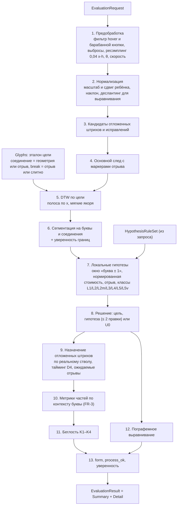

Изолированная буква идёт по ветке §6.4.10.

### 6.4. Шаги подробно

#### 6.4.1. Предобработка
1. Отбросить точки `hover`, штрихи с `Barrel`/`Eraser`, точки до первого `down`.
2. Удалить дубликаты и выбросы: скачок > 8 медианных шагов внутри штриха. Точки с `Clipped` остаются, но получают нулевой вес в метриках формы.
3. Микроштрихи (< 0,02 x-h и < 30 мс) пометить `dotCandidate`, не удалять.
4. Ресэмплинг по длине дуги с шагом `scoring.resampleStep` (0,04 x-h); время — линейная интерполяция.
5. Признаки на сглаженной копии (Savitzky–Golay, окно 7, порядок 2): θ, кривизна, скорость.

Если время интерполировано (`InterpolatedTime`), кинематические метрики получают флаг пониженной точности.

#### 6.4.2. Нормализация
- **Проход 1, для выравнивания.**
  - Робастная оценка масштаба `s` и сдвига baseline `b` по экстремумам y против ожидаемых x-height-зон.
  - Сдвиг по x — по первой точке.
  - Наклон — по нисходящим квазивертикалям. Рукопись деслантуется к наклону эталона (03 C10).
- **Проход 2, для оценки.** Метрики считаются в абсолютных единицах линейки: «крупно», «мелко», «не на строке» — это метрики F4, F5, F7, а не шум.

#### 6.4.3. Кандидаты отложенных штрихов и исправлений
- **Отложенные** (03 §4.5.3, шаг 1; пороги в `scoring.deferredDetector`). Штрих — кандидат, если он начинается левее конца предыдущего на `backtrackMinU` и при этом короткий или точечный.
- **Исправления** (A10). Длинный (≥ `correction.minLen`) штрих, который начинается левее конца предыдущего и ≥ `correction.overlapShare` своей длины проходит в коридоре 0,1 x-h от уже написанных чернил, — кандидат «исправление».
  - Участок под исправлением исключается из основного следа: оценивается последний вариант.
  - Буква получает `SegmentationConfident = false`; формируется находка `K4` (Info) и `Corrections + 1`.
  - Если после исключения стоимость буквы всё равно выше порога, уверенность по слову — `Low`, и ребёнок получает нейтральное «напиши ещё раз».
- Кнопка «Заново» (§7.6) — основной способ начать заново. Детектор исправлений ловит случаи, когда ребёнок переписал букву поверх.

#### 6.4.4. Основной след и выравнивание по цели (`TargetAligner`)

**Вход:**
- основные штрихи в хронологическом порядке; между ними маркер `lift` (без точек);
- эталон цели `WordTemplate`: точки тела букв, соединения `[Start..End]`, ожидаемые `break`.

**DP (DTW с дополнительными переходами):**
- Состояние `(i, j)`: `i` — индекс точки рукописи (маркеры `lift` — отдельные позиции), `j` — индекс точки эталона.
- Обычные шаги `(i−1, j)`, `(i, j−1)`, `(i−1, j−1)`. Ограничение `maxRunSameAxis` действует только внутри тел букв.
- Локальная стоимость: `c(i,j) = wPos·‖p_i − q_j‖² + wTheta·(1 − cos(θ_i − θ_j)) − anchorBonus·[тип ключевой точки i = тип j]`.
- **Соединение как альтернатива** (A03). Из конца тела буквы k (`j = BodyEnd_k`) разрешён переход сразу в начало тела буквы k+1 (`j = BodyStart_{k+1}`). Условие: рукопись проходит маркер `lift` (`i → i+1` через `lift`). Стоимость: `liftJoinPenalty` + расстояние между концом рукописи до отрыва и точкой выхода эталона. Это «соединение пропущено» — J1-кандидат, а не поломка выравнивания.
- **Break как альтернатива.** Ожидаемый отрыв эталона может быть написан слитно: на маркере `break` разрешён «пробег» до `breakRunMax` точек рукописи со стоимостью `continuousBreakCostPerPoint`.
- Отрыв рукописи внутри тела буквы — переход через `lift` с `liftInLetterPenalty`. Идёт в `LiftsInsideLetter`, не стоп-ошибка в слове (М FR-3).
- **Полоса по x** (A09): разрешены только пары с `|u_i − u_j| ≤ bandU` после нормализации и деслантинга (по умолчанию 0,8 x-h). Cursive в целом монотонен по x, поэтому такая полоса устойчивее индексной. Локальные возвраты (петли, ретрейс, овалы) укладываются в ширину полосы.
- Сложность: O(N · ширина полосы в точках эталона). Для слова из 8 букв (~600 × ~120 ячеек) — меньше 2 мс.

#### 6.4.5. Сегментация
Путь DP даёт диапазоны индексов рукописи для каждой буквы и каждого соединения. **Уверенность границы**: насколько растёт стоимость при сдвиге границы на ± 0,3 x-h. Пологий минимум — `SegmentationConfident = false`.

Внутри слова процессные метрики буквы с неуверенной сегментацией не считаются, остаётся только форма (М FR-3).

#### 6.4.6. Локальные гипотезы (`HypothesisScorer`; A04, A09)
1. **Генерация.** Для каждой позиции k цели и каждого правила из `HypothesisRuleSet` строится вариант окна:
   - подстановка буквы — глиф-заменитель из того же стиля или из `ru-propis`;
   - переписывание графемы;
   - замена гласной;
   - пропуск буквы k;
   - вставка после k.

   Вставки ограничены удвоением соседней и буквами-ловушками (М FR-1 (г)).
2. **Окно.** Буквы k−1..k+1 цели. Отрезок рукописи — объединение их сегментов (§6.4.5) с запасом `windowSlackU` (0,3 x-h) с каждой стороны. Эталон окна строит `ITemplateBuilder.BuildWord(style, glyphs)` из той же последовательности глифов, где позиция k заменена, — с соединениями и альтернативами отрыва. Открытые начало и конец (open-begin/end).
3. **Стоимость.** Локальный DTW того же вида, что §6.4.4, нормированный на число точек **рукописи** окна (одно и то же для цели и всех вариантов). Так сравнение не зависит от длины слова.
4. **Принятие.** Вариант h принимается, если одновременно:
   - `c_target − c_h ≥ hyp.localMargin`;
   - `c_h ≤ hyp.absoluteCap`.

   Штраф правила (`hyp.penalty[class]`) прибавляется к `c_h` один раз, отдельного множителя нет — устранён двойной учёт из v1.0.
5. **Несколько правок.** Принимаются не больше `MaxEditsPerWord` (2) правок в **непересекающихся** окнах, жадно по величине отрыва. Решение детерминировано: при равенстве выигрывает меньший индекс, затем порядок правил в файле.
6. **Классы:**
   - `L1` — кириллическая форма;
   - `L2` — другая латинская буква вне моторной семьи;
   - **`L2m`** — подмена внутри моторной семьи из `style.motorFamilies` (m↔n, u↔w — число горбов; e↔l — высота петли). Ось исполнения, не стоп, пока κ не подтверждена;
   - `L3` — пропуск, `L4` — вставка;
   - `L5` — переписывание графемы, `L5v` — гласная (приоритеты пар — `pairPrior` для акцента пакета);
   - `L6` — знак транскрипции вместо буквы (М v1.2 §1.3); `Var` — вариантное написание UK/US, не ошибка.

   Стоповость по режиму задаёт `errors.json`. Например, в копировании (E15, E21) `L2` не стоп-ошибка: образец виден, значит это ошибка исполнения.
7. **Режимы:**
   - `copy` — только двойники (`L1`, `L2`, `L2m`); без замен гласных, переписываний, пропусков и вставок;
   - `dictation` — полный набор;
   - `trace` и `memory` (изолированная буква) — подстановки букв (§6.4.10).
8. **Отрыв для уверенности.** Наименьший отрыв победителя от второго варианта в каждом окне (`LocalMargin`) идёт в `Summary`; ниже `confidence.lowMargin` — уверенность не выше `Medium`.

#### 6.4.7. Решение и «не распознано»
- `Decision = Target`, если ни один вариант не принят и `c_target` по слову ≤ `hyp.unrecognizedCostPerPoint`.
- `Decision = Hypothesis`, если принята хотя бы одна правка; `WrittenText` собирается из правок.
- `Decision = Unrecognized` (`U0`), если `c_target` по слову выше порога и правки его не объясняют. Буквенных находок L* при `U0` нет, `Confidence = Low`.
- Сегментация пересчитывается по победившему тексту: финальный проход §6.4.4 по эталону `WrittenText`.

#### 6.4.8. Назначение отложенных штрихов и ожидаемые отрывы
- Слоты — `deferred` букв победившего текста. Якорь пересчитывается **по реальному стволу ребёнка**.
- Назначение — Венгерский алгоритм. Неназначенный слот → `D1`; далеко от якоря → `D2`; лишний штрих → `D3`.
- **Тайминг:** `AfterWord`, если штрих позже конца основного следа, иначе `Immediate`. При `acceptTiming = either` штрих `Immediate` даёт только `D4` (Info).
- **Ожидаемый отрыв** (A03). Если штрих `Immediate` назначен букве k, то отрыв основного следа, непосредственно предшествующий этому штриху, и отрыв сразу после него (перед соединением k → k+1) помечаются `LiftExpected`:
  - на месте такого отрыва J1 не выдаётся;
  - в `pen_lifts − pen_lifts_expected` он не учитывается;
  - соединение оценивается по геометрии входа в следующую букву (J3), если она есть.

#### 6.4.9. Метрики частей (по контексту буквы, М FR-3)

| Метрика | Изолированная | Первая буква слова | Внутри слова |
|---|---|---|---|
| `start_err` → P1 | да | да | нет (вход задаёт соединение; J3) |
| направление → P2 | да | да (тело) | да (тело), только при уверенной сегментации |
| порядок и число штрихов → P3/P4/P5 | да (§6.4.10) | нет | нет; отрывы → `LiftsInsideLetter`, не стоп |
| ретрейс → P6 | да | да | да, при уверенной сегментации |
| форма F1–F5 | да | да | да, с `wordContextTolerance` |

| Код | Метрика | Алгоритм |
|---|---|---|
| P1 | `start_err` | первая точка против старта эталона (lead-in для изолированной, если `startDot = leadIn`) |
| P2 | `dirOk`, `reverseCostRatio`, угол первого сегмента | DTW сегмента против тела и против обращённого тела; угол первых 0,2 x-h |
| P6 | `retraceOk` | для сегментов `retrace`: точка возврата и обратный ход в пределах 0,08 x-h, а не петля |
| F1 | `dtwMean`, `dtwMax`, `frechet` | локальный DTW, дискретный Фреше |
| — | `corridorShare`, `coverage` | двусторонний коридор τ × допуск профиля |
| F2 | `closedGap` | участок `checks.closed` |
| F3 | `loopOk` | самопересечение на участке `checks.loops` |
| F4 | `reachX/Asc/Desc` | экстремумы против линий стиля |
| F5 | `baselineErr` | медиана нижних точек x-height-сегментов |
| F6 | `slantDeg`, `slantSd` | углы нисходящих квазивертикалей. Ожидание и допуск зависят от `Handedness` (М FR-6); главное — консистентность |
| F7, F8 | `sizeCv`, `spacingCv` | вариация высот и интервалов |
| J1 | `present` | в диапазоне соединения нет отрыва, **или** отрыв помечен `LiftExpected` |
| J2 | `height` | для `high` — провис ≥ `joins.highMinHeight` |
| J3 | `entryErr` | вход в тело следующей буквы; для E-C — «перекат» к старту овала |
| J4 | `unexpectedCorners` | углы > порога и малые петли в соединении |

Число горбов (`humps:N`) у m, n, u, w считается отдельно по экстремумам y. Расхождение даёт находку формы с указанием горба. Если локальная гипотеза уже выбрала соседа по моторной семье, это `L2m`.

#### 6.4.10. Изолированная буква (`IsolatedLetterEvaluator`)
Используется в E02–E04, E07–E09, E18, E23, печатных буквах диагностики и E29.
1. **Идентичность:** цель против заменителей из `HypothesisRuleSet` (двойники, моторная семья, в `dictation` — изученные буквы). Правила принятия — как в §6.4.6, окно — вся буква.
2. **Сопоставление штрихов** (03 §4.4): матрица DTW-стоимостей «штрих ребёнка × штрих эталона», включая обращённые, затем Венгерский алгоритм. Получаются порядок (P3), число (P4/P5) и направление каждого штриха.
3. Отложенные компоненты назначаются как в §6.4.8.
4. Форма — как в §6.4.9, контекст `Isolated`.

#### 6.4.11. Беглость (`FluencyAnalyzer`)

| Метрика | Определение |
|---|---|
| `latency_ms` (K1) | `firstDown.t − StimulusEndUs` |
| `duration_ms` | от первого касания до последнего отрыва основного следа |
| `speed` | длина пути в касании / время касания, x-h/с |
| `pen_lifts`, `pen_lifts_expected` | отрывы против ожидаемых: break, отложенные и `LiftExpected` |
| `pauses_250` (K2) | паузы > `fluency.pauseMs` и их положение: граница букв или внутри буквы |
| `niv` (K3) | смены знака производной сглаженного модуля скорости на букву |
| `air_share` | доля времени в воздухе |
| `retouch` (K4) | дорисовки и исправления (§6.4.3) |
| `pressure_mean/sd` | только лог |

Группа K попадает в находки, только если включена в `EnabledMetrics` (этап беглости). Сами числа считаются всегда.

#### 6.4.12. Фразы и последовательности
- **Фраза** (E21, E22):
  - основной след делится на слова кластеризацией горизонтальных промежутков; при несовпадении числа кластеров с числом слов перебираются соседние разбиения;
  - каждое слово оценивается по §6.4.4–6.4.11;
  - пропущенное слово — `L3` уровня фразы;
  - заглавная проверяется глифами заглавных, точка — микроштрих у baseline.
- **Спринт** (E24): эталон — ожидаемый порядок букв; между буквами разрешён отрыв, у каждой буквы есть альтернатива «пропуск». `lpm` — буквы с `processOk` и `form ≥ sprint`. Спринт слов (E25) — последовательность слов, `wpm`.

#### 6.4.13. `form`, `process_ok`, уверенность
- `form = Σ w_k · s_k(m_k)`: `s_k` — кусочно-линейные функции из `scoring.metrics`, веса — из `scoring.formWeights[profile]`. Подбаллы отдаются в `EvaluationDetail`.
- `process_ok` по контексту (М §9.1 v1.1):
  - изолированная: `start` ∧ `dir` ∧ `order` ∧ `strokeCountDelta < 2`;
  - первая буква слова: `start` ∧ `dir` ∧ `retrace`;
  - внутри слова: `dir` ∧ `retrace` ∧ `J3` в допуске — только при уверенной сегментации, иначе `null`.
- **Уверенность** — минимум из:
  - стоимости на точку;
  - локального отрыва гипотез;
  - уверенности границ;
  - доли исправленных участков.

  `U0` → `Low`.

#### 6.4.14. Находки и объяснимость
Каждая находка содержит:
- код;
- место: буква, соединение, отложенный слот, графема, слово;
- тяжесть 0..1;
- **`TemplateSpan`** — участок эталона.

Этого достаточно, чтобы без сохранения чернил нарисовать иллюстрацию ошибки на эталоне — дашборд при выключенной записи так и делает (М §8.1, A01). Подсветка на рукописи берётся из `EvaluationDetail.Alignment` и существует только в текущей сессии.

### 6.5. Живой монитор
- **Прогресс** — на всех уровнях (A26):
  - open-end DTW префикса против эталона цели;
  - в режиме `dictation` дополнительно против до 3 эталонов гипотез **другой длины**: пропуск последней буквы, вставка, самая дешёвая правка последних двух окон;
  - `Fraction` — максимум по ним;
  - `RightOfEnd` — последнее касание правее предполагаемого конца слова (М FR-4).
- **Сигналы** P1/P2 — только на L4–L2 и при `InstantCues`:
  - старт — на пути ≥ 0,15 x-h;
  - направление — на 0,3 x-h, по префиксу против прямого и обращённого эталона плюс угол первого сегмента.
- Тик ≤ 2 мс, не чаще раза в 50 мс.

### 6.6. Детерминизм и версии (A19)
- **Гарантия:** одинаковый запрос и снимок дают одинаковый результат в одном процессе и на одной машине. Между машинами решения (победитель, коды, места) совпадают, если числа не лежат у порогов. Метрики сравниваются с допуском.
- **Средства:**
  - запрещённые API (R2), в том числе SIMD-интринсики;
  - стабильные сортировки с явным tie-break;
  - суммирование в фиксированном порядке.
- **Снимки корпуса** (§10.2) хранят решения и метрики с допусками, а не полный JSON. В CI фиксируется образ раннера.
- **Версии:** `EvaluatorVersion` (semver) повышается при любом изменении чисел. `ConfigHash` идентифицирует снимок `scoring.json` и стилей. Кеш эталонов потокобезопасен, значения неизменяемы, ключ — (стиль, версия стиля, `ConfigHash`, последовательность глифов) (A33).
- **Переоценка истории** (`pfl reeval`) возможна только по записям, сделанным при согласии (`ink_blobs`, `recordings/`), и по корпусу взрослых.

### 6.7. Калибровка порогов
1. **Данные:**
   - взрослые копируют экранный эталон и намеренно делают типичные ошибки (S2, фаза 0);
   - дети — только при согласии родителя на запись;
   - синтетика — для регрессии, но не для решений go/no-go (A08).
2. **Разметка в InkLab:** границы букв и соединений, назначение отложенных, «что написано», оценки 2–3 экспертов (процесс 0/1, форма 0/1/2).
3. **`pfl calibrate`:**
   - пороги метрик — максимизация κ или индекса Юдена по контекстам;
   - веса `form` — порядковая логистическая регрессия на подбаллах;
   - `localMargin`, `absoluteCap`, штрафы классов — под целевую долю ложных L на верных словах (М FR-1: ≤ 3%);
   - отчёт: κ по классам, матрицы ошибок, распределения отрыва верной гипотезы от лучшей ложной.
4. **Выпуск:** предложение `scoring.json` + отчёт → ревью человеком → PR. В пилоте можно включить `overrides/`.

### 6.8. Требования к точности (М FR-1, FR-7)

| Класс | Метрика | Взрослые (S2, фаза 0) | Дети (пилот) |
|---|---|---|---|
| Сегментация | граница буквы с ошибкой < 0,2 x-h | ≥ 90% | ≥ 80% |
| Отложенные | верное назначение | ≥ 97% | ≥ 95% |
| Отрывы | ложный J1 на отрыве, помеченном `LiftExpected` | 0 случаев на корпусе | ≤ 1% |
| P1/P2/P3 | ложные срабатывания на верных попытках | ≤ 2% | ≤ 2% (FR-7) |
| Стоп-ошибки | κ с экспертами | ≥ 0,75 | ≥ 0,75 (FR-7) |
| Форма | κ с экспертами (0/1/2) | ≥ 0,6 | ≥ 0,6 |
| FR-1 | верные слова, признанные неверными (любой L-класс со стопом) | ≤ 3% (оценка) и верхняя граница 95% Уилсона ≤ 5%, на ≥ 300 верных словах | ≤ 3% |
| FR-1 | верный тип ошибки L1 и L5v при одной намеренной правке | ≥ 85% | ≥ 85% |
| FR-1 | доля `U0` | ≤ 5% | ≤ 10% |
| Время | слово, диктант | ≤ 100 мс на целевом ПК (требование М — ≤ 300 мс) | — |

Синтетика проверяет регрессию и корректность реализации (столбца в таблице нет): находит ли оценщик ровно внесённую ошибку. Решения go/no-go принимаются **только** по реальным данным (A08, §12.3).

Пока FR-7 не подтверждено:
- `processErrorsHard = false`;
- допуски формы в словах мягче;
- при `Confidence.Low` негативной обратной связи нет.

### 6.9. Бюджет производительности
Целевой ПК — вопрос заказчику В1, §13.2.

| Операция | Бюджет | Оценка сложности |
|---|---|---|
| Изолированная буква | ≤ 5 мс | DTW ~100 × 100 × (1 + число заменителей) |
| Слово из 8 букв, копирование | ≤ 20 мс | DTW по цели ~72 тыс. ячеек + 8 позиций × ~3 двойника × окно ~200 × ~60 |
| Слово из 8 букв, диктант | ≤ 100 мс | + гласные, переписывания, пропуски и вставки: ~8 × 10 вариантов × ~12 тыс. ячеек ≈ 1 млн ячеек |
| Фраза из 5 слов | ≤ 300 мс | — |
| Тик живого монитора | ≤ 2 мс | инкрементальный open-end DTW |
| Сборка эталона | ≤ 2 мс (кеш) | — |

### 6.10. Запасные варианты
- **Ранжирование слов целиком** (запасной план S2, A08). DTW всей рукописи против каждого целого варианта слова (цель и варианты с одной правкой, ≤ ~60 вариантов) без побуквенных границ. Выбор по нормированной стоимости и отрыву.
  - Диктант по-прежнему оценивается (решение, графемы по выбранному варианту).
  - Подсказки по форме букв в словах выключаются; буквы и пары оцениваются полностью отдельно.
  - Реализуется уже в M0 (задача T0.5), чтобы было с чем сравнить.
- **Общая решётка гипотез** (one-pass DP, 03 §4.5.3) — если S2 покажет, что сегментация цели разрушается при пропусках и вставках.

### 6.11. Известные ограничения
- Распознавание ограничено гипотезами. Слово, сильно отличающееся от цели, получает `U0` без наказания.
- Соединения заглавных — уровень 2.
- Перенос «экран → бумага» оценщик не видит, для этого есть бумажные задания.

---

## 7. Ввод с пера и UI

### 7.1. Источники ввода (`IPenInputSource`)

| Реализация | Сборка | Как работает | Время точки | Статус |
|---|---|---|---|---|
| `Win32PointerPenSource` | Platform.Windows | `HwndSource.AddHook`: `WM_POINTERDOWN/UPDATE/UP/CAPTURECHANGED`. Для `PT_PEN` — `GetPointerPenInfoHistory` прямо в hook: история в обратном хронологическом порядке, порядок разворачивается [проверено в ревью]. **Владение по `pointerId`** (A11): если `DOWN` пришёл внутри холста, все сообщения этого указателя до `UP`/`CAPTURECHANGED` принадлежат холсту и помечаются обработанными, а точки за краем идут с флагом `Clipped`. Если `DOWN` пришёл вне холста, сообщение не обрабатывается и уходит в WPF (кнопки) | QPC каждой точки → мкс | **основной кандидат** (подтверждается в V0.5/S1) |
| `WpfStylusPenSource` | Platform.Windows | `StylusPlugIn` на холсте, поток пера WISP, lock-free буфер | `StylusEventArgs.Timestamp` на пачку, внутри — интерполяция, флаг `InterpolatedTime` (03 §2.3) | запасной |
| `ReplayPenSource` | Ink | воспроизведение penlog по виртуальным часам | из лога | тесты, InkLab |
| `MousePenSource` | Platform.Windows | мышь как перо, давление 0,5 | `Stopwatch` | только режим разработчика |

Wintab (WintabDN, MIT) в план не входит. Вернуться к нему можно, только если S1 покажет, что Windows Ink на целевой машине неработоспособен (03 §2.3).

**Выбор источника.** Источник по умолчанию фиксируется после V0/S1 (ADR-003). При старте `PenSourceSelector` проводит быструю проверку: тип указателя = Pen, давление меняется, частота ≈ 200 Гц. При неудаче открывается экран «Диагностика пера» с инструкцией: Windows Ink в драйвере XPPen, сопоставление с монитором (03 §1.2).

**Совместимость с WPF.**
- Переключатель `Switch.System.Windows.Input.Stylus.DisableStylusAndTouchSupport` в WPF на .NET существует [проверено в ревью]. Приходят ли при нём `WM_POINTER` в hook — [не проверено, V0.5/S1].
- Необработанные сообщения ОС превращает в мышиные. За счёт этого кнопки работают пером как мышью [не проверено, V0.5].
- Если какое-то из этих условий не выполняется — вариант Б: `WpfStylusPenSource` + `DynamicRenderer`, а при hot-plug окно пересоздаётся (ADR-003).

### 7.2. Подавление помех Windows Ink (только для своего окна)

| Помеха | Мера |
|---|---|
| Press-and-hold → правый клик | `Stylus.IsPressAndHoldEnabled="False"`; `TABLET_DISABLE_PRESSANDHOLD` в ответ на `WM_TABLET_QUERYSYSTEMGESTURESTATUS` |
| Круги и рябь | `SetWindowFeedbackSetting(hwnd, FEEDBACK_PEN_TAP/DOUBLETAP/PRESSANDHOLD/RIGHTTAP/BARRELVISUALIZATION, FALSE)`; `Stylus.IsTapFeedbackEnabled="False"` |
| Flicks | `Stylus.IsFlicksEnabled="False"`, `TABLET_DISABLE_FLICKS` |
| Курсор | `Cursor=None` на холсте, свой маркер кончика при hover |
| Барабанная кнопка, ластик | такие точки не попадают в оценку; на кнопках интерфейса игнорируются |
| Express keys и диск | перехват клавиш в окне в детском режиме; в мастере — инструкция отключить их в драйвере |
| Панель рукописного ввода | в детском режиме нет текстовых полей; PIN — экранной клавиатурой |

Системные настройки Windows программа не меняет (03 §2.2).

### 7.3. DPI и координаты (A12)
- `app.manifest`: `<dpiAwareness>PerMonitorV2</dpiAwareness>`.
- **Прямоугольник холста:** `canvas.PointToScreen(new Point(0,0))` и `canvas.PointToScreen(new Point(ActualWidth, ActualHeight))`. Это уже **физические** экранные пиксели, дополнительно на DPI-масштаб они **не умножаются**. Пересчёт — при `LayoutUpdated`, `WM_DPICHANGED`, `WM_DISPLAYCHANGE`, перемещении окна.
- Источник вычитает левый верхний угол прямоугольника из `ptPixelLocation` и получает физические px поверхности.
- Юнит-тест `SurfaceMapper` с фейковым DPI 1,0/1,25/1,5 и разными DPI мониторов. Проверка на железе — монитор пера на 150%, основной на 100% (V0.5, S1).
- **`PxPerMm`** по убыванию приоритета:
  1. калибровка родителем по банковской карте 85,60 мм (ISO/IEC 7810 ID-1);
  2. EDID [не проверено, S1];
  3. значение по умолчанию 7,5 px/мм (03 §1.1).

  Линейки задаются в мм.

### 7.4. Монитор пера, полноэкранный режим, киоск
1. **Монитор пера:** `GetPointerDevices()` → устройство pen → `POINTER_DEVICE_INFO.monitor` [на XPPen — V0.5/S1]. Иначе монитор 1920×1080 размером ≈ 256×144 мм, иначе выбор родителя.
2. **Окно ребёнка:** borderless, `Topmost`, `SetWindowPos` в физических px после `SourceInitialized` (03 §7.3).
3. Если перо отображено не на тот монитор, родитель видит подсказку.
4. **Киоск:**
   - `closeGuard` (по умолчанию вкл): Alt+F4 и закрытие — только с PIN;
   - `keyboardHook` (по умолчанию выкл);
   - Assigned Access — только как документированная опция.

### 7.5. Отрисовка с низкой задержкой

**Решение (ADR-004):** собственный `LiveInkLayer` для Win32-источника; `DynamicRenderer` — только вместе с `WpfStylusPenSource`. Подтверждается замером в V0.6/S1.

`LiveInkLayer`:
- `FrameworkElement` с `VisualCollection`, без layout-проходов.
- Текущий штрих — фрагменты `DrawingVisual` по ≤ 32 точки; обновляется только последний фрагмент. После отрыва фрагменты сливаются и замораживаются.
- **Горячий путь без аллокаций** (A32): буферы точек из пула, `Span<T>`, `StreamGeometry` переиспользуется в пределах фрагмента.
- На время попытки — `GCSettings.LatencyMode = SustainedLowLatency`. В dev-оверлее — счётчик пауз GC и время «QPC точки → `CompositionTarget.Rendering`».
- Толщина — выбор ребёнка. Ширина по давлению выключена. Предсказания точек нет.

`GlyphAnimator` проигрывает `AnimationScript` по реальному времени: `AnimationScript.StateAt(t)` — чистая функция из `Glyphs`.

### 7.6. Завершение попытки и «Заново» (М FR-4; A10, A22)
- **«Готово»** — всегда.
- **Автоматическое завершение** (`CompletionPolicy`, чистая функция), когда одновременно:
  - (а) перо поднято дольше `T_end = clamp(max(tEndMin, k · медиана пауз ребёнка в этом виде упражнения), ≤ tEndMax)`. Для слова — `max(2,5 с; 3 × медиана) ≤ 6 с`, для буквы — `max(1,2 с; 3 × медиана)`. Медиана берётся из `pause_stats` (`Learner` обновляет после каждой сессии), при малом числе наблюдений — нижняя граница;
  - (б) прогресс ≥ 90% (буква — 95%), по максимуму из цели и гипотез другой длины (§6.5);
  - (в) последнее касание правее предполагаемого конца слова.
- **«Дописал?»** — если пауза > 6 с, а прогресс < 90%. Мягкий вопрос с кнопками «Готово» и «Пишу дальше»; вопрос исчезает, как только ребёнок продолжает писать. Слово никогда не обрывается насильно.
- **«Заново»** — в зоне кнопок, неактивна, пока перо опущено. Очищает холст; попытка помечается `cancelled`, не штрафуется, `Restarts + 1`. После двух нажатий подряд в одной попытке над строкой появляется подсказка «Посмотри ещё раз» (повтор анимации).
- Спринт — только таймер.
- Причина завершения и `T_end` пишутся в `AttemptRecord` и лог.

### 7.7. Потеря устройства
Сигналы: `WM_POINTERDEVICECHANGE`, исчезновение монитора пера (`WM_DISPLAYCHANGE`), `PenDeviceEvent.Lost`. Поведение — §4.6.

### 7.8. UI ребёнка

**Экраны:**
- выбор профиля;
- главная: карта алфавита и соединений, «Начать», «Мои слова», «Мои рекорды»;
- вход в занятие: «сегодня N заданий», выбор;
- упражнение;
- обратная связь;
- пауза E28;
- итог: «лучшая строчка дня» — из чернил текущей сессии;
- «Подключи планшет».

**Раскладка экрана упражнения:**
- прогресс «3 из 6»;
- зона стимула;
- **эталон над строкой** (М §4.1);
- зона письма на всю ширину;
- колонка кнопок: «Покажи ещё раз», «Проверь меня», «Заново», «Готово».

**Только перо** (A34):
- цели ≥ 12 мм (~90 физических px), отступ ≥ 4 мм;
- подсветка при hover пера;
- активация при отрыве внутри цели со смещением ≤ 3 мм;
- без двойных касаний и долгих нажатий — кроме скрытого жеста родителя;
- пока перо опущено в зоне письма, кнопки неактивны;
- текстовых полей нет;
- фишки E13 — «тап-тап» или перетаскивание.

**Стиль:** «тетрадь мастера», без маскотов, конфетти и красных крестов (М §7.6, §10). Инструкции — текстом на русском (М D27), английская речь — аудио.

**Левши** (М §6.3, FR-6). Ребёнок заказчика правша, поэтому реализация зеркальной раскладки отнесена к **M4** (задача T4.9). Контракт заложен сразу:
- `handedness` есть в профиле, `TaskSpec` и `EvaluationRequest`;
- допуск наклона для левшей — в `thresholds.slant.left`;
- сценарии указывают роли (`ModelAbove`, `ButtonsPanel`), а не стороны.

### 7.9. Родительский режим
- **Вход:** удержание пера 3 с в левом верхнем углу экрана пера + PIN на экранной клавиатуре; или отдельное окно на основном мониторе после PIN.
- **PIN:** PBKDF2-SHA256, соль, ≥ 210 000 итераций. 5 ошибок — блокировка на 60 с.
- **Разделы:**
  - дашборд и алерты (М §9.6–9.7);
  - бумажные задания: печать недельного PDF, ввод чек-листа, тест читателя, фото;
  - вопрос недели;
  - профили;
  - настройки: язык интерфейса, стиль, размер линейки, рука, цвет пера, строгий режим отложенных, киоск, **E29 (выкл.)**, имя латиницей, школьный английский, **«школьная подсказка» (выкл.**, знак транскрипции в школьной нотации, М §1.3), акцент аудио (из `audioAccents`; в v1 только en-GB);
  - **запись траекторий для калибровки — выключена по умолчанию**: включение показывает текст согласия, отзыв удаляет записи;
  - экспорт и резервная копия;
  - мастер настройки и диагностика пера;
  - «Дополнительно»: источник ввода, режим пилота;
  - «О программе».
- **Мастер первой настройки:** Windows Ink → монитор пера → мм-калибровка → **подтверждение матовой плёнки** (без него курс не начинается, М §11) → рука → школьный английский (класс, УМК, текущий урок, пройден ли алфавит, транскрипция, полупечатный шрифт; М §1.3) → имя латиницей.

### 7.10. MVVM
- CommunityToolkit.Mvvm и `Microsoft.Extensions.Hosting`. Навигация ViewModel-first.
- `ExerciseHostAdapter : IExerciseHost` переводит вызовы сценария в `StimulusViewModel` и `ResponseViewModel`. Каждый вид спецификации получает свой `DataTemplate`.
- Code-behind — только в визуальных слоях и связке с источником ввода.
- `IUiDispatcher` абстрагирует Dispatcher. ViewModel тестируются без окна с `ReplayPenSource` и фейками.

---

## 8. Аудио, локализация, печатные листы

### 8.1. Аудио (решения заказчика)
- **Порт** (`Application`): `IAudioService.PlayAsync(AudioKey, AudioChannel, ct)`, `PreloadAsync`, `StopAll`. `AudioCatalog` — ключ → файлы по голосам, ротация по seed задания.
- **Реализация:** `NAudioService` (NAudio + NVorbis, MIT) в `Platform.Windows`. Клипы < 10 с предзагружаются по плану занятия. Цель задержки ≤ 100 мс [не проверено, V0/S1].
- **Источники английской речи:**

| Что | Источник | Лицензия |
|---|---|---|
| слова, фразы, названия букв (z = /zed/), английские фразы обратной связи, песня-алфавит (британский вариант, по возможности) | **открытый нейро-TTS при сборке** (`pfl assets`), **голос SSBE** (`accent: en-GB`, М D46), 2–3 голоса для ротации. Требования: современный SSBE, не региональный акцент; чёткий отпущенный конечный /t/ без гортанной смычки в изолированных словах; американские голоса не используются даже для вариативности. Кандидаты: британские голоса Kokoro-82M, Piper en_GB [не проверено: состав голосов и их лицензии] | лицензия голоса должна допускать личное использование; проверяется по карточке модели в задаче T3.7 [не проверено] |
| изолированные звуки (фонемы /æ ʌ ɒ e ɪ/ и др., согласные) | **запись человеком** (диктор с SSBE) — TTS изолированные звуки произносит плохо | согласие диктора на личное использование; в манифесте |
| русская речь | **нет в v1** (М D27): инструкции, метки и подсказки — текстом | — |

- **Пайплайн `pfl assets`:** таблица фраз → внешний процесс TTS для акцента набора (только при сборке, в продукт не входит) → нормализация −16 LUFS → обрезка тишины → OGG Vorbis 22–24 кГц моно → манифест с SHA-256, источником и лицензией.
- Отсутствующий клип не роняет урок: лог, текст на экране; диктант без аудио пропускается.

### 8.2. Локализация (RU/EN)
JSON-каталоги `content/locales/<lang>.json` (ADR-013) — новый язык интерфейса добавляется данными:

```jsonc
{
  "schema": "pfl.locale/1", "lang": "ru", "plural": "ru",
  "strings": {
    "ui.start": { "text": "Начать" },
    "ui.today": { "text": "Сегодня {count, plural, one {# задание} few {# задания} many {# заданий}}" },
    "fb.start": { "text": "Начни отсюда, сверху справа, и иди назад по кругу", "child": true },
    "fb.xscript": { "text": "Здесь звук {sound}. Ты написал русскую «{cyr}» — рука её хорошо знает.", "child": true },
    "fb.humpsOrLoop": { "text": "Посчитай горбики: у n их два", "child": true },
    "fb.deferredTiming": { "text": "Точку можно поставить, когда допишешь слово", "child": true }
  }
}
```

- `LocaleCatalog` загружает каталоги через `IContentSource`. Markup extension `{l:Tr Key=...}` переключает язык без перезапуска.
- Домен выдаёт только ключи и параметры (`PhraseRef`).
- **Проверки CI:**
  - ключи во всех языках, плейсхолдеры совпадают;
  - фразы `child: true` — не больше 12 слов (М §7.6);
  - `audio` у фраз **необязателен**. Наличие аудио проверяется только для английской речи из контента (слова, фразы, фонемы, `en/fb/*`), A02.

### 8.3. Печатные листы (PDF)
- **Виды листов** (`worksheets.json`, М §9.5):
  - `practice` — E34: 3 слова под диктовку и строка пар;
  - `project` — E35: подпись к рисунку, открытка, страница «Моей книжки»;
  - `check.short` / `check.extended` — E27; в расширенном — 1 минута копирования на время, поле `paper_wpm`;
  - `sheet0`;
  - `final`;
  - `readerChoice` — бланк «чтение с выбором»: 3 печатных варианта на каждое слово;
  - `teacherMemo` — памятка учителю и родителю, одна страница (М §11, текст — М прил. D).

  Раз в неделю генерируется **один PDF**: тренировка (или проект) + проверка (A24).
- **`WorksheetBuilder`** (Reporting, чистый) → `WorksheetDocument`: страницы A4 в мм. Элементы: линейки по `guides.json`, нумерованные слоты, текст (ключи локали), образцы прописью (полилинии `WordTemplate`), печатные образцы, таблицы чек-листа и выбора, подвал.
- **Рендереры:**
  - `SvgWorksheetRenderer` — для снимков раскладки;
  - `PdfWorksheetRenderer` (Infrastructure) на **PDFsharp 6.2.x** (MIT, есть `net10.0`; [проверено в ревью, A31]). Font resolver обязателен: свой, со шрифтом Noto Sans (OFL-1.1) из ресурсов, для кириллицы. Образцы прописью — векторные пути.
- **Печать:** PDF открывается системным обработчиком, печатает родитель.

---

## 9. Расширяемость: рецепты

### 9.1. Новый стиль письма
1. `content/styles/<id>/style.json`: линии, наклон, классы, правила соединений, варианты, моторные семьи, политика «чему учим».
2. Глифы — на вкладке «Глифы» в InkLab, по подложке (например, Playwrite соответствующей страны, OFL, 03 §4.5.2); метки.
3. `pfl validate` → `pfl render` → ревью SVG человеком (`needs-human`).
4. Семейства JF, отсутствующие в стиле (`X-NONE`), получают статус «не применимо», шлюзы их не требуют.
5. Выбрать стиль в профиле. Знания хранятся по `item_id` со стилем.

Код нужен, только если появляется новая форма соединения или новый класс входа или выхода.

### 9.2. Новое упражнение (пример — гипотетический E37)
1. Класс `IExerciseScenario` над существующими примитивами, регистрация в `ScenarioRegistry`.
2. Параметры в `params.json`, фразы в `locales/*.json`, место в `scheduler.json`.
3. Тест на `ScriptedExerciseHost`.
4. Код добавляется в `content/exercises/catalog.json`, `pfl validate` сверяет его с реестром.

Если нужен новый примитив — §5.6.

### 9.3. Новые слова, темы, уровень 2
- **Слова** — элементы `words/*.json`. `pfl validate` проверяет буквы по блоку, сложность, аудио и картинку. Недостающее аудио генерирует `pfl assets`, недостающую картинку добавляет человек (`pfl images add`) или подбирает `pfl images suggest` + выбор человеком (§3.3.1).
- **Уровень 2** (решение заказчика: позже, только данными) — пакет `core-en-ru-level2` с `requires: ["core-en-ru>=1.1"]`:
  - блоки `kind: "graphemes"` с разделёнными диграфами через `graphemes[].at`;
  - правила `graphemeRewrite` (`a_e → a`, `ee ↔ ea`) в `hypotheses.json`;
  - веха `level2.start` в `course.json`.

  Соединение заглавных — флаг `capitals.joinMode = style` + список соединяемых заглавных в стиле. Код сочетания заглавной со строчной в `JoinGenerator` уже предусмотрен.

### 9.4. Новый язык интерфейса
1. `content/locales/<lang>.json` с полным набором ключей.
2. `labels/<lang>.json` в стиль-пакетах.
3. `translation.<lang>` в словах пакета.

Язык обнаруживается по файлам, код не меняется.

### 9.5. Прочее

| Что | Как |
|---|---|
| Новый голос | `pfl assets` или запись → ключи `#vN` в манифесте |
| Второй акцент (например, en-US) | клипы с `accent: "en-US"` в манифесте, `audioAccents` в `pack.json`, наборы E32 и приоритеты гласных с тем же `accent` (§3.3, ADR-026); код не меняется |
| Картинка к слову | `pfl images add` (вручную) или `pfl images suggest` → `pfl images pick` (§3.3.1) |
| Новая ловушка | строка в `traps.json` (+ глиф `ru-propis`) → гипотезы, E18, мониторинг подхватят автоматически |
| Новые числа статусов и шлюзов | `learner.json`, `course.json` + прогон `pfl simulate` |
| Новое правило статуса или шлюза | C#-класс в `Learner` + табличный тест + симуляция |
| Новая метрика оценщика | `PartScorer` + код в `errors.json` + фраза + снимки решений |
| Экспериментальное условие пилота | `experiments.json` |
| Режим учителя | новый экран над `EvaluationSummary`, а при согласии — над `ink_blobs` |

---

## 10. Тестовая стратегия

### 10.1. Уровни тестов

| Уровень | Где | Что проверяют | Когда |
|---|---|---|---|
| Юнит | `tests/PenForLang.<Module>.Tests` (xUnit, Apache-2.0) | геометрия, загрузчики, правила, сценарии, планировщик, обратная связь, репозитории | каждый PR |
| Property-based | FsCheck (BSD-3) | инварианты §10.4 | каждый PR |
| Синтетика | `Evaluation.Tests` + `Testing.SynthInk` | реализация находит ровно внесённую ошибку (регрессия, **не** go/no-go) | каждый PR |
| Корпус (реальные данные) | `Evaluation.Corpus` | решения на записях взрослых (а при согласии — детей) с допусками; метрики §6.8 | каждый PR (корпус взрослых), nightly (полный) |
| Визуальные | `pfl render` → SVG | глифы, все пары, слова, листы | артефакт CI + `needs-human` |
| Сценарии домена | `Learner.Tests`, `Lesson.Tests` | таблицы М §7–8, сценарии 37 упражнений на `ScriptedExerciseHost`, снимки планов с фиксированным seed | каждый PR |
| Симуляция курса | `pfl simulate` | §10.6 | каждый PR (быстрый режим), nightly (полный) |
| Контент | `pfl validate` | схемы, семантика, единственный владелец ключа, каталог E-кодов ↔ сценарии, «пары ловушек не в одном блоке» | каждый PR |
| Архитектура | `Architecture.Tests` | R1–R9; потребители не ссылаются на `EvaluationDetail` | каждый PR |
| Хранение | `Infrastructure.Tests` | миграции, репозитории, **без согласия на диске нет penlog и `ink_blobs`**, отзыв согласия удаляет, удаление профиля каскадное | каждый PR |
| Прикладные сценарии | `Application.Tests` | урок целиком без UI; сбой и продолжение по checkpoint | каждый PR |
| Указатель пера | `Platform.Windows.Tests` | синтетический указатель `CreateSyntheticPointerDevice(PT_PEN)` + `InjectSyntheticPointerInput` (Win10 1809+): история, владение по `pointerId`, клиппинг, координаты при DPI (A20) [на hosted runner не проверено — категория `Interactive`, при неудаче только локально] | nightly, локально |
| UI smoke | `UiTests` (FlaUI, MIT) + `ReplayPenSource` | запуск, профиль, урок на воспроизведённых чернилах, PIN, PDF | nightly |
| Производительность | `Benchmarks` (BenchmarkDotNet, MIT) | §6.9, §11.1 | nightly; регрессия > 20% — предупреждение |
| Железо | `docs/qa/hardware-checklist.md` | §10.9 | перед релизом, `needs-hardware` |

### 10.2. Корпус и снимки решений
```
tests/corpus/
├─ adults/<id>.pfl.jsonl.gz       # взрослые: копирование экранного эталона, аккуратно и с намеренными ошибками
├─ labels/<id>.json               # разметка InkLab: границы, отложенные, «что написано», экспертные оценки
└─ decisions/<id>.json            # снимок РЕШЕНИЙ: победитель, правки, коды и места находок, границы (±0,05 x-h), метрики с допуском
```
- **Снимки — это решения, а не полный JSON** (A19). Сравнение: решения и коды точно; границы, `form` и метрики — с допуском из `tests/corpus/tolerances.json`.
- **`pfl golden diff`** показывает, что изменилось по существу: сколько слов сменили победителя, какие коды появились или исчезли и где, как сдвинулись границы, как изменились метрики §6.8.
- **Принимает новые снимки только оркестратор или человек** (A18): команда `pfl golden accept` требует отчёт `golden diff` в PR и метку `needs-human`. Агент-кодер снимки оценщика не принимает.
- **Детские записи** (только при согласии родителя) в публичный репозиторий не попадают. Они хранятся отдельно; в CI идут только агрегированные отчёты.

### 10.3. Синтетический генератор (`Testing.SynthInk`)
1. Эталон → кинематика (минимальный рывок, паузы в точках возврата) → 200 Гц с джиттером.
2. Деформации: масштаб, наклон, поворот, дрейф baseline, гладкий шум, тремор, перелёты, паузы.
3. **Мутации с разметкой** (ожидаемая находка):

| Мутация | Ожидаемо |
|---|---|
| обратное направление тела или штриха | P2 |
| смещённый старт | P1 |
| перестановка или лишний штрих (изолированная) | P3, P4 |
| петля вместо ретрейса | P6 |
| **отрыв на каждом соединении** (A03) | J1 на каждом, сегментация в допуске |
| **точка или перекладина сразу у каждой i/t** (A03) | D4 Info, **ни одного** J1 рядом |
| **перо оторвано и начато с середины буквы** (A03) | `LiftsInsideLetter`, не стоп |
| **буква переписана поверх** (A10) | K4 Info, сегментация не разрушена, уверенность по букве снижена |
| низкое высокое соединение; врезание в овал | J2, J3 |
| незамкнутый овал; петля e схлопнута | F2, F3 |
| лишний или недостающий горб у n, m, u, w | находка формы или L2m (**не** L2) |
| кириллическая форма (т, п, и, д, у, ш, ч, й, в) на месте буквы или диграфа | L1 + верная русская буква |
| латинская подстановка вне семьи (b ↔ d) | L2 |
| замена гласной (cat → cot) | L5v |
| ck → k, sh → s | L5 |
| пропуск или удвоение буквы | L3, L4 |
| случайные каракули | U0 |

4. Пороги матрицы — `tests/synthetic-thresholds.json`. Это **регрессия реализации**: оценщик проверяется на собственной модели, поэтому для решений go/no-go синтетика не используется (A08).

### 10.4. Инварианты (property-based)
- Эталон, оценённый сам собой, — `form = 1.0`, ноль находок (кроме Info).
- Сдвиг рукописи по x не меняет решения и `form`. Сдвиг по y меняет только F5.
- Обращение любого штриха даёт P2 на соответствующей букве.
- Шум статистически монотонно снижает `form`.
- Без гипотез оценщик даёт ровно результат DTW по цели.
- Детерминизм в процессе: два вызова дают одинаковый сериализованный результат.
- **Планировщик:**
  - одинаковые вход и seed — одинаковый план;
  - любой план удовлетворяет ограничениям М v1.1: длительность ≤ 20 мин; новое не вводится при «> 6 отдельных заданий повторения, или > 10 отложенных слов, или `success_20` < 75%»; новое за сессию — 1 буква (2, если одна — «друг») и ≤ 1 семейство; допуск слов к диктанту (одна «изучаемая», остальные ≥ «знакома»); не больше 2 одинаковых элементов подряд; финал с прогнозом успеха ≥ 85%.

### 10.5. Модель знаний и планировщик
- **Правила М §8.1–8.7** — табличные тесты: история попыток → статус, коробка, опора, неявное зачисление (диктант — две оси, копирование — исполнение, не чаще раза в день, только готовые карточки), цикл исправления, шлюзы, вехи календаря.
- **Снимки планов:** 20 профилей знаний × дата × seed → `SessionPlan` (Verify). Профили: новичок, С1 блока 1 (пара ai, без слова), долг повторений, усталость, ловушки выше порога, заглавные, итоговая проверка.
- Время — `FakeClock`, случайность — `IRandomSource` с seed.

### 10.6. Симуляция курса («виртуальные ученики», М §12.1 фаза −1)
- **Модель ученика** (`Testing.VirtualLearner`), параметры по элементам:
  - вероятности успеха по осям выбора и исполнения, растущие с практикой;
  - у ловушек — ниже;
  - доля L1 и гласных ошибок;
  - латентность, усталость;
  - 3–5 сессий в неделю.
- **Профили:** идеальный, средний, отстающий, опережающий, «ловушечник», нерегулярный.
- **Режимы:**
  - быстрый — `AttemptFacts` напрямую, секунды на 16 недель;
  - полный — SynthInk → оценщик → тот же конвейер, nightly.
- **Проверки CI** (`tests/simulation-expectations.json`, по М §12.1):
  - (1) нет тупиков: идеальный ученик доводит каждую букву до «освоена» не позже 4-й сессии после введения и проходит блок 1 за ≤ 7 сессий;
  - (2) средний проходит шлюзы блоков 1–7 к номинальной неделе 7–8;
  - (3) отдельных заданий повторения ≤ 6 в ≥ 90% сессий;
  - (4) длительность 15–20 мин в ≥ 90% сессий;
  - (5) у отстающего срабатывают продление и сокращённый трек заглавных;
  - (6) активных слов ≤ 20 всегда.
- **Отчёт:** `pfl simulate --out sim.html`.

### 10.7. Производительность
BenchmarkDotNet: DTW, буква, слово (копирование и диктант), фраза, тик монитора, план, PDF. Базовая линия хранится в репозитории.

### 10.8. CI (GitHub Actions)

```yaml
# .github/workflows/ci.yml (сокращённо)
name: ci
on: { push: { branches: [main] }, pull_request: {} }
jobs:
  build-test:
    runs-on: windows-2025            # фиксированный образ вместо windows-latest (A19)
    steps:
      - uses: actions/checkout@v4
      - uses: actions/setup-dotnet@v4
        with: { global-json-file: global.json }
      - run: dotnet restore
      - run: dotnet build -c Release --no-restore -warnaserror
      - run: dotnet format --verify-no-changes --no-restore
      - run: dotnet test -c Release --no-build --filter "Category!=UI&Category!=Interactive&Category!=Hardware&Category!=Nightly"
      - run: dotnet run -c Release --project tools/PenForLang.Tools.Cli -- validate content
      - run: dotnet run -c Release --project tools/PenForLang.Tools.Cli -- render content --out artifacts/svg
      - run: dotnet run -c Release --project tools/PenForLang.Tools.Cli -- simulate --fast --check tests/simulation-expectations.json --out artifacts/sim
      - run: dotnet run -c Release --project tools/PenForLang.Tools.Cli -- golden diff --corpus tests/corpus --out artifacts/golden-diff.md
      - uses: actions/upload-artifact@v4
        with: { name: review-artifacts, path: artifacts/ }
# nightly.yml: полная симуляция, корпус целиком, BenchmarkDotNet, UI smoke (FlaUI), Interactive (синтетический указатель)
# release.yml (по тегу): dotnet publish -r win-x64 --self-contained -p:PublishReadyToRun=true → Inno Setup → setup.exe (без подписи)
```

**Windows 10 в CI нет.** Hosted runners GitHub — только Windows Server (здесь `windows-2025`); образа Windows 10 нет. Поэтому проверка на основной платформе (Windows 10 22H2) — **ручная, на целевой машине**: self-contained сборка из `release.yml` (или артефакт nightly) запускается по чек-листу §10.9. Сетевые команды `pfl images` в CI не запускаются.

### 10.9. Аппаратный чек-лист (`needs-hardware`)
- **Windows 10 22H2 — основная, на целевой машине** (вручную: CI её не покрывает). Windows 11 — позже, когда семья перейдёт на неё.
- Windows Ink вкл/выкл.
- Масштабы 100/125/150% на обоих мониторах, смена основного монитора; точность в 9 точках.
- Hot-plug USB и HDMI во время письма; сон и пробуждение.
- Барабанная кнопка, express keys, диск.
- Задержка (камера 240 fps).
- Режим левой руки и поворот в драйвере XPPen (низкий приоритет, A28).
- Звук после пробуждения; печать листа.
- Установка и обновление поверх старой версии.

---

## 11. Нефункциональные требования

### 11.1. Бюджеты
| Показатель | Бюджет |
|---|---|
| Холодный старт до выбора профиля | ≤ 3 с [цель] |
| Точка → кадр (в приложении) | ≤ 16,7 мс; пачка ≤ 1 мс без аллокаций |
| Перо → пиксель (сквозная) | замерить; ожидание 30–70 мс [не проверено] |
| Оценка | §6.9 |
| От завершения попытки до обратной связи | ≤ 200 мс (фраза ≤ 400 мс) |
| Звук: запрос → начало | ≤ 100 мс для предзагруженных [не проверено] |
| План занятия | ≤ 200 мс |
| Запись попытки в БД | ≤ 20 мс, асинхронно |
| PDF недели | ≤ 2 с |
| Память | ≤ 400 МБ на 20-минутном занятии |

### 11.2. Приватность (М D26; A01; ADR-012, ADR-023)

| Данные | Без согласия на запись (по умолчанию) | С согласием |
|---|---|---|
| сырые траектории текущей попытки и сессии (E05, E06, наложение, «лучшая строчка дня») | **только в памяти процесса**, очищаются в конце сессии | то же + сохраняются (ниже) |
| `EvaluationSummary` попытки: решения, коды, места **на эталоне**, `form`, беглость | в БД | в БД |
| операционные чернила `pfl.ruler-ink/1` (переоценка, примеры ошибок рукой ребёнка на дашборде) | **нет** | `ink_blobs` |
| полные penlog (время, давление, наклон, устройство) для калибровки и InkLab | **нет** | `recordings/` |
| **миниатюра «собственного написания»** в коллекции слов | **да** — упрощённая линия: Дуглас–Пекер, квантование, без времени, давления и порядка точек внутри штриха, ≤ 2 КБ на слово. Не годится ни для переоценки, ни для калибровки. Удаляется вместе с профилем | то же |
| checkpoint сессии | в БД, **без чернил** | то же |
| профиль, модель знаний, бумажные задания, фото листов | в БД и файлах профиля | то же |
| журнал приложения | 7 дней × ≤ 10 МБ, без имён и чернил | то же |

- Дашборд без согласия показывает ошибки на **эталонных иллюстрациях** по `Finding.TemplateSpan`.
- Отзыв согласия — удаление `ink_blobs`, `recordings`, файлов `recordings/`.
- Удаление профиля — каскадно, с PIN.
- Исследовательский экспорт — только записи при действующем согласии, анонимизированно (`subject.anon`, возраст в годах), только действием родителя.
- Сетевого кода в продукте нет (R3).

### 11.3. Надёжность
- WAL, `synchronous=NORMAL`, транзакция на попытку.
- Checkpoint после каждого задания. Продолжение в тот же день с того же места; потеря — не больше одной попытки (чернила текущей попытки не сохраняются).
- Резервные копии: раз в день при первом запуске (хранятся 7), перед миграцией. `PRAGMA quick_check` при старте, при ошибке — восстановление из копии.
- Хеши контента сверяются при старте; при повреждении — экран для родителя без падения.
- Ошибки домена перехватываются на границе `Application`: ребёнок видит нейтральное «дальше».

### 11.4. Логирование и диагностика
- Serilog + `Sinks.File`: структурированные события, ротация. `Debug` — в режиме разработчика или пилота.
- Ключевые события:
  - сессия; план и адаптация;
  - завершение попытки (причина, `T_end`, время оценки);
  - находки (коды), смены статусов;
  - устройство, аудио, миграции.
- Диагностический пакет по кнопке родителя: без чернил и имён. Записи прикладываются отдельной галочкой, только при согласии.
- Dev-оверлей: частота точек, задержка до кадра, паузы GC, время оценки, уверенность и находки.

### 11.5. Установка и обновление
- Inno Setup, установка на пользователя без прав администратора, self-contained `win-x64`, ReadyToRun.
- **Без подписи кода** — программа для своей семьи (решение заказчика). В инструкции к установке описано, что делать при предупреждении SmartScreen: «Подробнее → Выполнить в любом случае».
- Обновление — новый установщик поверх. Данные не трогаются, миграции идут с копией. Деинсталляция данные по умолчанию не удаляет.
- **Платформы** (изм. v1.2): **основная — Windows 10 22H2** (целевая машина семьи, сейчас); Windows 11 — позже. .NET 10 официально не включает потребительскую Windows 10 22H2 в матрицу поддержки (там только 21H2 E/IoT, 1809 E, 1607 E; 03 §3.2, A30), а поддержка самой Windows 10 22H2 закончилась 14.10.2025. Технически это то же ядро, что 21H2, и запуск ожидается без проблем [не проверено → V0.5]. Меры (риск K13): self-contained сборка с фиксированной версией рантайма; ранняя проверка на целевой машине в V0.5; ручной прогон §10.9 на целевой машине перед каждым релизом. Остаёмся на .NET 10.

### 11.6. Безопасность
- PIN — PBKDF2 (§7.9). Повышения прав нет. Низкоуровневый хук клавиатуры — только в детском режиме при включённом киоске.
- Контент загружается только из каталога установки (и `overrides/` в режиме пилота). JSON парсится с лимитами размера. Исполняемых выражений в данных нет (A15).
- Ключ Perplexity API — только в переменной окружения `PERPLEXITY_API_KEY` автора; в репозиторий, контент, логи и артефакты он не попадает (§3.3.1). Продукт ключа не знает и в сеть не ходит.

---

## 12. План реализации и задачи для агентов

### 12.1. Вехи

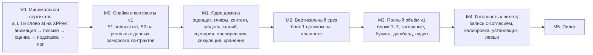

**Правила для задач и агентов:**
1. **Одна задача — одна сессия агента-кодера** (Sonnet): один модуль, одна ветка, один PR, один проверяемый результат. Если в задаче больше одного «и» — её делят.
2. **Критерии готовности — автоматические:** тесты, `pfl validate`, бенчмарк с порогом, снимок. Работа человека — отдельные задачи или пункты с метками:
   - `needs-human` — ревью форм, разметка, плейтест, решение;
   - `needs-hardware` — XPPen, камера, целевая машина с Windows 10 22H2.

   PR с такой меткой не сливается без отметки человека (A18).
3. **Входы и зависимости указаны явно.** Задача, которой нужны данные методиста, работает на фикстуре `tests/fixtures/pack-mini` (3 блока, 30 слов). Задача, которая наполняет пакет реальными данными, — отдельная.
4. **Контракты меняет только оркестратор.** До контрактов v1 (T0.9) интерфейсы живут в модулях; после — изменения через PR оркестратора и ADR. `EvaluationSummary` замораживается после S2 (T0.8). Педагогические контракты — после вертикали v0.
5. **Числа — только в `content/config`** со ссылкой на М § или с пометкой «инженерное стартовое значение».
6. **Golden-снимки оценщика принимает только оркестратор или человек** по отчёту `pfl golden diff`.
7. В описании PR перечисляются закрытые пункты [не проверено] этого документа.

### 12.2. V0 — минимальная вертикаль (первая веха, до заморозки контрактов)

**Цель:** за 1–2 недели получить на реальном XPPen цепочку «анимация → человек пишет букву → оценка → одна подсказка с наложением → лог пера». V0 заменяет S1-lite и S2-lite (решение оркестратора, A07).

**Объём:**
- буквы `a` (E-C, ретрейс), `i` (точка), `t` (перекладина) изолированно;
- затем слово `at` с альтернативой «соединение или отрыв».

**Не входит:** БД, планировщик, Leitner, правила, аудио, родительский режим.

| ID | Задача | Модуль | Входы | Готово, когда (авто) | Зависит | Метки |
|---|---|---|---|---|---|---|
| V0.1 | Скелет и CI | проекты `Core`, `Ink`, `Glyphs`, `Evaluation`, `Platform.Windows`, `Wpf.Controls`, `App.Wpf`, `Testing`, `Tools.Cli` + их тестовые проекты и `Architecture.Tests` | §2.1–2.4 | `dotnet build -warnaserror` и `dotnet test` зелёные на `windows-2025`; архитектурный тест R1/R4 падает на намеренно нарушающей фикстуре; BannedApiAnalyzers включён в доменных проектах; `pfl --version` | — | — |
| V0.2 | Геометрия | `Core.Geometry` | §2.2 | Безье, ресэмплинг, SG-фильтр; DTW (полный, индексная полоса, **полоса по x**, open-begin/end, многопризнаковый, путь, обращённый эталон) совпадает с наивной O(NM) на 1000 случайных входах; Венгерский — с перебором при n ≤ 7; Фреше; ошибка шага ресэмплинга < 1% | V0.1 | — |
| V0.3 | Ввод: модель, проекция, лог, воспроизведение | `Ink`, `Core` (`IContentSource`, `InMemoryContentSource`) | §3.1, §3.4, §3.7 | `PenLogReader/Writer` round-trip; `RulerProjection` и `SurfaceMapper` с фейковым DPI 1,0/1,25/1,5 (A12); `ReplayPenSource` на виртуальных часах ±1 мс | V0.1 | ∥ V0.2 |
| V0.4 | Глифы v0: схема, загрузчик, a/i/t, анимация, SVG | `Glyphs`, `schemas/`, `Tools.Cli` (`pfl render`) | §3.2 | загрузчик отвергает 10 некорректных фикстур с понятными сообщениями; `AnimationScript.StateAt(t)` монотонен (тест); SVG-снимок детерминирован | V0.2, V0.3 | `needs-human` (10 мин «похоже ли»), не блокирует |
| V0.5 | Перо в окне | `Platform.Windows`, `App.Wpf` (окно-холст) | §7.1–7.4 | `Win32PointerPenSource`: разворот истории и владение по `pointerId` — чистые функции с тестами на фейковых `POINTER_PEN_INFO`; клиппинг с флагом; `MousePenSource`; `WindowInkSuppressor`; окно без рамки на мониторе пера; тест `Interactive` с синтетическим указателем (nightly) | V0.3 | `needs-hardware`: протокол `docs/spikes/V0-hardware.md` — 200 Гц без потерь, давление, `WM_POINTER` при `DisableStylusAndTouchSupport`, кнопки пером, точность в 9 точках при 150%/100%, монитор пера; **запуск self-contained сборки .NET 10 на целевой машине с Windows 10 22H2** (риск K13) |
| V0.6 | Линейки, живые чернила, аниматор, dev-оверлей | `Wpf.Controls`, `App.Wpf` | §7.5 | горячий путь `LiveInkLayer` без аллокаций (тест: `GC.GetAllocatedBytesForCurrentThread` до и после 1000 пачек не меняется); тесты аниматора; запись penlog каждой попытки в dev-папку | V0.4, V0.5 | `needs-hardware`: замер «перо → пиксель» камерой 240 fps |
| V0.7 | Оценщик изолированной буквы v0 + SynthInk-lite | `Evaluation`, `Testing` | §6.4.1–6.4.2, §6.4.8, §6.4.10 | самооценка эталона: `form = 1.0`, ноль находок; мутации P1, P2, лишний штрих, D1, D4 находятся с верным кодом; на 50 чистых зашумлённых образцах каждой буквы нет ложных P1/P2; повторный вызов даёт тот же результат; ≤ 5 мс | V0.2–V0.4 | — |
| V0.8 | Подсказка и фиксированный сценарий | `App.Wpf` (+ временный класс `MiniFeedback`) | §5.4 (E01, E03, E04), М §7.3 | сценарий E01 → E03 ×3 → E04 ×2 для a/i/t; ViewModel-тест на `ReplayPenSource`: лог с мутацией P1 → ключ `fb.start` и подсветка старта; чистый лог → без подсказки или похвала | V0.6, V0.7 | `needs-human`: плейтест |
| V0.9 | InkLab v0: запись, повтор, разметка | `Tools.InkLab` | §2.2, §3.4 | вкладка «Запись» (список подсказок, копирование экранного эталона, метаданные субъекта) пишет валидный penlog; вкладка «Разметка» (границы букв, соединение, отложенные, «что написано») — round-trip файла разметки; тесты ViewModel | V0.3, V0.6 | `needs-human` + `needs-hardware`: 2 взрослых × 30 букв (a, i, t) + 20 × `at` (половина с отрывом на соединении, половина с перекладиной сразу), разметка |
| V0.10 | Слово `at` | `Glyphs` (`WordTemplateBuilder`, соединение JF1), `Evaluation` (`TargetAligner`) | §6.4.4–6.4.5, §6.4.8 | синтетика: отрыв на соединении → J1 и граница в пределах 0,2 x-h; перекладина сразу → D4 и **ни одного** J1; слитно → без J1. Корпусный тест (включается, когда есть разметка V0.9): границы ≤ 0,2 x-h в ≥ 90% из 20 записей; J1 только там, где размечен отрыв | V0.7 (+ данные V0.9 для корпусного теста) | — |
| V0.11 | Отчёт V0 и решения | `docs/spikes/V0-report.md`, ADR | V0.5–V0.10 | отчёт: задержка, точность, поведение `WM_POINTER`, качество DTW на реальных записях; статус ADR-003 и ADR-004 | все V0 | `needs-human` (оркестратор) |

**Параллельность:** V0.2 ∥ V0.3 → V0.4 ∥ V0.5 → V0.6 ∥ V0.7 → V0.8 ∥ V0.9 → V0.10 → V0.11.

**Что требует человека и железа:**
- прогон V0.5 и замер V0.6 на XPPen (целевая машина, Windows 10 22H2);
- плейтест V0.8;
- записи и разметка V0.9: 2 взрослых;
- решение V0.11.

### 12.3. M0 — спайки S1, S2 и контракты v1

**Новый дизайн S2** (решение оркестратора, A08):
- **Только реальные данные для go/no-go.** Взрослые **копируют экранный эталон**, поэтому эталон — истина, а глифам не обязательно быть точным ZB. С согласия родителей — 1–2 ребёнка.
- **Набор букв** `a c d e i l m n o r s t u w` + пробные `т и п д ш` в `ru-propis`. Есть m (тест «гребёнки») и s (блок 1).
- **Слова** (20–25): `an in on it at sat tin net ten ant sand stand minimum mint dot cat wet sun nest little letter window tired moon` и т. п.
- **Объём:** ≥ 300 верных слов (например, 4 взрослых × 25 слов × 3 повтора) + ≥ 150 слов с намеренными ошибками: т на месте t, ш на месте sh, замена гласной, пропуск, удвоение, лишний горб, отрыв на каждом соединении, точка сразу, переписанная буква.
- **Метрики:**
  - точность границ;
  - **распределение отрыва** локальной стоимости верной гипотезы от лучшей ложной;
  - доля ложных L (любой стоп-класс) на верных словах с 95% интервалом Уилсона;
  - верный тип ошибки при одной правке;
  - доля `U0`;
  - устойчивость к J1, D4-сразу и K4;
  - время.
- **Решающее правило записывается до прогона** (T0.4c, файл `docs/spikes/S2-protocol.md`; его хеш попадает в отчёт).

**Решающее правило S2** (стартовая редакция, фиксируется в T0.4c):

| Исход | Условие (на реальных данных взрослых) | Последствие |
|---|---|---|
| **GO** — побуквенная оценка слов | границы < 0,2 x-h в ≥ 90%; ложные L на верных словах ≤ 3% и верхняя граница Уилсона ≤ 5%; верный тип при одной правке ≥ 85%; ложных J1 на отрывах `LiftExpected` нет; диктант ≤ 300 мс | оценщик v1 по §6; заморозка `EvaluationSummary` |
| **PARTIAL** — запасной план | границы не проходят, но **ранжирование слов целиком** (T0.5) выполняет требования FR-1 по ложным L и типу ошибки | диктант и копирование оцениваются ранжированием; подсказки формы букв в словах выключены; буквы и пары — полностью |
| **NO-GO** | ни один вариант не выполняет FR-1 | исследовательская задача «общая решётка / больше данных»; диктант временно оценивается через E13 и выбор без письменного разбора; пересмотр плана с заказчиком |

| ID | Задача | Модуль | Готово, когда (авто) | Зависит | Метки |
|---|---|---|---|---|---|
| T0.1 | InkLab «Зонд»: полный S1 | `Tools.InkLab`, `Platform.Windows` | две вкладки-источника (Win32, WPF Stylus) с графиками частоты, джиттера и давления; журнал hot-plug и смены дисплея; журнал express keys; тест задержки NAudio; паттерн для камеры; генератор markdown-отчёта по журналу (тест на фикстуре журнала) | V0.11 | `needs-hardware`: прогон чек-листа на Windows 10 22H2 (целевая машина; Windows 11 — позже); режим левой руки в драйвере — низкий приоритет |
| T0.2 | Глифы для S2 | `content/styles/zaner-bloser`, `ru-propis` | 14 строчных + 5 русских (пробные); правила JF; варианты e, r, s после X-HIGH; `pfl validate` и самооценка проходят; SVG пар — артефакт | V0.11 | `needs-human`: ревью форм (30 мин) |
| T0.3 | SynthInk v1 | `Testing` | все мутации §10.3 (кроме фраз) с разметкой; детерминизм по seed | V0.10, T0.2 | ∥ T0.1 |
| T0.4a | Выравнивание общих слов | `Evaluation` | `TargetAligner` для любых слов: альтернативы соединения и break, полоса по x, уверенность границ, исправления (§6.4.3–6.4.5); синтетика: границы ≤ 0,2 x-h в ≥ 95% чистых образцов, ни одного J1 на `LiftExpected` | T0.3 | — |
| T0.4b | Локальные гипотезы и решение | `Evaluation` | `HypothesisScorer` (§6.4.6–6.4.7): окна, нормировка, отрыв, классы L1/L2/L2m/L3/L4/L5/L5v, ≤ 2 правки, `U0`; синтетика по `synthetic-thresholds.json`; лишний горб → L2m или форма, не L2; диктант ≤ 100 мс (бенчмарк) | T0.4a | — |
| T0.4c | Протокол и отчёт S2 | `Tools.Cli` (`pfl s2-report`), `docs/spikes/S2-protocol.md` | протокол с решающим правилом закоммичен; отчёт считает все метрики S2 по корпусу и разметке, выводит исход по правилу, интервалы Уилсона; тест на фикстуре корпуса | T0.4b | `needs-human`: утверждение протокола оркестратором **до** T0.6 |
| T0.5 | Запасной вариант: ранжирование слов целиком | `Evaluation` (`WordRanker`) | §6.10; та же матрица синтетики; включён в `s2-report` как второй столбец | T0.4a | ∥ T0.4b |
| T0.6 | Записи S2 | `tests/corpus/adults` | ≥ 300 верных слов + ≥ 150 с намеренными ошибками по протоколу; `pfl validate-corpus` проходит | T0.2, T0.4c, V0.9 | `needs-human` + `needs-hardware` |
| T0.7 | Разметка S2 | `tests/corpus/labels` | вся разметка валидна; согласие двух разметчиков по границам на 10% выборки (отчёт) | T0.6 | `needs-human` |
| T0.8 | Прогон S2 и решение | `docs/spikes/S2-report.md`, ADR-005/007 | отчёт `s2-report` по протоколу; ADR обновлены; исход GO / PARTIAL / NO-GO | T0.4c, T0.5, T0.7 | `needs-human` (оркестратор) |
| T0.9a | Контракты v1: педагогическая сторона | новые проекты `Curriculum`, `Learner`, `Lesson`, `Reporting`, `Application`, `Infrastructure` (заготовки) | `AttemptContext`, `AttemptFacts`, `TaskSpec`, `IExerciseHost`, `IExerciseScenario`, `FeedbackPlan`, порты `Application`, `IContentSource`, `IWordAnalyzer`; XML-документация; round-trip DTO; граф зависимостей §2.3 в архитектурном тесте | V0.11 | ∥ S2; `needs-human` (оркестратор утверждает) |
| T0.9b | Контракты v1: фасад оценщика | `Evaluation.Abstractions` (выделение из `Evaluation`) | `EvaluationSummary`, `EvaluationRequest`, `HypothesisRuleSet`, `IEvaluatorFactory`; архитектурный тест «потребители не ссылаются на `EvaluationDetail`» | T0.8 | `needs-human` (оркестратор) |

### 12.4. M1 — ядро домена

Если S2 дал PARTIAL, задачи T1.1–T1.2 сокращаются до метрик изолированных букв и пар, а T1.6 строит прогресс по ранжированию слов.

| ID | Задача | Модуль | Готово, когда (авто) | Зависит | Метки |
|---|---|---|---|---|---|
| **Оценщик** | | | | | |
| T1.1 | Метрики букв по контексту (FR-3), число горбов | Evaluation | таблица контекстов §6.4.9 покрыта тестами; мутации F*/P6 по матрице | T0.9b | — |
| T1.2 | Соединения J1–J4, метрики слова F5–F8, наклон по руке | Evaluation | мутации J2/J3; F6 для левши с вертикалью не даёт находки (тест) | T0.9b | ∥ T1.1 |
| T1.3 | Беглость K1–K4 | Evaluation | аналитические синтетические профили скорости дают точные NIV, паузы и отрывы | T0.9b | ∥ |
| T1.4 | Пографемное выравнивание и коды L | Evaluation | графемы с `at` (включая `a_e` на фикстуре); `GraphemeScore` | T0.9b | ∥ |
| T1.5 | `form`, загрузка `scoring.json`, фабрика, кеш эталонов | Evaluation | веса по профилю; `ConfigHash` в `EvaluatorInfo`; кеш потокобезопасен (тест с 8 потоками) | T1.1, T1.17 | — |
| T1.6 | Живой монитор | Evaluation | прогресс с ошибкой ≤ 10% на синтетике, по цели и гипотезам; сигналы P1/P2 на пути ≤ 0,3 x-h; ложные сигналы ≤ 1% | T0.9b | ∥ |
| T1.7 | Снимки решений корпуса, `pfl golden diff`, защита `accept` | `Evaluation.Corpus`, Tools.Cli | снимки решений с допусками; `golden accept` без отчёта и метки отказывает (тест) | T0.8 | — |
| **Глифы** | | | | | |
| T1.8 | InkLab «Глифы» | Tools.InkLab | подложка (изображение или шрифт), рисование пером → Безье, правка порядка, ретрейса, ключевых точек, стрелок, меток; сохраняет валидные файлы (тест сохранения) | V0.9 | — |
| T1.9 | ZB строчные: 26 + варианты | content | валидатор; SVG 26 × 26 пар; `pairOverrides` | T1.8 | `needs-human` (методист + исполнитель с планшетом; нужна пропись для сверки, вопрос В3) |
| T1.10 | `ru-propis` полностью | content | все буквы из `traps.json`; классы входа и выхода | T1.8 | `needs-human` |
| T1.11 | Печатный стиль 52 буквы | content | валидатор; SVG | T1.8 | `needs-human` (ревью) |
| **Контент и конфигурация** | | | | | |
| T1.12 | Модель и загрузка контент-пакета, правила `pfl validate` | Curriculum, Tools.Cli | проверки: буквы слова по блоку, «пары ловушек не в одном блоке», сложность, аудио (полнота по каждому `audioAccents`), картинки и метаданные `media.json` (§3.3.1), каталог E-кодов ↔ сценарии; фикстура `pack-mini` | T0.9a | — |
| T1.13 | `StyleWordAnalyzer` (A14) | Glyphs | буквы, пары, JF, ожидаемые отрывы слова — тесты на 20 словах | T0.9a, T0.2 | ∥ |
| T1.14 | Данные пакета: блоки B1–B3 | content | `pfl validate` зелёный | T1.12 | `needs-human` (сверка методистом) |
| T1.15 | Данные пакета: B4–B7, заглавные, рифмы, гласные, ловушки, гипотезы, графемы, темы, диагностика, итог, листы | content | `pfl validate` зелёный | T1.12 | `needs-human` |
| T1.16 | Строки RU/EN | content/locales, Application | проверки CI §8.2 | T0.9a | `needs-human` (вычитка) |
| T1.17 | Конфигурация (§3.6), владелец ключа, `ExperimentResolver` | content/config, Core, Tools.Cli | каждый ключ — в одном файле (тест валидатора); снимок и хеш; разрешение условий эксперимента (табличный тест) | T0.9a | ∥ |
| **Модель знаний** | | | | | |
| T1.18 | Карточки, Leitner, классификатор исхода (две оси, мягкие процессные ошибки) | Learner | табличные тесты М §8.3 | T0.9a, T1.17 | — |
| T1.19 | `AttemptFactsBuilder` и неявное зачисление | Learner | диктант — две оси, копирование — исполнение, только готовые карточки, раз в день; бумага не меняет коробки | T1.18 | — |
| T1.20 | Правила статусов: буква, заглавная, соединение, слово, диграф; понижения | Learner | табличные тесты М §8.2 v1.1 (включая сниженный критерий заглавных) | T1.18 | ∥ T1.19 |
| T1.21 | Опора, задержки памяти, статистика пауз | Learner | переходы М §4.1 (адаптивный режим); `PauseStats` по видам упражнений | T1.18 | ∥ |
| T1.22 | `RepairCycleMachine` | Learner | сценарии §4.7; флаг после 3 циклов | T1.18 | ∥ |
| T1.23 | `BlockGate` и `CourseCalendar` | Learner | скользящий шлюз; мягкий шлюз; ускорение ≤ 1 недели; заглавные по событию B6; сокращённый трек; итог по событию; продление до 16 | T1.20, T1.17 | — |
| T1.24 | Сводные показатели и алерты | Learner | М §9.3 и М §9.7: табличные тесты | T1.19 | ∥ |
| **Урок** | | | | | |
| T1.25 | Ядро упражнений | Lesson.Exercises, Testing | примитивы, `IExerciseHost`, `ScenarioRegistry`, `ExerciseSteps`, `params.json`, `ScriptedExerciseHost`, `CompletionPolicy` (FR-4: тесты на логах с длинными паузами) | T0.9a | — |
| T1.26 | Моторные сценарии: E01–E06, E10, E11, E23, E29 | Lesson.Exercises | каждый сценарий исполняется на фейк-хосте (тест на код) | T1.25 | — |
| T1.27 | Письмо по звуку и словам: E07–E09, E12, E13, E15–E18, E20 | Lesson.Exercises | то же; U0 → одна повторная попытка (E16) | T1.25 | ∥ T1.26 |
| T1.28 | Чтение и звуки: E14, E14a, E19, E21, E22, E26, E32, E33, E36 | Lesson.Exercises | то же | T1.25 | ∥ |
| T1.29 | Служебные: E24, E25, E27, E28, E30, E31, E34, E35 | Lesson.Exercises | то же; спринт изученного `MeasurementOnly` | T1.25 | ∥ |
| T1.30 | `FeedbackPlanner` | Lesson.Feedback | приоритет; стоповость по режиму; частота ±1 ступень за сессию; смена способа после 3 повторов; перегрузка; D4 мягко; `Low`/`U0` без негатива; условия эксперимента | T0.9a, T1.17 | ∥ |
| T1.31 | `SessionPlanner` | Lesson.Session | структура regular/practice/check; покрытие карточек словами (жадно); правило нагрузки и нового; допуск слов; перемешивание; выборы; финал на успехе; ≤ 20 мин; 20 снимков планов | T1.18–T1.23, T1.13 | — |
| T1.32 | `SessionRuntime` | Lesson.Session | повтор через 2–4; U0 — один повтор; усталость (нормированная); `WritingTimeTracker` → E28; `FirstEncounterPlan`; checkpoint | T1.31 | — |
| T1.33 | `FinalCheckPlanner`, виды final и retest | Lesson.Session | §4.9: состав по `final-check.json`, суммарный итог | T1.31 | ∥ T1.32 |
| **Симуляция** | | | | | |
| T1.34 | Виртуальные ученики и `pfl simulate` (быстрый режим) + проверки в CI | Testing, Tools.Cli | 6 профилей × 16 недель; `simulation-expectations.json` §10.6 зелёный на `pack-mini`, затем на реальном пакете | T1.32, T1.23 | `needs-human` (методист смотрит отчёт) |
| **Хранение и прикладной слой** | | | | | |
| T1.35 | Схема, миграции, резервные копии | Infrastructure | миграции с нуля; снимок схемы; копия перед миграцией | T0.9a | — |
| T1.36 | Репозитории: профили, настройки, согласия, сессии, задания, попытки и находки, состояния, паузы, вехи | Infrastructure | тесты на временной SQLite; один пишущий поток | T1.35 | — |
| T1.37 | Репозитории: бумага, спринты, алерты, достижения, коллекция с миниатюрами, диагностика, записи; отзыв согласия; удаление профиля | Infrastructure | **без согласия `ink_blobs` и `recordings/` пусты** (тест); каскады | T1.35 | ∥ T1.36 |
| T1.38 | `FileContentSource`, экспорт и импорт ZIP, PIN | Infrastructure | импорт экспорта даёт ту же БД | T1.35 | ∥ |
| T1.39 | PDF и font resolver | Infrastructure | PDF открывается (проверка структуры PDFsharp); кириллица встроена; снимок SVG того же документа | T1.41 | ∥ |
| T1.40 | `LessonService`: сборка `HypothesisRuleSet`, шлюз оценки, условия эксперимента, checkpoint и продолжение | Application | урок блока 1 целиком без UI (фейки + SQLite); «убийство» после задания → продолжение | T1.32, T1.36, T0.9b | — |
| T1.41 | `WorksheetBuilder` (все виды §8.3) + SVG | Reporting | снимки SVG раскладки для каждого вида | T0.9a, T1.13 | ∥ |
| T1.42 | `PaperService`, `DiagnosticService`, `RecordingService` | Application | сценарные тесты; `RecordingService` ничего не пишет без согласия | T1.40, T1.41 | — |
| T1.43 | `DashboardBuilder` и рекомендации | Reporting, Application | снимки DTO; иллюстрации ошибок по `TemplateSpan` | T1.24 | ∥ |

### 12.5. M2–M5

| ID | Задача | Модуль | Готово, когда (авто) | Зависит | Метки |
|---|---|---|---|---|---|
| **M2. Блок 1 на планшете** | | | | | |
| T2.1 | Продуктовый источник ввода по ADR-003, наблюдение за устройством, hot-plug | Platform.Windows | тесты конечного автомата устройства; синтетический указатель (nightly) | T0.1 | `needs-hardware` |
| T2.2 | Оболочка, навигация, профили, главная | App.Wpf | ViewModel-тесты | T1.40 | ∥ |
| T2.3 | Экран урока + `ExerciseHostAdapter` + представления примитивов блока 1 | App.Wpf | урок блока 1 на `ReplayPenSource` (ViewModel-тест) | T2.2, V0.6 | — |
| T2.4 | `NAudioService`, каталог, предзагрузка; `pfl assets` для блока 1 | Platform.Windows, Tools.Cli | манифест валиден; отсутствующий клип не роняет урок (тест) | T1.16 | ∥ |
| T2.5 | Родительский раздел (минимум): PIN, профили, настройки, согласие (выкл.), E29 (выкл.) | App.Wpf | ViewModel-тесты | T1.37 | ∥ |
| T2.6 | Мастер настройки: Windows Ink, монитор, мм, плёнка, школьный английский, имя | App.Wpf, Platform | проходит на `MousePenSource` (тест сценария) | T2.1 | `needs-hardware` |
| T2.7 | Завершение: «Дописал?», «Заново», прогресс | App.Wpf | тесты на логах с длинными паузами | T1.6, T2.3 | — |
| T2.8 | UI smoke (FlaUI) | UiTests | 5 сценариев зелёные в nightly | T2.3–T2.7 | — |
| T2.9 | Полная симуляция блока 1 (SynthInk → оценщик) | Testing | отчёт без деградации против быстрого режима | T1.34, T1.5 | ∥ |
| T2.10 | Плейтест блока 1 | — | список проблем, замер задержки, вывод по `T_end` | T2.1–T2.7 | `needs-human` + `needs-hardware` |
| **M3. Полный объём v1** | | | | | |
| T3.1 | Заглавные 26 | content | валидатор, SVG | T1.8 | `needs-human` |
| T3.2 | Представления: фишки, выбор лучшей, повтор, контраст, полоска алфавита, мини-текст | App.Wpf | ViewModel-тесты по примитиву | T2.3 | ∥ |
| T3.3 | Представления: самоотметка, подтверждение родителя, бумажный ввод, иллюстрация | App.Wpf | то же | T2.3 | ∥ |
| T3.4 | Оценка фраз и спринтов | Evaluation | §6.4.12; синтетика фраз | T1.5 | ∥ |
| T3.5 | Диагностика: поток UI | App.Wpf, Application | сценарный тест | T1.42, T3.2 | — |
| T3.6 | Бумага: недельный PDF, диктовка, чек-лист, тест читателя, фото | App.Wpf | сценарный тест | T1.42, T3.3 | — |
| T3.7 | Аудио en-GB: TTS SSBE для всех слов, фраз и названий букв (z = /zed/); фонемы | content/audio, Tools.Cli | манифест полон для `accent: en-GB`; лицензия каждого голоса и записи указана | T1.15 | `needs-human` (выбор голосов SSBE слепым прослушиванием, лицензии, запись фонем диктором) |
| T3.8 | Картинки к словам | content/media, `media.json` | у каждого слова картинка или `image: null`; метаданные источника полны; `pfl validate` зелёный | T1.15, T3.14 | `needs-human` (добавление вручную или выбор кандидатов) |
| T3.9 | Дашборд, экраны прогресса ребёнка, достижения | App.Wpf | ViewModel-тесты | T1.43 | ∥ |
| T3.10 | Коллекция слов с миниатюрами; E26 и E19 | App.Wpf, Ink | миниатюра ≤ 2 КБ, без времени и давления (тест кодека) | T1.37 | ∥ |
| T3.11 | Экспорт, резервные копии, диагностический пакет | App.Wpf | сценарные тесты | T1.38 | ∥ |
| T3.12 | Итоговая и повторная проверка, отчёт об овладении | App.Wpf, Reporting | сценарный тест | T1.33, T3.6 | — |
| T3.13 | Сверка с методикой v1.2 и полная симуляция на реальном пакете | content, Testing | `pfl validate` + `pfl simulate` зелёные | T1.14, T1.15, T1.34 | `needs-human` (методист) |
| T3.14 | `pfl images suggest / pick / add` (§3.3.1) | Tools.Cli (`Tools.Cli.Images`) | клиент Perplexity за интерфейсом `IImageSearch`; тесты с подменным `HttpMessageHandler` (сети в CI нет); ключ только из `PERPLEXITY_API_KEY`, отсутствие ключа — понятная ошибка; ключ не попадает в вывод и логи (тест); нормализация картинки; запись `media.json`; архитектурный тест R3 разрешает сеть только здесь | T1.12 | `needs-human`: проверить эндпойнт и параметры Perplexity по документации, один ручной прогон с ключом |
| **M4. Готовность к пилоту** | | | | | |
| T4.1 | Режим записи с согласием, исследовательский экспорт | Application, App.Wpf | без согласия файлов нет; отзыв удаляет (тесты) | T3.11 | `needs-human` (текст согласия) |
| T4.2 | InkLab «Эксперт», отчёт κ | Tools.InkLab | отчёт по корпусу | T1.7 | — |
| T4.3 | `pfl calibrate` | Tools.Cli | предложение конфигурации + отчёт §6.7 | T4.2 | — |
| T4.4 | Установщик (без подписи), обновление поверх версии | build/ | установка без прав администратора; обновление сохраняет данные (проверка на целевой машине с Windows 10 22H2) | M3 | `needs-hardware` (целевая машина Win10) |
| T4.5 | Аппаратный чек-лист | docs/qa | все пункты §10.9 | T4.4 | `needs-human` + `needs-hardware` |
| T4.6 | Бюджеты на целевом ПК | — | §11.1 выполнен или заведены задачи | T4.4 | `needs-hardware` |
| T4.7 | Аудит лицензий, «О программе» | build/, App.Wpf | отчёт по лицензиям NuGet; атрибуции (OFL, CC BY, голоса, картинки из `media.json`); список картинок с `license: unknown` | T4.4 | — |
| T4.8 | Фаза 0 калибровки | content/config | метрики §6.8 на взрослых; конфигурация v1 | T4.3 | `needs-human` (взрослые; 1–2 ребёнка при согласии; 2–3 эксперта) |
| T4.9 | Левши: зеркальная раскладка, сигнал вне руки, проверка наклона | App.Wpf, Evaluation | ViewModel-тесты раскладки; синтетика левши без ложных F6 | M3 | низкий приоритет (ребёнок правша) |
| **M5. Пилот** | | | | | |
| T5.1 | Пилот выполнимости (М §12.1) | — | данные, решения, конфигурация v1.x | M4 | `needs-human` |

**Критический путь:** V0.1 → V0.2 → V0.4 → V0.7 → V0.10 → T0.3 → T0.4a → T0.4b → T0.4c → [T0.6 → T0.7: люди] → T0.8 → T0.9b → T1.1 → T1.5 → T2.9.

Параллельно с S2 идут T0.9a и вся педагогическая часть M1 (T1.12–T1.38 на фикстуре), так что M1 не ждёт S2 целиком.

### 12.6. Что требует человека или железа (сводно)

| Работа | Кто | Когда |
|---|---|---|
| Прогоны на XPPen: V0.5, V0.6, S1 (T0.1), плейтест, чек-лист — на целевой машине с Windows 10 22H2 | человек с планшетом, камера 240 fps | V0, M0, M2, M4 |
| Записи взрослых (копирование экранного эталона) и разметка | 2–4 взрослых, разметчик | V0.9, T0.6–T0.7 |
| Утверждение протокола S2 и решение по нему | оркестратор | T0.4c, T0.8 |
| Ревью форм; создание ZB-строчных, заглавных и русских глифов пером | методист + исполнитель с планшетом | T0.2, T1.9–T1.11, T3.1 |
| Пропись для сверки форм (М D29) | заказчик | до T1.9 |
| Выбор голосов TTS SSBE, проверка лицензий, запись фонем диктором | человек | T3.7 |
| Картинки: добавить вручную или выбрать кандидатов `pfl images suggest` (ключ Perplexity — свой, в переменной окружения) | человек | T3.14, T3.8 |
| Экспертная оценка, фаза 0, пилот | эксперты, родители, дети | M4–M5 |

---

## 13. Риски и открытые вопросы

### 13.1. Риски

| # | Риск | Вероятность / влияние | Меры |
|---|---|---|---|
| K1 | Сегментация слов на реальном письме недостаточна | средняя / **критическое** | V0.10 рано показывает качество на `at`; S2 на реальных данных с правилом, зафиксированным заранее; запасной вариант с ранжированием слов целиком уже реализован (T0.5); уверенность границ; `Low` → без негатива |
| K2 | Ложные стоп-ошибки демотивируют ребёнка (М R14) | средняя / высокое | требования §6.8 (≤ 3% ложных L, ≤ 2% ложных P); `processErrorsHard = false`; класс `L2m` без стопа; в копировании L2 не стоп; локальное сравнение гипотез |
| K3 | Гипотезы диктанта путаются или их не хватает | средняя / высокое | локальный отрыв в нормированных единицах; `U0` без наказания; набор правил — данные; распределение отрыва измеряется в S2 |
| K4 | Нет прописи для сверки форм; создание 52 + 21 глифа занимает долго | высокая / высокое | V0 и S2 не зависят от точности ZB (взрослые копируют экранный эталон); вкладка «Глифы»; процедурные соединения; вопрос В3 |
| K5 | `WM_POINTER` не приходит в hook при отключённом стилусе или WISP зависает при hot-plug | средняя / высокое | проверяется уже в V0.5; два источника за одной абстракцией; ADR-003, вариант Б |
| K6 | Задержка или смещение при смешанном DPI | средняя / высокое | физические px без двойного масштабирования (A12); тест с синтетическим указателем; мм-калибровка; замеры V0.5–V0.6 |
| K7 | Методика продолжит меняться | высокая / среднее | числа в JSON; правила — небольшие C#-классы с табличными тестами; симулятор в CI |
| K8 | Расхождение контрактов при параллельной работе агентов | средняя / среднее | контракты по работающему коду (после V0); узкий фасад оценщика; архитектурные тесты; изменения только через оркестратора |
| K9 | Качество или лицензия TTS-голоса SSBE (мало открытых британских голосов, региональный акцент, гортанная смычка вместо конечного /t/) | средняя / среднее | 2–3 кандидата, слепое прослушивание по требованиям §8.1; фонемы — только запись человеком; лицензия в манифесте и аудит (T4.7); слова без приемлемого клипа — запись человеком |
| K10 | Юридическое: товарный знак и формы прописи | низкая (своя семья) / низкое | «Американская пропись» в UI; собственные глифы; сканы — только внутренняя подложка, не в продукт (М D29) |
| K11 | Утечка детских данных | низкая / высокое | без согласия траектории не сохраняются; миниатюры — без времени и давления; детский корпус вне публичного репозитория |
| K12 | Слабый ПК не держит бюджеты | низкая / среднее | DTW с полосой, локальные окна, кеш; бенчмарки; вопрос В1 |
| K13 | Основная платформа — Windows 10 22H2, а .NET 10 официально не включает её в матрицу поддержки; сама ОС вне поддержки Microsoft с 14.10.2025; CI на GitHub не умеет Windows 10 | низкая (технически то же ядро, что 21H2) / высокое (это основная платформа) | self-contained сборка с фиксированной версией рантайма — от установленного .NET не зависим; **ранняя проверка на целевой машине в V0.5**; ручной прогон §10.9 на целевой машине перед каждым релизом; остаёмся на .NET 10 (технически работает); при проблеме — разбор в отчёте V0 (V0.11) и решение оркестратора |
| K14 | FlaUI и синтетический указатель нестабильны на раннерах | средняя / низкое | nightly и `Interactive`; логика покрыта тестами ViewModel и `Application` |
| K15 | Задачи агентов окажутся крупнее одной сессии | средняя / среднее | правило «одно „и“ — делим»; оркестратор режет задачу при первой неудаче; фикстуры вместо ожидания данных |
| K16 | Картинки из поиска: неизвестная лицензия, неподходящее содержание | средняя / низкое (только своя семья) | выбор каждой картинки человеком; источник и лицензия в `media.json`; отчёт о `license: unknown` (`pfl validate`, T4.7); перед передачей за пределы семьи — замена на свои или свободные |
| K17 | Perplexity API: утечка ключа, изменение API, цена | низкая / низкое | ключ только в переменной окружения, тест «ключ не в выводе»; только авторинг, рантайм не зависит; запасной путь — `pfl images add` вручную |

### 13.2. Вопросы к заказчику

**Закрыты решениями заказчика** (текущая версия):

| # (v1.0) | Вопрос | Решение |
|---|---|---|
| A2 | подпись кода | не нужна — программа для своей семьи |
| A3 | название стиля в UI | «Американская пропись»; внутренний id `zaner-bloser` |
| A4 | аудио (изм. v1.2) | слова и фразы — открытый нейро-TTS при сборке, **голос SSBE** (лицензия допускает личное использование); изолированные звуки — запись человеком; русской озвучки в v1 нет |
| A7 | рука ребёнка | правша; поддержка левшей — позже (T4.9) |
| A10 | распространение | только своя семья |
| A12 | школьный английский (изм. v1.2) | УМК И. Н. Верещагиной (М Q1 закрыт); данные о школе — в мастере настройки (`school_english_json`), опция «школьная подсказка» (М §1.3, §7.9) |
| — | произношение (v1.2) | британское (SSBE), `accent: "en-GB"` в пакете (М D46, ADR-026) |
| — | целевая ОС (v1.2) | Windows 10 22H2 — основная сейчас, Windows 11 — позже (ADR-001) |
| В4 | картинки к словам (закрыт в v1.2) | вручную или подбор через Perplexity API на этапе авторинга (`pfl images`), ключ пользователя в переменной окружения; картинки с метаданными источника — в пакете; рантайм офлайн (§3.3.1, ADR-025) |

**Открыты:**

| # | Вопрос | Зачем | Предложение по умолчанию |
|---|---|---|---|
| В1 | Характеристики целевого ПК (CPU, RAM, ноутбук или настольный) | бюджеты §6.9, §11.1 | 4 ядра, 8 ГБ, 2018 г. и новее |
| В2 | Без согласия на запись чернила не сохраняются. Можно ли по тому же правилу, что для коллекции слов (упрощённая миниатюра без времени и давления, удаляется с профилем), хранить ещё (а) печатные буквы диагностики с процессной ошибкой — для E06 «так рука привыкла» — и (б) «лучшую строчку дня» для родителя (М §10)? | М §4.5, §10 против D26 | разрешить (а) и (б) как миниатюры; иначе E06 показывает иллюстрацию на эталоне, а лучшая строчка живёт только в сессии |
| В3 | Пропись для сверки форм (М D29): какое издание, есть ли страницы или сканы для внутренней подложки | блокер T1.9 и T3.1 | класс 2–3; если прописи нет — подложка Playwrite US Trad (OFL) + ревью методиста |
| В5 | Нужна ли жёсткая блокировка выхода из урока (хук клавиатуры) | киоск | только защита от закрытия |
| В6 | Пилот: кто кроме своей семьи (М §12.1: 3–5 детей) и кому передаются исследовательские записи | текст согласия, приватность | при пилоте вне семьи — отдельное согласие каждой семьи; экспорт анонимизированный, на носитель |
| В7 | Нужен ли родительский экран на основном мониторе во время урока | второе окно | да, отдельное окно после PIN |

---

## 14. Журнал архитектурных решений (ADR)

Полные тексты — `docs/adr/ADR-NNN-*.md`. Ниже: контекст → решение → последствия. Пометка «(изм. v1.1)» — решение пересмотрено.

| ADR | Контекст | Решение | Последствия |
|---|---|---|---|
| **ADR-001** Стек и платформа (изм. v1.2) | ввод пера на Windows, офлайн, тестируемое ядро; целевая машина семьи — Windows 10 22H2 (решение заказчика v1.2); .NET 10 официально не включает потребительскую Windows 10 22H2 в матрицу | .NET 10 LTS + WPF, self-contained. **Основная платформа — Windows 10 22H2 (сейчас), Windows 11 — позже.** Запасной UI — Avalonia | поддержка .NET 10 до 11.2028; принятый риск K13: ранняя проверка на целевой машине в V0.5, ручной прогон перед релизом (CI Windows 10 не умеет) |
| **ADR-002** Чистое ядро, 14 сборок (изм. v1.1) | параллельная работа агентов, детерминизм; v1.0 — 20 сборок | доменные `net10.0` без UI, IO, часов и RNG; `IContentSource` в `Core`; `Exercises`, `Feedback` и `Session` слиты в `Lesson`; `Audio`/`Localization` — порты в `Application`; PDF — в `Infrastructure` | меньше csproj; границы по пространствам имён проверяются тестом |
| **ADR-003** Источник ввода | у WPF Stylus нет времени у каждой точки и есть риск при hot-plug | `Win32PointerPenSource` (основной кандидат) с владением по `pointerId`; `WpfStylusPenSource` — запасной; Wintab вне плана | подтверждается в V0.5/S1; вариант Б — Stylus и пересоздание окна при hot-plug |
| **ADR-004** Отрисовка | бюджет ≤ 1 кадра | собственный `LiveInkLayer` без аллокаций в горячем пути; `SustainedLowLatency` на время попытки; `DynamicRenderer` — только со Stylus | замер в V0.6 |
| **ADR-005** Выравнивание (изм. v1.1) | глобальная решётка дорога и плохо определена (A09); пропущенное соединение ломает DTW (A03) | **v1: DTW по цели с полосой по x**; соединение — альтернатива «геометрия или отрыв»; break — «отрыв или слитно»; ожидаемый отрыв у точки или перекладины, поставленной сразу; ML в рантайме нет | общая решётка — только если S2 потребует |
| **ADR-006** Факты отдельно от решений | педагогика меняется чаще геометрии | оценщик — метрики и коды; стоповость (по режиму и контексту), приоритет, исход — `Lesson.Feedback`/`Learner` по `errors.json` | калибровка педагогики без переоценки |
| **ADR-007** Гипотезы диктанта (изм. v1.1) | М FR-1; глобальный порог зависел от длины слова (A04) | **локальные окна «буква ± 1»**, стоимость нормирована на точки рукописи, абсолютный отрыв; ≤ 2 правки в разных окнах; класс **L2m** (m/n, u/w, e/l) без стопа; в копировании L2 не стоп; `U0` без наказания | `HypothesisRuleSet` разрешается в `Application` из данных пакета |
| **ADR-008** Стиль-пакеты | стиль подключаемый (М §3.1) | JSON-глиф на файл; классы E-*/X-*/JF*; процедурные соединения; роли teach/print/confuser; моторные семьи в стиле | новый стиль без кода, кроме новой формы соединения |
| **ADR-009** Упражнения — C#-сценарии (изм. v1.1) | шаблоны JSON требовали языка выражений (A15) | `IExerciseScenario` над общими примитивами `IExerciseHost`; числа — в `params.json`; каталог E-кодов сверяется с реестром | новое упражнение — небольшой класс + тест; язык выражений не нужен |
| **ADR-010** Слоёная конфигурация (изм. v1.1) | пороги калибруются; дубли ключей (A25); эксперименты пилота (A21) | слои + `ConfigHash`; **один владелец каждого ключа**; `experiments.json` с назначениями «профиль × элемент × дата», условия пишутся в попытку | воспроизводимость; пилотные условия без кода |
| **ADR-011** Правила модели знаний (изм. v1.1) | DSL правил — лишняя сложность (A15); правила v1.1 устоялись | статусы, шлюзы, календарь, цикл исправления — **C#-классы**, числа в `learner.json`/`course.json`; табличные тесты + симуляция | новое число — данные; новое правило — код с тестом |
| **ADR-012** Приватность траекторий (изм. v1.1) | М D26, FR-8; v1.0 хранил «операционные» чернила без согласия (A01) | **без согласия сырые траектории только в памяти сессии**; в БД — `EvaluationSummary` с местами на эталоне; дашборд — иллюстрации на эталоне; с согласием — `ink_blobs` и `recordings/` | переоценка истории только по записям с согласием; checkpoint без чернил |
| **ADR-013** Локализация JSON | язык UI — данными | `locales/<lang>.json`, ключи в домене; `audio` у фраз необязателен (русской озвучки нет) | отклонение от `.resx` из 03 |
| **ADR-014** Аудио (изм. v1.2) | решение заказчика: британское произношение (М D46) | слова и фразы — открытый нейро-TTS при сборке, **голос SSBE**; фонемы — запись человеком; NAudio + NVorbis; русской речи нет | лицензии голосов в манифесте; акцент — поле данных (ADR-026) |
| **ADR-015** PDF и SVG из одной геометрии | листы и ревью совпадают с экраном | `WorksheetDocument` → SVG (тесты) и PDF (PDFsharp 6.2.x, MIT, `net10.0` [проверено]) с font resolver и Noto Sans | один недельный PDF |
| **ADR-016** SQLite + миграции вперёд | сбои питания, обновления | WAL, SQL-миграции с контрольными суммами, копия перед миграцией | fixture-БД каждой версии |
| **ADR-017** Установщик (изм. v1.1) | своя семья | Inno Setup, per-user, self-contained, **без подписи** | инструкция по SmartScreen |
| **ADR-018** Детерминированный планировщик | тесты, симуляция, разбор жалоб | `Plan(input, seed)` — чистая функция; адаптация — правила рантайма; seed и план хранятся | занятие воспроизводимо |
| **ADR-019** Сначала вертикаль, потом контракты (изм. v1.1) | заморозка до спайка и «большой взрыв» (A07) | **вертикаль v0** (a/i/t, `at`) на XPPen → контракты v1 по работающему коду; педагогические контракты раньше фасада оценщика; `EvaluationDetail` предварителен до S2 | интеграция с первой недели; меньше переделок |
| **ADR-020** Без сетевого кода (изм. v1.2) | офлайн, приватность | в продуктовых сборках нет `System.Net.*`, проверяется тестом R3; единственное исключение — инструмент авторинга `pfl images` (ADR-025), в установку не входит | экспорт и обновления вручную |
| **ADR-021** Отложенные штрихи | решение заказчика | учим «после слова», принимаем любой момент: `D4` Info, отрыв рядом с таким штрихом ожидаем | строгий режим — настройкой |
| **ADR-022** Адаптивное завершение (изм. v1.1) | М FR-4 (A22) | `T_end` по статистике пауз ребёнка; прогресс по цели и гипотезам другой длины; «Дописал?»; «Готово» и «Заново» | живой монитор на всех уровнях, сигналы только на L4–L2 |
| **ADR-023** Миниатюры собственного написания (новое) | коллекция слов показывает «своё написание» (М §9.6), а D26 запрещает хранить траектории без согласия | решение оркестратора: хранить для слов коллекции **упрощённую векторную миниатюру** (Дуглас–Пекер, квантование, без времени, давления и устройства, ≤ 2 КБ). Это не калибровочный лог, он не годится для переоценки. Удаляется вместе с профилем | расширение на диагностику и лучшую строчку — вопрос В2 |
| **ADR-024** Один инструмент разработчика (новое) | три WPF-инструмента дублировали оболочку (A16) | **InkLab** с вкладками «Зонд», «Запись», «Разметка», «Глифы», «Эксперт», «Разбор»; консольный `pfl` | одна оболочка, общие `Wpf.Controls` |
| **ADR-025** Картинки к словам (новое, v1.2) | ≈ 250 картинок; решение заказчика: вручную или подбор через Perplexity API; рантайм должен остаться офлайн | картинки — файлы контент-пакета с метаданными источника в `media.json`; добавление вручную (`pfl images add`) или подбор `pfl images suggest` → выбор человеком; ключ — только в переменной окружения; сеть — только в `Tools.Cli.Images` (R3) | продукт сети не касается; лицензии видны в отчёте; риск K16, K17 |
| **ADR-026** Языковой вариант аудио как данные (новое, v1.2) | переход GA → SSBE (М D46); возможный второй акцент | `pack.accent = "en-GB"`, `audioAccents`; поле `accent` у клипа в манифесте, у наборов E32 и правил гласных; `AudioCatalog` выбирает по акценту профиля | en-US добавляется данными без кода; валидатор проверяет полноту каждого набора |

---

## Изменения v1.1

Исправлены все находки ревью архитектуры ([reviews/ARCHITECTURE-review.md](reviews/ARCHITECTURE-review.md)), синхронизация с методикой v1.1, решения оркестратора и заказчика.

| ID | Серьёзность | Что сделано / почему отклонено |
|---|---|---|
| A01 | критично | Без согласия сырые траектории живут только в памяти сессии. В БД — `EvaluationSummary` с местами на эталоне (`TemplateSpan`); дашборд рисует ошибки на эталоне. `ink_blobs` и `recordings` — только с согласием; отзыв удаляет; `pfl reeval` — только по записям с согласием. Коллекция слов: по решению оркестратора — упрощённая векторная миниатюра без времени и давления (ADR-023). Checkpoint оставлен без согласия, так как чернил не содержит (**принято частично**: ревью предлагало и checkpoint только при согласии, но он не содержит траекторий). §3.5, §11.2, ADR-012. Расширение миниатюр на диагностику и лучшую строчку — вопрос В2 |
| A02 | критично | Синхронизация с М v1.1:<br>• 37 типов упражнений: E32–E36 в таблице §5.5; пример нового упражнения — гипотетический E37;<br>• примитивы `ShowText`, `SelfMark`, `ShowIllustration`, `AlphabetStrip`;<br>• головные карточки `write:sound>cursive`, `write:capital`, `write:join`, `write:sound>digraph`, `write:word` (≤ 20 активных), пассивные — без расписания;<br>• правило «нагрузка и новое» вместо 40% — в `thresholds.json`, инвариантах и симуляции;<br>• новое за сессию: 1 буква (2 с «другом»); допуск к диктанту «одна изучается, остальные ≥ знакома»;<br>• печатная коррекция убрана из диагностики, E29 — опция, выключена;<br>• неявное зачисление: копирование — только исполнение;<br>• русской озвучки нет;<br>• CI-проверка «каждый E-код имеет сценарий» |
| A03 | критично | Соединение — альтернатива «геометрия или отрыв», break — «отрыв или слитно» (§6.4.4). Отрыв рядом с отложенным штрихом, поставленным сразу, — `LiftExpected`, без J1 и без вклада в `pen_lifts` (§6.4.8). Мутации SynthInk: отрыв на каждом соединении, точка сразу, старт с середины буквы |
| A04 | критично | Локальное сравнение на окне «буква ± 1», нормировка на точки рукописи, абсолютный отрыв `localMargin`, штраф без множителя (§6.4.6). Класс `L2m` для m/n, u/w, e/l (ось исполнения, не стоп). Стоповость по режиму в `errors.json`: в копировании L2 не стоп |
| A05 | важно | Нейтральный `AttemptContext` в `Learner`; `Lesson` строит его сам; `KnowledgeUpdater.Apply` принимает только `AttemptFacts`; диаграмма §4.1 исправлена |
| A06 | важно | `EvaluationRequest` несёт разрешённый `HypothesisRuleSet` (собирает `Application` из `Curriculum`); оценщик создаётся фабрикой на сессию со снимком `ScoringConfig` |
| A07 | критично | Первая веха — вертикаль v0 (§12.2); контракты v1 — по работающему коду: педагогические (T0.9a) раньше фасада оценщика (T0.9b, после S2); узкий стабильный `EvaluationSummary` + предварительный `EvaluationDetail` (ADR-019) |
| A08 | критично | S2 переделан (§12.3): взрослые копируют экранный эталон, 1–2 ребёнка при согласии, набор букв с m и s, пробные т/и/п/д/ш, ≥ 300 верных слов + намеренные ошибки, распределение локального отрыва, интервалы Уилсона, решающее правило до прогона (GO / PARTIAL / NO-GO), честный запасной план — ранжирование слов целиком (T0.5). Синтетика — только регрессия |
| A09 | важно | v1: точное DTW по цели с полосой по x после деслантинга + локальная переоценка окон; вставки ограничены удвоением и ловушками; общая решётка — улучшение после S2 (§6.1, §6.4.4–6.4.6, §6.9) |
| A10 | важно | Кнопка «Заново» (попытка `cancelled`, без штрафа, `Restarts`); детектор исправлений (длинный штрих назад поверх чернил): оценивается последний вариант, K4 Info, уверенность снижается; мутация SynthInk (§6.4.3, §7.6) |
| A11 | важно | Владение по `pointerId` от DOWN до UP/CAPTURECHANGED; точки за краем — `Clipped`; тест на синтетическом указателе (§7.1, §10.1) |
| A12 | важно | Прямоугольник холста — `PointToScreen` без дополнительного масштаба; юнит-тест с фейковым DPI; проверка 150%/100% в V0.5 (§3.1, §7.3) |
| A13 | важно | `IContentSource` в `Core`; адаптер `FileContentSource` в `Infrastructure`, `InMemoryContentSource` в тестах |
| A14 | важно | Порт `IWordAnalyzer` в `Curriculum`, реализация `StyleWordAnalyzer` в `Glyphs` (§2.2, §3.3) |
| A15 | важно | Самодельные языки выражений убраны: правила — C#-классы с числами в JSON (ADR-011); упражнения — C#-сценарии (ADR-009); проверка R9 — порогов-литералов в `Learner`/`Lesson` нет |
| A16 | важно | 14 сборок (§2.2); `Lesson` = Exercises + Feedback + Session; один WPF-инструмент InkLab (ADR-024); `AssetBuilder` → `pfl assets`; PDF — в `Infrastructure` |
| A17 | важно | Все задачи нарезаны на одну сессию агента с явными зависимостями и автоматическими критериями (§12); недостающие зависимости дописаны: правила ← конфигурация; планировщик ← данные или фикстура; s и `ru-propis` в T0.2; S3 поглощён V0.4 и T0.2 |
| A18 | важно | Метки `needs-human`/`needs-hardware` блокируют слияние; снимки оценщика принимает только оркестратор или человек по `pfl golden diff`; критерии оценщика — на реальном корпусе (§10.2, §12.1) |
| A19 | важно | Детерминизм обещан в процессе и на машине; снимки решений с допусками; запрет SIMD в `Evaluation`; фиксированный образ раннера `windows-2025` (§6.6, §10.8) |
| A20 | мелко | Тест `Win32PointerPenSource` через `CreateSyntheticPointerDevice` + `InjectSyntheticPointerInput` (категория `Interactive`, nightly; работа на hosted runner не проверена) |
| A21 | важно | `experiments.json`: условия → назначения «профиль × элемент × дата» → переопределения; условия в `TaskSpec`, `FeedbackContext`, `attempts.experiment_json` (§3.6) |
| A22 | важно | FR-4: `T_end` по `pause_stats`, прогресс по цели и до 3 гипотезам другой длины, «Дописал?» после 6 с при прогрессе < 90%; §4.3 исправлен (§6.5, §7.6) |
| A23 | важно | Добавлены `RepairCycleMachine` (§4.7), `FirstEncounterPlan` (§4.8), `FinalCheckPlanner` и `SessionKind.Final/Retest` (§4.9), `WritingTimeTracker` и пауза E28 (§4.10) |
| A24 | важно | Бумага по М v1.1: E34 (`SelfMark`), E35, `readerChoice`, `teacherMemo`, `paper_wpm`, вариант теста читателя, таблица `paper_practice`, единый недельный PDF (§3.5, §4.5, §8.3) |
| A25 | мелко | Таблица единственного владельца ключей; проверка валидатором; `processErrorsHard` назван как в М FR-7; `hypotheses.json` в `pack.json/files` (§3.6) |
| A26 | мелко | Прогресс — на всех уровнях, сигналы — на L4–L2 (§4.1, §6.5) |
| A27 | мелко | `U0` → одна немедленная повторная попытка, при повторном `U0` — дальше без оценки (§4.3) |
| A28 | мелко | `school_english_json`, `matte_film_confirmed_at` в профиле; шаги мастера; пункт S1 «режим левой руки в драйвере» (низкий приоритет) |
| A29 | мелко | Метрики FR-1 в §6.8 (ложные L ≤ 3% по любому стоп-классу, тип L1/L5v ≥ 85%, время); правила гипотез дополнены: ch, th, ng, nk, zz, удвоение соседней (§3.3) |
| A30 | мелко | Основная платформа — Windows 11, Windows 10 — по возможности (ADR-001, §11.5). **Изменено в v1.2:** основная — Windows 10 22H2 |
| A31 | мелко | PDFsharp 6.2.x (MIT, `net10.0`) зафиксирован, свой font resolver с Noto Sans; QuestPDF убран (§8.3, ADR-015) |
| A32 | мелко | Горячий путь без аллокаций, `SustainedLowLatency`, счётчик пауз GC; тест на аллокации в V0.6 (§2.5, §7.5) |
| A33 | мелко | Потокобезопасный кеш эталонов с неизменяемыми значениями, ключ включает версию стиля и `ConfigHash` (§6.6) |
| A34 | мелко | Явно: ввод — только перо (мышь в режиме разработчика), сенсорного слоя нет (§1.2, §7.8) |
| — | решение заказчика | Ребёнок правша: левши — задача M4 (T4.9), контракт `handedness` сохранён |
| — | решение заказчика | Своя семья: подписи кода нет; в UI «Американская пропись», внутренний id `zaner-bloser` |
| — | решение заказчика | Аудио: TTS для слов и фраз (GA), фонемы — запись или свободные записи, русской озвучки нет (ADR-014). **Изменено в v1.2:** SSBE, фонемы — запись человеком |
| — | решение оркестратора | М v1.1 R24: печатная коррекция встроена в цикл прописи, E29 — опция, выключена по умолчанию |

---

## Изменения v1.2

Основание — решения заказчика после v1.1 и методика v1.2 (переход на британское произношение, согласование со школьным УМК Верещагиной, отчёт [04](research/04-school-alignment-vereshchagina.md)).

| Что | Где | Почему |
|---|---|---|
| **Основная платформа — Windows 10 22H2** (сейчас), Windows 11 — позже. Риск «.NET 10 официально не поддерживает потребительскую Windows 10 22H2» принят: self-contained сборка, ранняя проверка на целевой машине в V0.5, ручной прогон перед релизом; остаёмся на .NET 10. CI на GitHub Windows 10 не умеет — проверка на Win10 ручная | §0, §1.2, §1.3, §10.8, §10.9, §11.5, §12.1–12.2, §12.3 (T0.1), §12.5 (T4.4), §12.6, K13, ADR-001 | решение заказчика: целевая машина семьи на Windows 10 |
| **Произношение — британское (SSBE)**: голос TTS SSBE с лицензией для личного использования, фонемы — запись человеком, z = /zed/ | §0, §2.2, §3.3, §8.1, T3.7, K9, A4, ADR-014 | М D46 |
| **Акцент как данные:** `pack.accent = "en-GB"`, `audioAccents`, поле `accent` в манифесте, наборах E32 и правилах гласных; en-US добавляется вторым аудио-набором без кода | §3.3, §3.5, §9.5, ADR-026 | возможность вернуть или добавить GA данными |
| Правила гипотез под RP: приоритеты пар гласных (a–u, o–u высокие, a–o низкий), класс `L6` (знак транскрипции, пакет `school-ipa`), `Var` (mum/mom без штрафа); `readingTwins` без mom; `vowels.json` под RP | §2.1, §3.3, §3.6 (`errors.json`), §6.2, §6.4.6 | М v1.2 FR-1, §1.3 |
| **Картинки к словам:** вручную (`pfl images add`) или подбор через Perplexity API (`pfl images suggest` → выбор человеком), ключ в `PERPLEXITY_API_KEY`; файлы и метаданные источника в контент-пакете; новая задача T3.14; вопрос В4 закрыт | §0, §1.1–1.4, §2.1–2.2, §3.3.1, §9.3, §9.5, §11.6, §12.5, §12.6, K16, K17, ADR-025 | решение заказчика |
| Сеть разрешена только в инструменте: правило R3 уточнено (белый список — `Tools.Cli.Images`), продукт по-прежнему офлайн | §1.4, §2.4, §11.2, ADR-020 | рантайм офлайн, архитектурный тест сохраняется |
| Школа: `school_english_json` (класс, УМК, урок, транскрипция), настройка `school_hint`, памятка `teacherMemo` по М прил. D | §3.5, §7.9, §8.3, A12 | М v1.2 §1.3 |
| Закрыты вопросы: учебник (Верещагина), ОС (Windows 10), картинки (вручную или Perplexity), произношение (RP) | §13.2 | решения заказчика |
